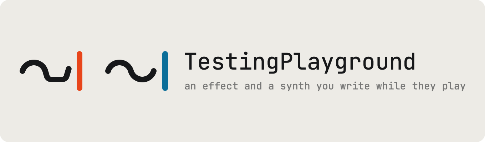

<picture>
  <source media="(prefers-color-scheme: dark)" srcset="Assets/logo/readme-graphite.png">
  
</picture>

# TestingPlayground

Two audio plugins whose sound is a program you write while it plays: **TestingPlayground**, an effect, and
**TestingPlaygroundSynth**, a synth. You type the DSP in [FMinus](https://github.com/Snipet/FMinus), a small C for
audio, and press RUN; or you ask Claude, and it writes the program for you.

- **macOS** on Apple silicon (macOS 14 or later): AU, VST3 and a Standalone app.
- **Windows** x64 (Windows 10 1803 or later, 11) and **Linux** x86-64: VST3 and a Standalone app.

Built on JUCE 8.0.4, with a GPU editor made with [FunkGui](https://github.com/Snipet/FunkGui) and FMinus's JIT compiler
linked in. [CHANGELOG.md](CHANGELOG.md) says what changed, day by day.

## What it does

- **Write DSP while it plays.** RUN (Cmd-Return) compiles the program in the editor and the next block plays it: the
  effect crossfades from the last program, the synth starts the keys you hold again on the new one.
- **A chat that writes it.** Describe an effect or a sound, and Claude writes the FMinus, runs it, fixes what does not
  compile, measures and looks at the result, and leaves the dials at good settings: a sentence does what a preset did.
- **Dials and panels.** The program's parameters become dials and host parameters; a `.gui` file makes a whole
  interface, with knobs, pads, displays and shaders.
- **Projects.** Every save is a version, with presets, A/B between versions and export; factory projects come with
  each plugin (placeholders for now).
- **The synth's voices.** Sixteen at once, MIDI with its wheels and pedal, MIDI learn, mono and legato, and a Logitech
  G29 racing wheel in the Standalone.
- **Analog circuits.** A SPICE netlist (`.cir`) becomes a module the program plays, with a schematic you can edit and
  live probes on its nets.
- **Claude Desktop and Claude Code.** Each plugin comes with an MCP server, packed as a Claude Desktop extension:
  Claude works on the plugin open in your DAW, on your Claude plan, and designs panels with no plugin open.
- **A headless renderer.** Render and measure a program from the command line, with the plugin's own compiler.
- **Safe to try things.** A loop that never ends, or an index outside its array, stops the program and says where, and
  what leaves the plugin is always finite.

## Building from a clone

### On macOS

**You need** a Mac with Apple silicon on macOS 14 or later, Xcode or its command-line tools
(`xcode-select --install`, which brings Git and Python 3 too), CMake 3.30 or later and Ninja (with Homebrew:
`brew install cmake ninja`). The first builds download what they need (LLVM's source, JUCE, bgfx), so they need the
network.

**1. Clone** TestingPlayground and its two sibling libraries. The build looks for FMinus and FunkGui in
`~/audio/libraries/` (or `~/audio/`); TestingPlayground itself can live anywhere.

```sh
git clone https://github.com/Snipet/FMinus.git            ~/audio/libraries/FMinus
git clone https://github.com/Snipet/FunkGui.git           ~/audio/libraries/FunkGui    # optional
git clone https://github.com/Snipet/TestingPlayground.git ~/audio/plugins/TestingPlayground
```

Without a FunkGui clone, the build fetches FunkGui from GitHub. JUCE and bgfx come from the cache `~/audio/.deps` when
it has them, else from GitHub. Each dependency is used at the version `cmake/Deps.cmake` pins, which a clone you
already had must hold (`git pull` in it).

**2. Build FMinus once.** Its build makes the LLVM, Bison and Flex this one links; TestingPlayground reads them from
FMinus's `.deps/` folder and never builds them itself.

```sh
cd ~/audio/libraries/FMinus
cmake --workflow --preset dev      # LLVM: 10 to 30 minutes, the first time only; then FMinus and its tests
```

`cmake/Deps.cmake` pins FMinus's commit (`FP_FMINUS_SHA`) and its LLVM (`FP_FMINUS_LLVM`): if FMinus's `main` has
moved on to another LLVM since, check that commit out before this step.

**3. Build both plugins**, and run every test:

```sh
cd ~/audio/plugins/TestingPlayground
cmake --workflow --preset dev-verify
```

`cmake --preset dev && cmake --build --preset dev` builds without running the tests. The first configure also builds
bgfx's shader compiler (about 2,000 CPU-seconds) unless `~/audio/.deps` has one. Everything lands in `build-dev/`:

| What | Where, in `build-dev/` |
| --- | --- |
| the effect's app, AU and VST3 | `TestingPlayground_artefacts/RelWithDebInfo/`: `Standalone/`, `AU/`, `VST3/` |
| the synth's | `TestingPlaygroundSynth_artefacts/RelWithDebInfo/` |
| the Claude Desktop extensions | `TestingPlayground.mcpb`, `TestingPlaygroundSynth.mcpb` |
| the headless renderers | `TestingPlaygroundRender`, `TestingPlaygroundSynthRender` |
| the installer | `Installer_artefacts/RelWithDebInfo/TestingPlayground Installer.app` |
| pictures of both editors (after the tests) | `probe-out/effect/gui.dump.png`, `probe-out/synth/gui.dump.png` |

**4. Try it:**

```sh
open build-dev/TestingPlayground_artefacts/RelWithDebInfo/Standalone/TestingPlayground.app
open build-dev/TestingPlaygroundSynth_artefacts/RelWithDebInfo/Standalone/TestingPlaygroundSynth.app
```

**5. Install** into your DAW, from a Release build:

```sh
cmake --workflow --preset release-build   # Release with LTO, both products, in build-release/
scripts/install.sh                        # the AU and VST3 into ~/Library/Audio/Plug-Ins, the apps into /Applications
```

For another Mac, `scripts/package.sh --installer` makes the installer's disk image,
`build-release/dist/TestingPlayground-Installer-<version>.dmg` (and `scripts/package.sh` alone a `.pkg`). The details
are in [Install](#install), and the whole build in [Build and run](#build-and-run).

### On Windows

**You need** Windows 10 (1803 or later) or 11 on x64, Visual Studio 2022 with "Desktop development with C++" and its
**C++ Clang tools for Windows**, CMake 3.30 or later, Ninja (Visual Studio's), Git and Python 3. In an **x64 Native
Tools Command Prompt for VS**:

```bat
git clone https://github.com/Snipet/FMinus.git %USERPROFILE%\audio\libraries\FMinus
git clone https://github.com/Snipet/TestingPlayground.git %USERPROFILE%\audio\plugins\TestingPlayground
cd /d %USERPROFILE%\audio\libraries\FMinus
cmake --preset dev
cd /d %USERPROFILE%\audio\plugins\TestingPlayground
cmake --workflow --preset windows-verify
```

FMinus's configure builds its LLVM and WinFlexBison, the long step and all this build needs of it. The apps land in
`build-windows-dev\<Name>_artefacts\RelWithDebInfo\Standalone\`, and `cmake --workflow --preset windows-release-build`
makes the installer (`build-windows-release\Installer_artefacts\Release\`). The details: [Windows](#windows).

### On Linux

**You need** an x86-64 processor with AVX2 and FMA, a Vulkan driver, and these packages (Arch Linux's names; other
distributions have the same under their own):

```sh
sudo pacman -S --needed base-devel clang lld cmake ninja git python alsa-lib freetype2 fontconfig libx11 libxext \
    libxrandr libxinerama libxcursor libxrender libxcomposite glib2 vulkan-icd-loader vulkan-headers libglvnd mesa \
    openssl curl xdg-utils libsecret
```

Then, in your desktop session:

```sh
git clone https://github.com/Snipet/FMinus.git            ~/audio/libraries/FMinus
git clone https://github.com/Snipet/TestingPlayground.git ~/audio/plugins/TestingPlayground
cd ~/audio/libraries/FMinus && CC=clang CXX=clang++ cmake --workflow --preset dev   # about half an hour on 8 cores
cd ~/audio/plugins/TestingPlayground && cmake --workflow --preset linux-verify
```

To install, `cmake --workflow --preset linux-release-build`, then `scripts/package-linux.sh` makes a `.tar.gz` whose
`./install.sh` installs both plugins for you alone (`~/.vst3`, `~/.local`). The details: [Linux](#linux).

## Using it

- **Open** the Standalone app, or load TestingPlayground (an effect) or TestingPlaygroundSynth (an instrument) in your
  DAW.
- **Play a program.** The editor opens on Init, a plain starting point. Change it and press **RUN** (Cmd-Return,
  Ctrl-Return on Windows and Linux): the parameters it declares become the dials. **Examples**, **Library** and
  **Random** give you a start.
- **Ask Claude.** In the chat at the right, **Add your API key** (from console.anthropic.com; or choose another
  provider), then describe a sound: "a tape delay with wow and flutter", "a warm detuned pad".
- **Or use Claude Desktop.** Open the product's `.mcpb` (from the build, or the copy the installer puts in place) and
  Claude Desktop offers to add it; then, with the plugin open, ask Claude Desktop for an effect or a sound.
- In the effect's Standalone, **Settings…** (Cmd-, on macOS) picks the audio input, which starts muted: unmute it with
  headphones on.

## Contents

- [Writing a program](#writing-a-program): [the effect](#the-effect-module-effect), [the synth](#the-synth-module-voice)
  and [what both share](#both): dials, MIDI learn, frozen dials, loops and bounds, the host's tempo and wheels,
  samples, circuits, `.gui` interfaces, the examples.
- [The editor](#the-editor): the explorer, Examples, Library and Random, projects and presets, A/B, export, the code
  editor, the schematic, the IR view, the Standalone and the racing wheel.
- [The chat](#the-chat): Claude in the plugin, checking its work, recording what you play, other model providers,
  Claude Desktop (MCP) and the panel sandbox.
- [The headless renderer](#the-headless-renderer): render and measure from the command line.
- [Build and run](#build-and-run): the whole build, [Windows](#windows), [Linux](#linux) and [Install](#install).
- [Test](#test): the probes. [FMinus](#fminus): how the compiler comes in. [What is where](#what-is-where): the
  source tree.
- [A new plugin, or a new product](#a-new-plugin-or-a-new-product), [Update the DSP core](#update-the-dsp-core),
  [Theme, zoom, diagnostics](#theme-zoom-diagnostics).

The two are one code base compiled twice, once for each product (`products/effect.cmake`, `products/synth.cmake`):
what differs is the program each plays (below), its examples and its identity (name, codes, bundle id, its own
folders). The editor, the chat, the projects, the library and the Claude Desktop extension work the same in both.
Where this guide says "the effect" or "the synth", it means that product; the rest holds for both.

## Writing a program

FMinus is C with DSP's additions (vectors, modules, parameters); its README has the language, and its
`docs/programs.md` and `docs/extending.md` the details. The effect plays a module named `Effect`, one instance; the
synth plays a module named `Voice`, one instance a note, sixteen at once.

### The effect: module Effect

```c
module Effect
{
    param float gain [[fminus::range(-24, 12)]] [[fminus::default(0)]];   // dB: a dial
    float level;                                                          // state: the module's fields

    void init(float rate)                     // optional: before the first block, and when the sample rate changes
    {
        level = 1;
    }

    void process(float* restrict left, float* restrict right, int n)     // the audio thread: in place
    {
        for (int i = 0; i < n; ++i)
        {
            left[i] *= level * expf(0.115129255f * gain[i]);
            right[i] *= level * expf(0.115129255f * gain[i]);
        }
    }

    void end() {}                             // optional: before the program goes (free what init allocated)
};
```

- **process** gets n samples of both channels and changes them in place (a mono bus: `right` is a copy of the left,
  unheard). A module's fields are its state: they start at 0, live as long as the program, and carry from block to
  block. Keep the state per sample, and the output does not depend on the host's block size.

### The synth: module Voice

```c
module Voice
{
    param float release [[fminus::range(5, 5000)]] [[fminus::default(300)]];   // ms: a dial
    float rate, phase, step, env;                                              // state: the module's fields
    bool held;

    void init(float sampleRate)                // optional: before the first note, and when the sample rate changes
    {
        rate = sampleRate;
    }

    void start(float note, float velocity)     // a note-on: 69 is A, 440 Hz; velocity 0 to 1
    {
        step = 440 * expf(0.0577622650f * (note - 69)) / rate;
        env = velocity;
        held = true;
    }

    void stop()                                // optional: the note-off
    {
        held = false;
    }

    bool process(float* restrict left, float* restrict right, int n)   // the voice's next n samples
    {
        const float down = expf(-6907.7553f / (release[0] * rate));
        for (int i = 0; i < n; ++i)
        {
            if (!held)
                env *= down;
            const float out = env * sinf(6.28318531f * phase);
            left[i] += out;
            right[i] += out;
            phase += step;
            if (phase >= 1)
                phase -= 1;
        }
        return held || env > 0.0001f;          // false: silent for good, and the voice is free
    }

    void end() {}                              // optional: before the program goes (free what init allocated)
};
```

- **start** begins a note on a voice, which may have played another before: set what the note needs (a voice's
  fields keep their values between notes, and start as 0 when the program does). **stop** releases it. **process**
  adds the voice's next n samples into both channels (they arrive at 0, so writing works too) and returns false once
  the voice is silent for good, which frees it. Keep the state per sample, and the output does not depend on the
  host's block size: the plugin calls the voices in parts that end on multiples of 16 samples, and frees a finished
  voice only there.
- **Voices.** Sixteen sound at once. A seventeenth note steals the oldest released voice (else the oldest): its stop
  comes at once (unless it had one), then it fades out over 2 ms while the new note starts on another instance, and
  its key's note-off later finds no voice. With all 32 instances still taken (fading voices too), the quietest voice is
  cut at once, its stop first, and the new note starts on its instance. A key pressed again while its note still
  sounds stops that voice first. The voices are summed, and a mono output gets their two channels' average. The
  sustain pedal is the plugin's: a key let go while it is down gets its stop when the pedal comes up.
- **One stop a start.** Each start gets exactly one stop before its instance starts again: at the note-off (or the
  pedal), a retrigger, a steal or a cut as above, and also when a voice's process returns false while its key is held
  (as it is freed), when it goes non-finite and is dropped, and when the host prepares the plugin again. So a program
  may keep what its notes do in its `Shared` (a count of the keys held; for a mono voice, `#pragma mono` below, or
  Shared's `noteOn` and `noteOff`). A program swap is apart: the old program's voices fade out over 20 ms with no
  stop, its `Shared` going with it, and the keys still held start again on the new one.
- **Shared on its own.** The synth's `Shared` (below, "Shared data") may also have, each optional: `void tick(int n)`,
  called every 16 samples (n is 16) whether or not a voice sounds, after the events at that sample and before the
  voices' calls, so state that moves between notes (an engine's temperature, a display, an LFO every voice reads) moves
  the same at any block size and a display of `shared->x` moves with no note held; `void noteOn(float note, float
  velocity)`, at each note-on before its voice's start (a held key starting again on a new program too); and `void
  noteOff(float note)`, as that note ends, before its voice's stop: its note-off, or, the sustain pedal down, the
  pedal's going up; All Notes Off; the host preparing again. Each noteOn gets one noteOff before that key's next (a key
  pressed again while its note is on gets its noteOff first), so a key stack in `Shared` needs no voice. A `param` of
  `Shared` named as a dial reads that dial, as a voice reads one (`drive[0]`): Shared's init runs when the program
  compiles and sees the dial's default; from the first block on, each tick and each note hook sees its value at that
  sample. A method of one of these names declared otherwise is the program's own, never called (a note says so), and a
  `param` of `Shared` that no dial is named as keeps its default (a note too). The effect's `Shared` has its init and
  end only.
- **Mono.** A line `#pragma mono` plays the program one voice at a time, the newest key held sounding; `#pragma mono
  solo` does so while the dial `solo` (a `bool`, or an `int`: on when it is not 0) is on, so the panel switches it
  (it is read at each note: a switch takes effect at the next). A key pressed while that voice is held (by its key, or
  by the sustain pedal) goes to it through `void legato(float note, float velocity)`, an optional method of `Voice`,
  with no start and no stop: the voice keeps sounding and takes the new note, and a glide (portamento) is the
  program's to make there and in process. Letting go of the key it sounds while others are held gives it back the
  newest of them, at the velocity that key was pressed with; letting go of the last stops it (or the pedal holds it
  until it comes up), and a key let go that it does not sound changes nothing. A note after every key is up, or every
  note when `Voice` has no `legato`, starts a voice of its own, the voice before it getting its stop and a 2 ms fade:
  one voice sounds, and nothing steps. Each start still gets one stop, `legato` coming between them. `Shared`'s
  noteOn and noteOff still come for each key. A `legato` declared otherwise, or in a program that is not mono, is the
  program's own (a note says so); the line's dial when it is not there, or is real, is a note too, and the program is
  then mono always. The held keys starting again on a new program give one voice, the newest key's.

### Both

- **Dials.** The main module's first 32 parameters, in the order they are declared, are the dials, and the host's
  parameters P1 to P32 (a host shows "1 gain", and the value in the program's units; the next 32 are the panel's own,
  below); the synth's voices all read the
  same values. A `float` glides when its dial turns: it is read sample by sample, `gain[i]`, as a stream of 20 ms
  ramps, and held still otherwise (`release[0]` reads it once a call). An `int` or a `bool` is read once a call
  (`mode[0]`, or any index). `fminus::range` sets the dial's span (a float without one spans 0 to 1, an int 0 to 10)
  and `fminus::default` where it starts and where a double-click returns it. A run that brings a parameter the slot
  did not have moves that dial to its default; one with the same name keeps its value in its units, never its knob's
  turn: a new range (clamped into it when it no longer holds the value) or a new `taper=log` leaves the sound where it
  was, and an `int` whose values have names (its switch's, buttons' or menu's texts) keeps its value's name when an
  option is inserted or reordered (KEYS CAR PITCH to KEYS CAR TRUCK PITCH keeps PITCH). It plays so from the new
  program's first block, and the host's parameter is then set to it (one gesture a dial that changed, so a host can
  undo it); a host's automation lane, which records the knob's turn, plays other values after a range or a taper
  changes. Projects and presets keep a value's name with its number, so a preset saved on PITCH applies PITCH after
  options are inserted before it.
- **The panel's own dials.** The 33rd to the 64th parameter are dials too, but the panel's alone: a panel's control
  turns one as any other, it glides, freezes and carries its value across a run as the others do, and the session, a
  project's versions and presets and Claude's `set_dial` keep and set it by name, but the host never sees it: no
  parameter P33, no automation (`Source/dsp/Controls.h`, `isPanelDial`). The session keeps their values beside the
  host's, all 32 as it keeps every host parameter (`<PANEL><DIAL slot value/>`); a session from before them loads them
  at their defaults. A 65th parameter has no dial (a note says so) and keeps its default.
- **MIDI learn** (the synth's). Right-click a dial (or ctrl-click it, or use a screen reader's menu action; a `.gui`
  file's knob, slider, switch or buttons too, not its dropdown, whose menu is its list) and choose **Learn MIDI CC**: the dial shows a ring at its top right and the footer says it is learning; move a knob or a fader
  on a MIDI controller, and that control (its number and channel) moves the dial from then on: a dot at the dial's top
  right, and its footer line names it ("MIDI CC 74 ON CHANNEL 1"). A controller that sends a 14-bit pair (CC 0 to 31,
  then its LSB, the number + 32) is learned as one, at 14 bits. A dial learns one control and a control moves one dial:
  learning a control another dial has takes it from that one. The menu also has **Stop learning** while it learns,
  **Forget** the dial's control, **Forget every MIDI CC**, and the host's own menu (its automation, its own MIDI
  learn) for a host parameter. A control moves the dial as your hand does, through its parameter: one gesture a touch
  (it ends 0.3 s after the control stops), so the host records it, undoes it and lets its automation take over again
  as after any touch (the last to move the dial wins), and the dial glides as always; a write of the plugin's own on
  that dial meanwhile (Claude's, a version's dials) joins the touch's gesture. The channel mode messages (120 to 127)
  are never learned, nor, while the Standalone's racing wheel is on, its controls on channel 1 (CC 16 to 24 and 48 to
  51: "A racing wheel"; it sends them all again whenever the devices change): while a dial learns, the footer says so
  and it goes on learning. Anywhere else (a host, another channel, no wheel on) those are learned as any control (a
  controller whose knobs send CC 16 to 23), and, learned or not, they still reach a program's wheel fields. The
  mappings follow each dial by its name (a program without that dial keeps its mapping waiting for one with it), are
  kept with the session (`<MIDI><MAP dial channel cc fine/>`; a session from before them has none) and with each
  project version saved (opening a version that has some makes them the mappings; one with none leaves them as they
  are, and saving it as it was then adds no version for them), and Claude reads them in its dial lines ("moved by MIDI
  CC 74 on channel 1"). The effect gets no MIDI from its host (its plugin type takes none), so
  its dials are learned in the host: right-click opens the host's menu there, as before.
- **Frozen dials.** Once no dial has moved for 3 seconds, the plugin compiles the program again in the background with
  each dial's value as a constant (FMinus's frozen binding), in FMinus's fast math (LLVM's own sinf, cosf, tanf, expf,
  tanhf and logf) and without the bounds checks ("An index outside its array", below), and plays that copy on the same
  instance (the synth's on the same voices), at a block's start, until a dial moves (that block it plays its own code
  again; 3 s later it freezes again); the top bar shows a snowflake beside the CPU load while the copy plays (under the
  pointer, the status bar says what it means). The two sound the same, so the switch cannot be heard: fast math moves a
  result's last bits, never its level or its spectrum (`dsp.freeze` plays the examples and 64 of RANDOM's programs for
  ten seconds each: every octave band within 0.1 dB, the peaks within 0.01 dB). The samples are not the same bits,
  though (an FM voice's pitch, from an expf an ulp apart, drifts its phase so slowly that the worst of them parts from
  the program's samples 97 dB under the signal in ten seconds), and while the copy plays the output may depend on where
  the host's blocks end. On those programs the copy takes about 92% of the program's time in the effect and 90% in the
  synth (the geometric means, on a quiet Mac; single programs 74% to 163% and 76% to 130%). A copy in exact math, the
  program's own, would take 94% and 93% and play the program's very bits: since FMinus c75caab its math is kernels of
  its own, inline, which fold a frozen dial's math exactly, where fast math calls the system's functions. So most of the
  gain is the dials' folding (FMinus also makes copies of a method for a bool's or a small int's values and moves a
  still dial's arithmetic out of its loops), and a program that calls `tanhf` or `sinf` a sample at a time in a loop
  with state runs slower frozen: the effect's Drive (124% to 168%), the synth's FM bell (105% to 127%) and a few of
  RANDOM's (`dsp.freeze` names each more than 5% slower, and measures the copy in exact math beside it).
- **The audio thread.** process (and the synth's start and stop) may not allocate: FMinus refuses a program whose
  methods could reach `calloc`, `malloc` or `free` from them, and names the line. Allocate in init (a delay line:
  `calloc`, zeroed; in the synth each voice's own) and free in end, both off the audio thread; or use a fixed array,
  `float line[48000];`, a field like any other, which the bounds checks see (below; the Echo's and the Pluck's lines).
- **A loop that never ends.** One ordinary bug (a `while (phase >= 1)` wrap whose step went infinite, a loop whose
  condition never changes) would hold the audio thread for ever, and the host's whole session with it. So every
  program is compiled with FMinus's loop budget (its recipe 29): the code counts its loops' iterations against a budget
  the plugin sets before each call, and a call that runs past it returns at once. The budget is a count, not a clock:
  2^32 a second of the call's samples at the rate (about what one core runs in a second when a loop's iteration takes
  a cycle, the fewest it takes), and 16 samples' worth at least; at 48 kHz 89,478 a sample, 22.9 million for a block of
  256. So a call stops only after running about as long as its samples last, or as many times longer as its loop takes
  cycles an iteration, and a stuck call holds the host that long (a loop of 50 cycles an iteration, about a second for
  the effect's block of 1,024 at 48 kHz; the synth's calls are its voices' parts of 16 samples). A loop in a
  `parallel for` counts on each of its threads. init and end (Shared's too) get 2^32 each. A program that runs past it
  stops: the plugin calls it no more (its state may be anything: not even its end, so what its init allocated stays
  allocated), and it fades out over 20 ms from its last samples (the effect to its input, as with no program; the
  synth's voices to silence). The error names the method at its line
  ("program.fm:14:10: error: process() ran past its budget: a loop that never ends?"; FMinus does not say which loop).
  When it stops in its first blocks after a RUN, the program it replaced has not gone yet and plays on: the RUN fails as
  one that does not compile. When it stops later (a note, a dial, the input sets the loop going), the plugin compiles
  the program before it again and plays that, and the status says so. An init that never ends fails the compile. Within
  its budget a call computes exactly what it would without one, and the checks cost little (the thread's CPU time at
  48 kHz, `dsp.budget`): the examples (two seconds each, the synth's with eight voices) +0.3% in the effect and +0.2%
  in the synth, their frozen copies (which keep the checks) +1.4% and +0.5%; a large program of thirteen files,
  +1.7% to +2.3%, and its frozen copy +1.6% to +2.7%. The heaviest call of any of them took 0.3% of its budget.
  measure_output, trace and view_sound say when a render stopped.
- **An index outside its array.** An index past an array's end reads or writes whatever lies beside it, another field or
  the host's memory: a write there corrupts the host or crashes it, perhaps much later. So the program as you write it
  is compiled with FMinus's bounds checks (its recipe 30), RUN's and every tool's render alike (measure_output,
  view_sound, compare, trace, tune_dials): each access whose array the compiler sees (a field's, a local's, a constant
  table's: `line[at]`, `voices[v].taps[k]`, `&table[i]`) is checked against the array's length, and a call whose check
  fails returns before the access. The program then stops as one past its loop budget does (above: it fades out, the
  program before it plays again, or plays on when it stopped in its first blocks after a RUN, which then fails), and the
  error is at the access, naming the file, the array and the index ("program.fm:10:13: error: process() went outside an
  array: index 16 out of bounds for 'line' of type 'float[16]'"; an `#include`d file by its own name), in the problems
  list (the status bar says STOPPED: AN INDEX OUTSIDE ITS ARRAY), run_program, get_status, measure_output, view_sound
  and trace. An init that goes outside fails the compile. The frozen copy that plays once the dials hold still (above)
  has no checks, at full speed: the plugin compiled it anyway, so the two builds take no compile more than one did, and
  a RUN's compile takes about as long with the checks (the examples' in all within the noise of a busy Mac, -7% to +5%
  over two runs; the Echo and the Pluck, whose lines are checked, +8% to +17%). Within its arrays a call computes
  exactly what it would without them, and they cost little (the thread's CPU time at 48 kHz, `dsp.bounds`): the examples
  (two seconds each, the synth's with eight voices) +0.7% to +1.0% in the effect and 0.0% to +0.5% in the synth, the
  most of one +3.8% (the Pluck); a loop that updates a ring buffer's index in a field then stores it every sample
  (FMinus measured a comb a third slower). What a pointer the program keeps reaches is not checked: a heap block from
  `calloc`, a pointer held in a variable, a host's buffer; nor an FFT's buffers against its plan. The library's
  `delay.fm` (any length), `reverb.fm` (its combs sized by the rate: arrays long enough at 192 kHz would take five times
  the memory at 48 kHz, 540 KB a reverb and 17 MB for a synth's voices) and `wavetable.fm` (172 KB a frame, up to 256)
  keep their buffers so. Keep a buffer of your own in a fixed array field where its size allows, as the Echo and the
  Pluck examples do (sized for 192 kHz, the Echo's two lines 3 MB at any rate: the same bits as from `calloc` at any
  rate up to it). The Echo used to read one sample past its line's end where its read position rounded up to the line's
  length (a sample of silence every two seconds at its defaults), which the checks catch at 192 kHz; it wraps there now.
  A 2-D array is checked a dimension at a time, each index against its own extent, so `grid[1][16]` of a
  `float grid[4][16]` stops though `grid[2][0]` lies there ("index 16 out of bounds for 'grid[1]' of type
  'float[16]'").
- **double, 2-D arrays, field attributes** (FMinus 3ed1ba6, its recipes 33 to 35). `double` is C's 8-byte IEEE double,
  for what a float's 24 bits round away: a clock in seconds (a float's is two seconds behind after a minute at 48 kHz),
  a temperature that moves a millionth a block (`t += 1e-6` at 90 never moves a float), a coefficient a hair below 1.
  The audio stays in floats: there are no double vectors, `sinf` and the other math builtins compute a double in float
  (`sqrt`, `fabs`, `floor`, `fmin`, `fmax` and `fma` are a double's, exact), and a C library function declared for doubles
  (`double sin(double x);`) is no audio-thread code. An unsuffixed constant is a float, as it always was, unless its
  arithmetic has a double (`double y = x * 0.1;`, `d *= 0.999;`, `d < 0.1`): a program without doubles means what it
  meant, bit for bit. A 2-D array is C's array of arrays (`float bank[4][256];`, `bank[t][i]`, its row `bank[t]` a
  `float*`), a field, a local or a table; no parameter is one (pass a row, or the module). A field may carry attributes
  after its name, C23's way (`float level [[ui::unit("dB")]] [[fminus::range(-60, 0)]];`): FMinus passes them on, and
  the plugin reads four, `ui::unit`, `ui::label`, `ui::decimals` and `fminus::range` (a display's unit, label, places
  and range when its line gives none, a label past 14 bytes or a unit past 7 cut with a note; trace's lines say them
  whole); another in a namespace of its own is the program's, and one without a namespace that is none of C's is ignored
  with a warning (`-Wunknown-attributes`). trace reads a double as one (its values to 12 digits), a 2-D array of 16
  elements at most whole (`gain[1][2]`), and leaves a larger one out saying its shape; a display shows a double, or one
  element of an array (`bands[2]`, `grid[1][3]`).
- **Modules inside modules.** The main module may hold others (`Svf l;`, `Osc osc[3];`): their methods are its
  helpers, and their parameters start at their defaults (they have no dials).
- **Shared data.** A module named `Shared`, when the program has one, is made once for it, not once a voice: its init
  runs before the main module's (with the rate), its end after theirs, and every field of the main module of type
  `Shared*` points at it. So the synth's voices read one wavetable, lookup table or sample that init built once, where
  a voice's own init would build it for every voice instance; they read it on the audio thread and never free it. The
  effect, one instance, may as well hold what it needs. The synth's may also tick, hear the notes and read the dials
  (above, "Shared on its own").

  ```c
  module Shared
  {
      Wavetable table;                                       // wavetable.fm
      void init(float rate) { table.allocate(1); table.shape(0, 2); }
      void end() { table.release(); }
  };

  module Voice
  {
      Shared* shared;                                        // the plugin sets it before init
      WaveOsc osc;
      void init(float rate) { osc.table = &shared->table; }
      ...
  };
  ```
- **Samples: audio files a program reads.** Drop a WAV, AIFF or FLAC file on the editor (anywhere), or use the **+**
  of the explorer's **ASSETS**, and it becomes one of the program's samples (its name tidied: `Kick 808.wav` is
  `Kick-808.wav`; a file of a name the samples have replaces it). A program reads one as a table: a line `#pragma sample
  kick "kick.wav"` fills the field `Sample kick;` (the library's `sample.fm`; a field of the main module, in every voice,
  or of `Shared`) before init runs, with the file's sound at the rate the plugin plays at: `kick.frames` samples a
  channel, `kick.channels` (1 or 2), `kick.at(c, i)` (0 outside it) and `kick.readAt(c, i, frac)` (between samples i
  and i + 1, for another pitch; `kick.read(c, pos)` takes a float position, which a float holds exactly enough only for
  short sounds: past 2^16 samples, 1.4 s at 48 kHz, `pos += step` rounds the step). A drum hit, an impulse response, a
  single-cycle wave:

  ```c
  #include "sample.fm"
  #pragma sample kick "kick.wav"

  module Voice
  {
      Sample kick;
      int index;                                             // the sample, and the fraction past it, apart
      float frac, step, gain;
      void start(float note, float velocity)
      {
          index = 0;
          frac = 0;
          step = expf(0.0577622650f * (note - 60));
          gain = velocity;
      }
      bool process(float* restrict left, float* restrict right, int n)
      {
          for (int i = 0; i < n; ++i)
          {
              left[i] += gain * kick.readAt(0, index, frac);
              right[i] += gain * kick.readAt(1, index, frac);
              frac += step;
              const int k = (int)frac;
              index += k;
              frac -= k;
          }
          return index < kick.frames;                        // a one-shot: free once it has played
      }
  };
  ```

  A file is decoded once, when it is added (JUCE's readers: a 32-bit float WAV's floats bit for bit, a 16- or 24-bit
  file's integers exactly), never on the audio thread, and resampled to the plugin's rate where its own is another
  (a windowed sinc, about 120 dB clean: once a rate, when the program compiles or the host changes the rate, never as it
  plays); the program holds its copy until it is replaced, so a sample removed or replaced plays on until the next Run.
  A sample the program's samples lack, or a field that is no `Sample` (any module with `const float* data` and `int
  frames` will do, `int channels` and `float rate` too; `const`: every voice reads the one copy), is a note, and the
  field stays empty: frames 0, silence. The pointer is the plugin's, so the bounds checks do not see it: read within
  `frames` (`at`, `readAt` and `read` do). What a program may hold: 8 MB a file (as added), 32 MB in all, sixteen
  samples, two channels, 1 to 768 kHz and 60 s each, 64 MB each decoded; past those a file is refused, saying why, and
  so is a damaged one whose header names more sound than the file holds (checked before anything is read). The session
  keeps the samples as they were added, and so does each project version (below). Claude's renders take a program's
  own samples: the editor's files the samples as they are, the program that plays and compare's previous_run those
  they compiled with, a version its own; A/B's loudness and a recording's replay take the samples as they are now, and
  run_function too (on the program that plays, those it compiled with). The headless renderer has none, so it refuses a
  program that reads one ("The headless renderer").
- **The host: tempo, position, wheels.** `#include "host.fm"` (the plugin provides it: no tab of its own) and declare
  `Host* host;` in the main module (Shared may have one too): the plugin points it at one `Host`, filled before every
  call (process; the synth's start and stop too). It holds the host's tempo (`bpm`), the song's position at the call's
  first sample in quarter notes (`beat`; sample i is at `beat + i * bpm / (60 * rate)`), the bar's start, the time
  signature and whether the transport runs (`playing`), and, in the synth, the player's mod wheel (CC 1, 0 to 1),
  pitch wheel (-1 to 1; the program picks the range), channel pressure and sustain pedal, and a racing wheel's
  `steering`, `throttle`, `brake`, `clutch`, `gear` and `buttons` (MIDI CCs 16 to 24: "A racing wheel", under "The
  editor"); the effect's stay at rest. The other way, in the synth's Standalone, a field of the program's own named
  `shiftLights` (the main module's or Shared's) lights a G29's shift lights ("A racing wheel"); the effect has no
  wheel. A host that says nothing (the Standalone) gets 120 BPM and a position that runs on from the start. Tempo sync
  is the program's: a delay of `beats * 60 / bpm` seconds, an LFO at `bpm / 60 / beats` Hz, or one that follows the
  song with `lfo.follow(position, beats)` (`lfo.fm`); a voice's key tracking comes from start's note. Read it, never
  write it.

  ```c
  #include "host.fm"

  module Effect
  {
      Host* host;
      float line[96000];
      int w;
      void process(float* restrict left, float* restrict right, int n)
      {
          const int d = (int)(0.5f * 48000 * 60 / host->bpm);              // an eighth note
          ...
      }
  };
  ```

  ```c
  #include "host.fm"

  module Voice
  {
      Host* host;
      float step, phase;
      void start(float note, float velocity) { step = 440 * expf(0.0577622650f * (note - 69)) / 48000; }
      bool process(float* restrict left, float* restrict right, int n)
      {
          const float f = step * expf(0.0577622650f * 2 * host->pitchbend);     // a bend of 2 semitones
          ...
      }
  };
  ```
- **The FFT.** FMinus has one, real and complex: a plan from `fft_create(n)` in init (n a multiple of 32 made of 2s,
  3s and 5s: 256, 1024, 2048), `fft_forward(plan, in, bins)` and `fft_inverse(plan, bins, out)` anywhere, the audio
  thread too (n floats to n / 2 + 1 bins and back, unscaled: the round trip is n times the input), `fft_destroy(plan)`
  in end. `wavetable.fm` builds band-limited wavetables with it.
- **Several files.** The editor has a tab for each file, the program's first (`program.fm`). The program includes
  another by its name, `#include "filters.fm"`, as C does: the file is read where the line is (a module there is a
  type after it), and once only, as if every file began with `#pragma once`, so two files may both include a third.
  Its errors name it ("filters.fm:3:12: error: ...").
- **Conditional compilation.** C's `#if`, `#ifdef`, `#ifndef`, `#elif`, `#else` and `#endif` choose the lines that
  compile, on macros (`#define NAME value`, `#undef NAME`): the other groups are never read, so `#if 0` ... `#endif`
  sets anything aside. A macro is read in those conditions only, never substituted in code (its name there is an
  error: a constant is an `enum` or a top-level `const`). The plugin defines `DEBUG` in every build it makes: RUN's,
  the check's, Claude's renders, and the frozen copy's, which plays through the program's instances and so must be the
  same program (its fields, its sound, what its displays read). So `#ifdef DEBUG` keeps instrumentation (a field trace
  or a display reads, a counter) that a copy of the program built elsewhere (`fminus`, a C compiler) leaves out, and
  `#undef DEBUG` at the program's top builds it here without:

  ```c
  module Effect
  {
  #ifdef DEBUG
      float peak;                       // the loudest sample so far: a display's, trace's
  #endif
      void process(float* restrict left, float* restrict right, int n)
      {
          for (int i = 0; i < n; ++i)
          {
  #ifdef DEBUG
              peak = fmaxf(peak, fabsf(left[i]));
  #endif
              ...
  ```
- **Warnings.** FMinus warns where clang does with `-Wswitch` (a `switch` on an enumeration's value with no `default`
  that misses some of its constants) and with `-Wunknown-attributes` (an attribute without a namespace that C does not
  have, which it ignores: `[[range(0, 1)]]` for `[[fminus::range(0, 1)]]`). A warning does not stop the program: it plays, and the editor marks the place in
  amber (the problems list, the status line's count); Claude's run_program says it on one line.
- **The library.** Ready-made building blocks, tested by `fminus.library`: filters (`svf.fm`, `ladder.fm`,
  `onepole.fm`, `biquad.fm`), delays and reverb (`delay.fm`, `reverb.fm`), sources (`osc.fm`, `wavetable.fm`,
  `noise.fm`, `sample.fm`: a sample, above; `waveguide.fm`: a plucked string or a blown tube, a delay line in a loop
  tuned exactly by an allpass, with its decay, its damping of the highs and its dispersion, which stretches the
  overtones as a piano's or a metal bar's; fed all the time, a resonator), modulation (`adsr.fm`, `lfo.fm`, `follower.fm`), shaping and utilities (`shaper.fm`, `util.fm`, and
  `oversample.fm`: 2x and 4x oversampling, IIR or FIR, the halfbands the circuits' modules use, for a shaper that would
  alias), and circuits (`diodetone.cir`, `screamer.cir`, `otalp.cir`: netlists, below). LIBRARY (the editor) or Claude
  adds one as a tab of the program's own; `#include` it and use its modules (each file's header says how). It is then
  the program's file like any other, saved with it, and yours to change. They live in
  `Source/fminus/library/<n>-<category>/`, the same in both products.
- **Circuits: a .cir file.** A file whose name ends in `.cir` is a SPICE-style netlist of an analog circuit (resistors,
  capacitors, inductors, pots, switches, diodes, OTAs, ideal op amps, DC and controlled sources; FMinus's
  `docs/circuits.md` has the language), which the plugin turns into one FMinus module with FMinus's circuit compiler
  (`fminus/Circuit.h`; here `Source/fminus/Circuits.h`): an `#include` of it reads that module, generated the first
  time an `#include` reaches it in a compile. The module is named by the netlist's `.title`:

  ```c
  #include "screamer.cir"

  module Effect
  {
      param float drive [[fminus::range(0, 1)]] [[fminus::default(0.5)]];
      Screamer pedal;                           // the module the netlist generates
      int grid;                                 // samples to the next set()
      void init(float rate) { pedal.init(rate); }
      void process(float* restrict left, float* restrict right, int n)
      {
          for (int i = 0; i < n; ++i)
          {
              if (grid == 0)                    // the pots, 0 to 1, on the 16-sample grid
              {
                  pedal.set(drive[i], 0.5f, 0.7f);
                  grid = 16;
              }
              grid -= 1;
              left[i] = pedal.tick(left[i]);    // volts in, volts out: 1.0 is 1 V
              right[i] = left[i];
          }
      }
  };
  ```

  `set` takes the pots (0 to 1, in `.pot` order), then the switches' positions; call it on the absolute 16-sample grid
  (a counter from init, a voice's from start), every grid tick while a dial glides or a switch ramps, and the output
  never depends on the host's blocks. `tick` takes the signal, then the law inputs (`.input iabc - kind=current
  range=10u:2m`: an OTA's bias current, which a voice computes every sample through its own expo converter, an `expf`).
  `clear` returns the circuit to rest (a voice's start). A netlist's mistakes are its lines' ("screamer.cir:37:1: error:
  ...") and stop the compile; FMinus's messages on the generated module are cited at the netlist's line they come from
  ("(in the module generated from screamer.cir, line 11)"); a netlist no `#include` reaches is not compiled (its tab
  still gets the check's squiggles, after RUN too), and the program itself, the first tab, is FMinus. A netlist names its configuration
  (`.oversample 4 iir`, `.adaa on`, `.solver omega(1)`), or leaves it to FMinus's self-test, which chooses it on the
  circuit's stress tests (the solver's accuracy, the aliasing, the harmonics, within targets). The library's netlists
  are pinned, the line in each header. One nonlinear part a stage (a diode pair, an OTA) and ideal op amps: resonant
  filters, transistors, tubes and biased junctions are FMinus's Phase 2.
- **A circuit's pots as dials.** A field of the main module whose type is a netlist's module (`Screamer pedal;`, or an
  array, `Screamer amp[2];`) gets its pots as dials of their own and its switches as int dials, with no code: after
  the program's own params, in field order (each field's pots in `.pot` order, then its switches), within the 32
  dials (past them, a note: the pot stays at its default); a pot 0 to 1 shown 0-100 % at its `.pot` default, linear
  (its taper is the netlist's, inside `set`), a switch over its positions at its default; named as the pot is, or
  `<field>_<pot>` when another dial has that name (`amp_drive` beside a param `drive`; two scalar fields, two sets),
  an array's elements sharing one set. The plugin then calls the module's `set` itself (`Source/fminus/Patch.h`,
  "Circuits": a shim appended to the program, nonblocking, for each such field) on the absolute 16-sample grid, with
  the dials' glided values there: at every grid tick while one glides, and for 20 ms of ticks after a switch moves
  (its ramp), and before an instance's first call (a new program's, a voice whose instance missed the dials
  meanwhile; a switch not yet where its dial is then set at once, as the instance has played nothing yet); never while
  they stand still. While such a dial moves, the effect's `process` is called in parts that
  end on that grid (only then: a program that keeps state per call may differ there, as it may where any dial moves);
  the synth's voices run in such parts anyway. Projects, presets, the host's automation and Claude's tools treat
  them as any dial; the frozen copy plays the instances' pots where the dials left them, and a dial that moves drops
  it. A program that calls the module's `set` itself (as the examples do, to compute the pots from params of their
  own) keeps driving it: that module's fields get no dials, and the Schematic view's info strip says why ("program.fm:38:
  Screamer's pots have no dials: the program calls its set()"; a `set` on something the editor cannot tell the type
  of counts too, so a pot is never driven twice). The GUI sandbox reads the same dials.
- **The self-test.** A netlist that leaves its configuration out plays a provisional one at once (8x oversampling for
  diodes, 2x for an OTA: safe, and costly), with a note saying so ("x.cir: note: the self-test chooses this circuit's
  configuration; provisional: 8x IIR, omega(2)"). Meanwhile the plugin runs the self-test in the background, on threads
  of its own at a low priority (`Source/dsp/SelfTester.h`: a second for a clipper, longer for a larger circuit; RUN
  never waits for it, and the check while typing never starts one), and when its answer lands it compiles the program
  that plays (never the editor's draft) again with it, and swaps it in as RUN does: the effect crossfades; the synth
  waits until no note sounds, fades or is held, so a held note never starts again, and a synth program whose `Shared`
  ticks (above, "Shared on its own") plays the answer from the next RUN (one that changes only the panel's files too),
  as a swap would start its `Shared` again; neither while a recording is armed (looked at again once it is compiled,
  just before the swap: a key pressed meanwhile holds it until the next silence).
  The status then ends with a note of the choice ("x.cir: note: the self-test chose this circuit's configuration: 4x,
  ADAA, omega(1)", then any warning of the test's own, such as a block that rings at Nyquist); after a RUN that failed
  it still shows that RUN's errors, as the draft still does not compile. A test that finds no configuration (nothing
  under its cost cap finite on every signal, or its budget spent) is not tried again while the process lives: the status
  says so where the provisional note was ("x.cir: note: the self-test found no configuration for this circuit (...), so
  the provisional one plays on: 8x IIR, omega(2)"), and so does every compile of that netlist after. A RUN of files that
  no longer include the netlist cancels its test. An answer a damaged session or project brings back that its netlist
  cannot take (ADAA with BDF2, a diode's solver for an OTA) never stops a compile: FMinus ignores it, the provisional
  configuration plays, and the answer is dropped so the self-test answers again. The answers are the process's (the
  newest 64; every instance reads them, so two instances never test one netlist), kept with the session and with each
  project version saved (a version saved before its answer gets it when the same program is saved again), and stored
  again when they load, before the program compiles: a session or a version loaded plays the refined configuration from
  its first block. Measure, compare, trace and tune read the same answers. `fminus x.cir --self-test` (FMinus's command
  line) runs the self-test and prints the line that pins its answer in the netlist.
- **The interface: a .gui file.** A file named `panel.gui` (any name ending in `.gui`) beside the program gives it
  an interface richer than the `#pragma panel` lines below, which it replaces: containers laid out as CSS's flexbox
  lays them out, pages behind tabs, every kind of control with its own label, unit and taper, displays and text
  (FMinus never reads it; `Source/fminus/GuiSpec.h` has the language, `Source/editor/GuiLayout.h` the layout):

  ```
  class "main" size=72 arc=orange               // properties an element takes with class="main"
  defaults knob look=soft                       // properties every knob takes (its own win)
  panel accent=orange background=#1d1b19 gradient=#121110 {   // around everything
      row gap=10 {                              // left to right; column: top to bottom; grid cols=4
          section "FILTER" color=orange look=card radius=10 {   // frame (the default), card, inset or plate
              knob cutoff class="main" taper=log unit="Hz" live=cutoffnow   // live=: where a field has it now
              knob resonance label="RESO" look=vintage
          }
          section "ENVELOPE" {
              slider attack; slider decay; slider sustain scale=100 unit="%" decimals=0; slider release
              envelope attack decay sustain release          // their shape, drawn
          }
          box {                                 // a filled frame without a title
              buttons wave "SAW" "SQR" "TRI" horizontal
              switch sync "OFF" "ON"
              menu mode "POLY" "MONO"
          }
      }
      tabs look=bar {                           // pages, one shown at a time: tabs, bar, pills or side
          page "MOD" { xy level pan }           // a pad that moves two parameters
          page "METERS" { meter out; vu out; led gate; number count; scope out; spectrum out grow=1 }
      }
      keyboard from=48 keys=25 wheels           // the synth's keys and its pitch and mod wheels, played with the mouse
  }
  ```

  An element is a line (or several, between `;`): its name, its arguments, `key=value` properties, its children
  between `{` and `}`; `//` and `/* */` are comments. Every container takes `gap=`, `pad=`, `align=` (stretch, start,
  center, end), `justify=` (start, center, end, between, around), `grow=`, `width=`, `height=` and `wrap` (a row's
  children onto more lines when it is narrow); any element `margin=`, `self=` and `minwidth=` to `maxheight=`;
  `spacer`, `divider thickness=3` and `label "TEXT" size=title` (or a size in px, `align=right`) fill and dress it.
  Sections and boxes take a look (frame, card, inset, plate), `radius=`, `fill=`, `border=`, `borderwidth=`,
  `shadow=` and a title's colour, alignment and size; tabs a look (tabs, bar: a header bar of pages as Serum has,
  pills, side: a list at the left), and the page you pick stays picked when the program runs again and in the
  session. A knob has nine looks (modern, vintage, flat, minimal, ring, led, chicken, soft, dot), a size (small,
  medium, large or a face in px), colours for its arc, track, cap, pointer, ticks, label and value, a pointer
  (line, dot, triangle, none), `sweep=`, `ticks=`, `thickness=`, `bipolar`, `labelpos=`, `value=` and `shadow=`;
  `live=field` marks on its ring where the program has the parameter now (its modulation, from a field).
  `class "NAME" ...` and `defaults KIND ...` lines give properties to many elements at once.
  `shader "glow.sc" inputs="cutoff out"` draws a GPU shader of the program's own: `glow.sc`, a tab like any file, holds
  the body of a fragment shader in bgfx's GLSL (a `main()` that sets `gl_FragColor`, reading `v_uv`, `v_px`, `u_size`,
  `u_time`, `u_px` (one screen pixel in px, to smooth an edge over) and its inputs, 16 at most (FunkGui's `u_params`),
  as `in0`..`in15` or `in_cutoff`, `in_out`: a parameter's 0..1, a field's value, the audio's level). It may
  `#include "funk/text.sh"` and `"funk/shapes.sh"`, the plugin's own library, and `.sh` files of the program's (functions
  several shaders share, tabs like any file; a `.sc` or a `.sh` includes one, each read once). `text.sh` draws text and
  numbers in the panel's font (a signed distance field of the bundled JetBrains Mono, a texture the plugin binds to every
  shader): `text(v_px, at, size, align, "RPM")`, `number(v_px, at, size, align, value, decimals)` and
  `textWidth(size, "RPM")`, a string in quotes becoming its glyph codes before the shader compiles (up to 48
  characters: ASCII, and `\u00B0` for °, `\u2212` for −, and the font's other signs by their codes). `shapes.sh` has
  rounded boxes, circles, rings, segments, arcs, tick marks, needles, seven-segment digits and numbers, gradients, and
  `cover(d)`, the antialiasing they share. Each gives a coverage 0..1 to mix a colour in by; positions are px, angles
  degrees clockwise from straight up. One whose code (or a `.sh` file it includes) reads `u_time`, outside its
  comments, is drawn every frame while it shows; any other only when an input moves. The plugin builds it with the
  shaderc it carries (`Contents/Resources/shaderc`, bgfx's) when the program runs, a panel's shaders at once and while the program
  compiles, and has the GPU check each then too, on threads of their own that the compile waits for: a RUN's never on
  the window's thread, so a new shader does not stall it, and a host's session or preset load's while the thread that
  loads it waits. The builds are kept, for every instance and on disk between sessions
  (`~/Library/Caches/<Company>/<Name>/Shaders`, on Windows `%LOCALAPPDATA%\<Company>\<Name>\Shaders`, on Linux
  `~/.cache/<Company>/<Name>/Shaders`; 16 MB at most, the least used going first), so a shader built before is not
  built again until it, a file it includes, its inputs or the plugin's shaderc change. One that does not compile, or
  that the GPU refuses, is a note on its own line (in a `.sh` file it includes, that file's), and draws nothing until it
  does; so is a string that cannot be one and an `#include` of no file (`Source/fminus/Shaders.h`,
  `Source/fminus/ShaderLib.h`). Four a panel at most.
  `taper=log` gives a frequency's or a time's knob the same turn for each octave, and the host's automation follows
  it; `unit=`, `decimals=` and `scale=` say how a value reads, to the host too (`Source/dsp/Controls.h`). Displays are
  those of the lines below and `spectrum` (an analyser of `in` or `out`), 32 at most (a `live=` field and a field a
  shader reads count as one each); a field of the module
  `Shared` is named through the main module's pointer to it, `meter shared->level` (its one Shared, read whether a
  voice sounds or not: the main module's fields of an instrument are its newest sounding voice's, 0 while none
  sounds), and `live=` and a shader's inputs take one too. A `number` shows an int or a bool field as a whole number
  and takes a knob's `unit=`, `decimals=` and `scale=` for a field (`number speed unit="rpm" decimals=0` reads "1250
  rpm"; its cell wide enough for a sign, four digits, its decimals and unit, and a longer readout drawn smaller, never
  past its box). What the plugin cannot use is a note on its line and column ("panel.gui:12:5: note: ..."), and the
  rest stands; a parameter no control names comes last, in a section without a title. Running an edit of the `.gui`
  file (or a shader's file) alone shows it at once without restarting the program (**Run**, below); when the
  interface is larger than the Panel view at the editor's size, Claude's run_program says so in a line (by how much,
  and what is out of view until it scrolls).
- **The panel.** `#pragma panel` lines lay the dials out as an analog synth's panel is printed, in titled sections,
  framed, in rows; they choose how each dial looks and add displays that show what the program does as it plays
  (FMinus ignores every `#pragma`; the plugin reads these from the program and what it includes):

  ```c
  #pragma panel section "OSCILLATORS" shape detune      // a section: its title, then its dials and displays in order
  #pragma panel section "FILTER" cutoff resonance amount
  #pragma panel row                                     // the sections after it start a new row
  #pragma panel section "ENVELOPE" attack decay sustain release
  #pragma panel section "OUTPUT" level out              // out: the VU below
  #pragma panel label amount "ENV AMOUNT"               // a dial's label (else its name)
  #pragma panel small detune                            // a small knob: its label under it, no value
  #pragma panel style cutoff vintage                    // knob (the default), vintage, fader, switch or buttons
  #pragma panel style attack decay sustain release fader
  #pragma panel style shape buttons
  #pragma panel options shape "SAW" "SQUARE" "TRI"      // an int's values' names, from its range's low end
  #pragma panel color "FILTER" orange                   // a section's colour, or a dial's or a display's
  #pragma panel vu out "OUTPUT"                         // a display: meter, vu, led, number or scope
  ```

  - **Dial styles**: `knob`; `vintage`, a black knob over a printed scale; `fader`, a slider; `switch`, a toggle (a
    bool, or an int of two values); `buttons`, a lit button a value (an int or a bool, up to eight). A `style` line
    names one dial or several, the style last. `options` names an int's values (a bool's: off, on): its buttons show
    them, and its knob and the host say them.
  - **Displays** show the plugin's audio, `in` (the effect's input; the synth has none) or `out` (the output; left and
    right, in dBFS), or a float, double, int or bool field of the main module that process writes (`gr = reduction;`;
    the synth's from the newest voice that sounds) or of its `Shared` through its pointer (`shared->level`), or one
    element of an array of them, an index a dimension (`bands[2]`, `grid[1][3]`), across a range given after it (0 to 1
    unless it says, or the field's own `[[fminus::range(lo, hi)]]`: `#pragma panel meter gr 0 24 "GR"`). A field's
    attributes give its displays what their line leaves out: `float gr [[ui::label("GR")]] [[fminus::range(0, 24)]]
    [[ui::unit("dB")]] [[ui::decimals(1)]];` labels and scales its meter and has a `number` read `6.0 dB`. `meter`: LED bars, the highest held a second (the audio's peaks); `vu`: an
    analog VU meter's needle (0 VU at -18 dBFS RMS); `led`: a light, a field's value its brightness (of the audio: a
    clip light); `number`: a readout of the field (of the audio: its peak in dBFS), which takes `unit=`, `decimals=`
    (0 to 4) and `scale=` as a knob's value reads (`#pragma panel number speed "SPEED" unit=rpm decimals=0 scale=60`
    reads 1250 rpm; no space around the `=`; `unit=""` none, over the field's own; its cell widens for them); `scope`: an oscilloscope (of a
    field: its trace over the last 2.5 seconds). A section names a display by its source, or by the name `as` gives
    it, which a second display of one source needs: `#pragma panel scope out as wave "WAVE"`. 32 displays at most.
    The colours: red, orange, yellow, green, teal, blue, violet, pink, cream, grey.

  A row too wide for the window wraps, its sections shared out evenly; shorter rows widen toward the widest; when
  the sections need more height than the window gives, every knob is drawn small. Under the code, dials that would
  still leave the editor less than 80 px (64 in the least window) fold into a bar (**64 DIALS   SHOW**): SHOW shows
  the rows that fit under the editor, the bar saying how many, and the PANEL view shows them all, its small rows
  closer together when it must. Dials and displays no section
  names come last, untitled. A line the plugin cannot use (a name that is no dial, a dial in two sections, a field
  that is not there, a style the dial does not suit) is a note on its line, and the rest stands
  (`Source/fminus/PanelSpec.h`). The examples and RANDOM's programs use these lines; Claude writes a `panel.gui`.
- **Its types are checked.** The plugin calls each method through a line of its own with the type it calls it by, so
  a `process` with other parameters (or, the synth's, one that returns nothing) is an error ("Effect::process: the
  plugin calls it as ..."), never a crash.
- **What the plugin guards, and what it cannot.** Every sample that leaves the plugin is finite and within +-4
  (+12 dBFS): the effect turns a NaN or an infinity into 0, the synth drops a voice whose output is not finite, a
  louder sample is clipped, and the toolbar says so. A NaN in the effect's state stays there: RUN again starts it from
  scratch. But the program is native code: a write through a pointer past its memory, or a loop that never ends,
  takes the host with it. Try a new program in the Standalone.
- **Subnormals** are flushed to zero (the plugin compiles with FMinus's `Denormals::Flush`, the mode the audio thread
  runs in), and the math builtins (`sinf`, `cosf`, `tanf`, `expf`, `tanhf`, `logf`; also `fabsf`, `sqrtf`, `floorf`,
  `fminf`, `fmaxf`) are FMinus's default math mode's, kernels of its own: one result for a float wherever it is
  computed, on any machine. `tanf` is a builtin, so a program's own function of that name is an error.
- **Cost.** A math call in a loop that carries state from sample to sample (a filter, an envelope, a phase) computes
  one sample for the price of four; in a loop with no state FMinus makes one call for four samples. So put the math
  in a loop of its own, in parts of 16 samples: first the sources and the dials into arrays, then the math, then the
  oscillators and filters. The filters take their cutoff as a coefficient for that (`g[i] = svfG(fc[i], rate)` in the
  math loop, `filter.setG(g[i], res)` beside `tick`; `ladderG` and `onePoleG` likewise), and the Modular voice in
  Claude's instructions (`Source/plugin/ChatPrompt.cpp`) is built so: 35% fewer instructions than with its math in the
  one loop, the same samples. `lfo.fm`'s sine is a polynomial, within 0.0011 of `sinf`; a filter's `set` takes its
  sine and cosine in one call (`sinf` of a `float2`).

The EXAMPLES menu holds each product's own to start from, `Source/fminus/examples/<key>/`. The first, **Init**, is the
program a new instance plays (and what the Standalone's File, Reset to Default State, and a session saved without a
program play): the classic init patch, a neutral start that sounds right as it is, laid out to be edited.

- **The effect's seven** (`effect/`): Init (an INPUT and an OUTPUT level in dB and a dry/wet MIX in %, gliding as every
  float dial does, around an empty place for your processing, marked; with every dial at its default the output is the
  input, bit for bit; input and output meters), Gain and pan (a level and a stereo position, the smallest effect),
  Tremolo (init and the sample rate; SYNC follows the song in notes, host.fm), Filter (a state-variable filter as a
  module of its own), Echo (its delay lines arrays in the module, long enough at up to 192 kHz, so the bounds checks see
  them; a VU and a switch; SYNC sets its time in notes at the host's tempo), Drive (tanh saturation; input and output
  meters, a vintage knob) and Tube screamer (the library's `screamer.cir`, an overdrive pedal's circuit, one for each
  channel: DRIVE, TONE and LEVEL its pots, set on the 16-sample grid, INPUT and OUTPUT trims in dB).
- **The synth's six** (`synth/`): Init (one band-limited oscillator, a sawtooth or a square, a triangle or a sine,
  through a resonant low-pass wide open, CUTOFF in octaves above 20 Hz from 0 to 11 (at 11 as open as the filter goes,
  at any sample rate), its RESONANCE and ENV AMOUNT at 0; an ADSR on the level, a 2 ms attack, full sustain and a 100 ms
  release, so a note starts and ends without a click, a stolen voice's instance too; the velocity on the level, the
  pitch wheel bending 2 semitones, a VOLUME in dB; its oscillator, filter and envelope the library's `osc.fm`, `svf.fm`
  and `adsr.fm`, copied in), Sine (an attack and a release; the pitch wheel bends it, host.fm), Saw and filter (a
  polyBLEP sawtooth through a resonant low-pass, an ADSR on both: eight dials, the envelope's on faders, a light that
  follows it and a VU; the pitch wheel bends it and the mod wheel opens the filter), FM bell (two operators; a meter of
  its brightness and a scope; the mod wheel adds index), Pluck (Karplus-Strong, each voice's delay line an array in the
  module, long enough for 20 Hz at up to 192 kHz) and OTA filter (an oscillator through the library's `otalp.cir`, an
  analog two-pole OTA low-pass whose cutoff is its bias current: each voice computes Iabc every sample from its note,
  CUTOFF and the envelope through one `expf`, and clears the circuit in start; the library's `osc.fm` and `adsr.fm`
  beside it).

An example may `#include` library files (the circuit examples do): they come with it as tabs.

To add one, add a file there whose first line is `// <Title>: what it is`.

## The editor

- **The layout**: a top bar (the product; the project's pill, which opens PROJECTS; the **Code / Panel**
  switch; the CPU load; the theme's button), then three cards: the explorer's at the left (below), the program's (its
  status and its actions, **Examples**, **Library**, **Random** and **Run**, over the files' tabs, the editor or the
  panel, the problems and the dials) and the chat's, at the right. The chat's **>** folds it into a rail at the right
  edge, and the editor takes the room; the rail's button opens it again, and a dot on the rail says Claude answered
  meanwhile (the session keeps the fold). The status bar at the bottom says what the control under the pointer does;
  the zoom is its pill at the right.
- **Menus**: every control that opens a menu (**Examples**, **Library**, the project's pill, the zoom, the chat's
  model and **Thinking**, Settings' selects, a `.gui` interface's `menu`, the schematic's **More** and its probe chip)
  is the same pill with a chevron at its right: it lights under the pointer, stays pressed while its menu is open (an
  edge in the accent, the chevron turned up), shows the focus ring when Tab reaches it, and opens on a click, Return
  or Space (a screen reader's press too); a screen reader hears a combo box. In the Schematic view they open on a
  click, and **A** opens More. A `.gui` `menu` is wide enough for its longest choice. The menus are drawn in the
  editor's colours, corners and face (FunkGui's MenuLook): a menu of choices is at least as wide as its pill, the
  current choice has a dot and is highlighted when it opens (Up, Down, Home, End and the page keys move from there;
  Return chooses), the Library lists its files under their categories' headers and the model menu its two parts under
  theirs, and the schematic's commands show their keys at the right. Typing the start of a name jumps to it
  (**type-ahead**: `sv` finds `svf.fm`; a pause of a second starts again): a menu has no search field of its own,
  since a menu window takes no typing. PROJECTS is a card of its own, not a menu, with a search field of its own.
- **Wider or narrower**: drag the explorer's right edge or the chat's left edge (a line lights along the edge under
  the pointer, which becomes a left-right arrow). Until you do, the explorer takes about a sixth of the window and the
  chat about a third; dragged, the explorer goes from 180 to 440 px and the chat from 330 to 760, as far as the
  program's card keeps 600 px: the chat keeps its width before the explorer does, so dragging the chat wider takes the
  explorer down to its least, and the explorer's edge stops where the chat begins. A double-click on an edge gives it
  back its share of the window. From the keyboard, Tab (or Shift-Tab) to an edge: the left and right arrows move it
  8 px (32 with Shift), Home and End take it to its narrowest and widest, Delete resets it; a screen reader finds each
  edge as a slider in px. The session keeps the widths, and the last ones you set become this Mac's default for an
  editor that has set none (a new instance). When the window narrows, the explorer gives way first, then the chat,
  each down to its least; past that the explorer folds away, as before; widened again, both come back to the widths
  you set. The **Code** and **Panel** views (the Panel view has no explorer), a netlist's Schematic view and Claude's
  picture of the whole editor all take the same widths, and the chat is as wide in the Panel view as in the Code view
  (narrower than you set it there when the explorer took some of its room), so switching views never lays a long
  conversation out again.
- **The explorer**, at the left, lists in sections that fold (a click on a section's title): **Files**, the program's
  files (the one shown marked, one the last run's errors name with a red dot; a click shows a file, a double click
  renames it, the cross on a row closes it, asking first when it has text; **+** makes a new file); **Assets**, the
  program's samples (above: each with its length, the details under the pointer, a tick on those the program that
  plays reads; **+** adds WAV, AIFF or FLAC files, the cross on a row removes one); **LLVM IR**, what
  FMinus compiled the program into (below: a click opens a view of it, read only); **Presets**, the
  presets of the project open (a click applies one, its dials at once; **+** saves the dials as a new one);
  **Projects**, the ones on this Mac, the newest first, each with its newest version (a click opens it, asking first
  when the editor has changes no version holds; **+** opens PROJECTS to save), in PROJECTS' groups (a caption a
  group: Favourites first, the factory ones starred among them, a category a group, Uncategorised last; a click on a
  caption folds that group, there and in PROJECTS; a flat list while none is starred and none has a category); **Factory**, the factory projects,
  folded at first (a click opens one, as a project of yours opens; below, "Factory projects"); **Library**, the library's building
  blocks by category (a tick on those the program has; a click adds one as a tab, `#include`d, or shows it); and
  **Examples** (a click starts afresh from one, as **Examples** below does). Its **<** folds it away, the
  program's card taking the room, and the button at the left of the program's card's header opens it again; the
  session keeps the fold. A window too narrow for it beside the chat leaves it folded, and its button then folds the
  chat to make room. The **Panel** view has no explorer: the plugin's interface keeps the whole left column. The
  explorer, the Projects card's lists, the presets' list, the A/B card, the Settings card, the chat and a scrolling
  interface scroll as the code does: the same direction and the same distance for the same turn of the wheel or
  stroke of the trackpad, a row at an edge cut in part, and a thumb you can drag (a click on its track jumps there).
- **Run** compiles the text and plays it once it compiles; **Cmd-Return** does the same from the keyboard. The effect
  crossfades from the last program over 20 ms; in the synth the sounding voices fade out over 20 ms, and the keys
  still held start again on the new program. Compiling takes some tens of milliseconds, off the audio thread and off
  the editor's. A Run that changes only the interface's files (`panel.gui`, a shader's `.sc` or `.sh`) compiles
  nothing: the new panel shows over the program as it plays, with no crossfade or fade, the notes held sounding on and
  every dial where it was, and the status line says **PANEL UPDATED IN** some milliseconds. It compiles as any Run
  when the `.gui` file changes what a dial's value means (a `taper=`, the names of an int's values), when it is added,
  removed or renamed, when another file changed too, or when nothing changed (Run then starts the program afresh),
  during an A/B, and in a synth program whose `Shared` ticks while a circuit's self-test answer waits for a Run.
- **Examples** starts afresh from an example, as a new instance starts from Init: its file, and the library files
  it `#include`s, become the only tabs (every other file goes, a `panel.gui` or a netlist too), it runs, and every
  dial goes to its default. No project is open after it and no preset applied, Claude's checks are cleared, the IR
  tab and the find bar close, and the interface starts at its top and its first pages. The chat's conversation and
  the editor's look (its size, theme, zoom, view, folds and widths) stay. When the editor's files have changes nothing
  opened, saved or loaded holds, it asks first; there is no Cmd-Z back.
- **Library** lists the library's files by category, a tick on those the program has. One it lacks becomes a tab,
  shown, and the program `#include`s it (a line after its description; Cmd-Z in the program takes it back); one it
  has is shown. With sixteen tabs, the rest are greyed.
- **Random** writes a new program for inspiration, from the library's building blocks, with random settings, a panel
  and a name: in the effect, two to four of a drive (tanh, a wavefolder, a crusher or a tube's curve), a filter
  (still, swept by an LFO, or opened by the input's level), a chorus, a flanger, a tremolo or an auto-pan, and an echo
  or a reverb, then a dry/wet mix; in the synth, a voice of one or two oscillators (a band-limited morph, a wavetable
  built once in `Shared`, or two operators of FM), noise, a filter its envelope opens, an envelope of a character (a
  pluck, keys, a pad, a bass, brass, a bell), an LFO and a drive. It starts afresh as **Examples** does: its file and
  the library files it needs become the only tabs, it runs, and every dial goes to its default (asking first when the
  editor's files have changes nothing opened, saved or loaded holds); each click makes another. Its first line names
  it and its seed (`random 4821`).
- **Projects** (the top bar's pill, named after the project open and its version; its preset beside it, below) keep programs on
  this Mac: the editor's files (every tab, and the one shown) and the dials' values, under a name, in each product's
  own folder, `~/Library/Audio/Presets/Funk/TestingPlayground/` (the effect's) and
  `~/Library/Audio/Presets/Funk/TestingPlaygroundSynth/` (the synth's; a JSON file a project, `<name>.fmproject`:
  copy, rename or share them in the Finder). Every save is a **version** of
  the project (v1, v2, ...), with when it was saved and what changed since the one before ("program.fm +12 -3, 2
  dials"; one Claude saved begins with its own note, "Claude: a brighter filter", below in **The chat**); an older
  version opens again, and saving it makes it the newest. A project keeps its last 100 versions. A
  version keeps its samples too (above; "kick.wav new", "snare.wav changed", "hat.wav gone" in the note), the project
  each file once whichever versions name it (64 MB of them at most: a save past it is refused, saying why), and
  opening a version makes its samples the plugin's. A
  project's **presets** are dial settings for its program, no code: applying one turns the dials at once, with nothing
  to compile. The sounds a program makes by its dials alone are presets of one project; a sound that needs other code
  is a project of its own. The card lists the projects at the left (a click chooses one, a double-click opens its
  newest version) and the chosen project's versions and presets at the right (a double-click opens a version, or
  applies a preset; a click under the presets starts a new one). The projects come in **groups** that fold (a click
  on a group's header; a right-click there folds or opens every group): **Favourites** on top (the projects you star, with the star at a row's right: each stays in
  its own group too), **Factory** (below), a group a **category** (the project's info's, as Export keeps it; "Pad"
  and "pad" are one: a category typed in another case takes the group's spelling), by name, and **Uncategorised** last. A project's category is set from the **context menu** (a
  right-click: **Category**, the kind's categories and your own, **None**, **New category...**), by **dragging** it
  onto a group (onto Uncategorised: none; onto Favourites: starred; onto Factory: refused), or **typed** (New
  category..., or a category group's **Rename...**, which renames all of the group's, whatever the search shows: the
  field names the category, Return sets it, Escape goes back; **None** clears one);
  Cmd-click chooses more than one (Shift-click a run of them), and the menu or a drag then sets all of theirs. A
  factory project's category stays its own. Above the lists, the **search** (Cmd-F: each word you type in a project's
  name, description or tags; while it filters, every group with a match shows it; Escape clears it), the **tag**
  filter (a project with that tag, the menu saying how many have each) and the **order** (by name, or the newest save
  first). The stars, the groups folded, the search, the tag and the order are this Mac's: every instance and the
  explorer show the same, kept in a hidden file in the projects' folder (`.projects-view.json`) as they change (the search as the card
  closes; what another instance changed meanwhile stays).
  Categories stay in each project's file (no folders on disk: a project's name is its file's, unique in the one
  folder, so moving files between folders would let two projects share a name and make a category change a move).
  The field names what **Save** saves: a project (a
  new version of the project named, or a new project) or, while the presets are chosen from, a preset of the project
  open. **Open** opens the chosen project or version, **Apply** the chosen preset, **Delete** deletes the chosen
  project, version or preset. Saving into another project, opening over changes no version holds, replacing a preset
  and deleting each ask first (a second click). **Cmd-S** saves a new version of the project open (where the host
  passes the key on), or opens PROJECTS while none is. A save takes what the editor has at once and reads and writes
  the project's file in the background, so the editor never stops for it however large the project is: the status
  says SAVING meanwhile, then what it saved; a second Cmd-S while one is under way saves once it ends. PROJECTS and
  EXPORT open at once too: they read what the plugin already knows of each project, and a project another instance (or
  another app) changed shows as soon as the plugin has read it again in the background ("Reading the project..."
  meanwhile). The pill says (edited) once the files change, or the dials move
  while no preset is applied (the preset's own dot, below, says when they move from it). The presets saved before
  projects (`<name>.fmpreset`) become projects of one version the first time the folder is read, and the old files move
  into its `Presets before projects` folder.
- **Presets in turn**: while a project is open, the top bar has its presets right of its pill, the arrows either side
  of the preset's name and place ("Bright  2/7"). The arrows step through the project's presets (by name, wrapping at
  both ends; from none, the first or the last), and so do **[** and **]** while no text field has the caret (in the
  code editor they are typed: Escape leaves it first). The name is the preset applied, else the first whose dials
  (every one the program has) are where the dials are, else **(no preset)**; a **dot** after it says a dial moved off
  the preset applied: stepping away keeps none of that (the status says so; save it as a preset in PROJECTS to keep
  it), as when PROJECTS applies another. A click on the name opens their **list** under it, not the browser: a search
  (each word in a preset's name or category), the presets in groups by their **category** (by name, Uncategorised last;
  no captions while none has one), each with its number, the current one marked; Up, Down and Return, or a click,
  apply one; a right-click sets a preset's category (the project's presets' categories, **None**, **New
  category...**, which the search field then names; a factory project's presets stay as they are). A preset's
  category stays in the project's file, and a preset saved over another of its name keeps it. A preset applied this
  way, or any way, glides its dials there over 20 ms as a dial turned does (an int or a bool steps, as when turned).
  The synth takes a MIDI **program change** on channel 1, in the Standalone and in a host: the preset of that number
  (0 the first) of the project open (the effect takes no MIDI). The host's **programs** are the presets too (their
  names, and the one current), so a DAW's own preset arrows and list step through them: a VST3 host reads how many
  programs a plugin has once, when it loads it, so the VST3 always lists 128 (those past the presets named "-"); the AU
  and the Standalone list the presets themselves. While the dials are no preset's, the host's current program stays
  the one before, until another project opens (then the VST3's is a "-", so any preset chosen from its list applies).
  A session reopened shows the preset it had, and its dot if its dials had moved. A factory project's presets cycle
  the same way.
- **A/B** (PROJECTS, **A/B...**) listens to two versions in turn while you play: the editor's files ("Current", as
  they were when it began) against the chosen version, or any two versions of the project (each row's **A** and **B**
  chips choose; a click on a row makes it B, Up and Down move B, Shift with them A). **A** and **B** (the buttons,
  the keys, or Space) switch what plays: each side plays as a run of its files (an effect crossfades over 20 ms, the
  synth's held notes start again on it), and the editor keeps its files until you keep one. The louder side is turned
  down to the quieter's loudness (**Match loudness**: both measured offline, BS.1770's integrated loudness of a chord
  held, or pink noise through the effect, and the card says by how much, and measured again once the dials you move
  have rested half a second; a 20 ms ramp, never louder, at most 24 dB, and a switch to the louder side waits for the
  level to come down first; the meters and a recording stay untrimmed). **Dials**: the same for both, or **each its own** (a version's saved
  ones, Current's as they were; a move on one side is kept for it). The right of the card is what changed from A to B,
  a tab a file (its lines added and taken away, "new", "gone"): the lines taken away and added, numbered on both sides,
  three lines of context. **Keep A** or **Keep B** (Return keeps the one playing) makes that side current: its files
  become the editor's, one undo step (Cmd-Z gives the files before it back), and a version's becomes the project
  open; **Close** (Escape) goes back to what played before (and its dials, when each side had its own). A program
  run from elsewhere (Claude's run, the folder's run on save, a session or preset the host loads) ends it, and the
  card says so; the plugin's window closed and opened again shows it as it plays. A side that stops as it plays (a
  loop that never ends, an index outside its array: a dial you turn may set it off) says so on the card: the other
  side plays again at its own matched level (or, when the program before it was neither side, the A/B ends), and a
  side that stops in its test is not matched. Claude
  sees it in get_status (the sides, which plays, the loudness), and compare renders a version (`version:N`,
  `project:Name@N`). The A/B itself is not kept in the session: a session saved while it is on keeps what Close would
  put back, so a side you never kept is not what the project plays when it opens again.
- **Export** (PROJECTS, **Export...**) keeps a project's description, author, category (a synth's: Bass, Lead, Pad,
  ...; an effect's: Reverb, Delay, ...), tags and genres with it, and takes it off this Mac two ways: **Export source
  (.zip)**, its code to read and edit anywhere (`<Name>/README.md` says what it is; `project.json` keeps the dials, the
  presets and every version's place; the newest version's files at the top, each older one's in `versions/v<N>/`, the
  samples' files in `samples/`, as they were added),
  and **Export package (.fmpack)**, everything in one compressed file for another playground (xz, by macOS's own
  Compression framework: a project of 30 versions, 33 KB of text, is a 1.3 KB package; the header is 20 bytes and the
  rest a plain .xz stream). Every version goes, or the newest only. **Import...** in PROJECTS, or a .zip or a .fmpack
  dropped on the editor, adds one as a project of its own ("<name> 2" when the name is taken); a synth's export does
  not open in the effect, nor an effect's in the synth.
- **Factory projects** come with the plugin: its own sounds, each a project of one version (its files and its dials)
  with its presets and its info (its category and tags too), read-only. PROJECTS lists them in a group of their own on
  top, **FACTORY** (each with its presets counted; starred, in Favourites too), and the explorer in its **Factory**
  section; opening one, or applying one of its presets, works as with a
  project of yours, and the pill names it "Factory: <name>" (its own name otherwise). Nothing writes one: **Save**
  (and Cmd-S) makes your own copy, a new project under its name ("<name> 2" when one of yours has it, or the name you
  type), of one version, the editor's files and dials, with the factory one's presets and info, and that copy is then
  the project open; **Delete** and a preset saved into it are refused, saying so. Choosing one in PROJECTS that is not
  the one open leaves the field at the program open's name (**Save** saves the editor's program, never the chosen
  one's): open it first to make it yours. A project of yours of the same name stays yours: the two are apart. EXPORT
  shows a factory project's info as it is, read-only, and exports it so; it imports as a project of your own. The
  session keeps a factory project open by its name. They are compiled into the plugin (as the examples and the
  library are), so nothing goes to disk and every plugin binary grows by their text alone (a configure prints the
  bytes: the placeholders are 3.8 KB for the effect and 7.5 KB for the synth); the installer and the `.pkg` carry
  them inside the bundles, with nothing of their own.

  In this repository they are `factory/<key>/<name>/` (`factory/synth/`, `factory/effect/`): a folder a project, named
  as it is, holding `project.json` (a project file's JSON, as the plugin writes one, of one version, its files' texts
  left out) and each of that version's files beside it, so a program reads and diffs as the file it is.
  `scripts/import-factory.py` writes them from your projects:

  ```sh
  scripts/import-factory.py --source ~/Library/Audio/Presets/Funk --names <map.tsv> [--dry-run]
  ```

  `--source` is a projects folder, or one holding the products' (`<ProductName>/`, as that one does); `--names` a
  TSV of three columns, product (`synth`, `effect` or a product's name), from (the project's name there) and to (its
  name as a factory project), and a fourth if wanted, its category (over the project's own; one the plugin would
  change is refused), which stays out of the repository. Of each project it writes the latest version only,
  as version 1 ("factory version"), with its presets and its info (the description too), and nothing else of the
  file (its MIDI learn mappings stay the user's). It prints each project's bytes and its largest text (each text is one string literal in the plugin's source:
  one over 64 KB still compiles, and it says so). It refuses (and writes nothing) a project it cannot read or of the
  other kind, a name the plugin would change, one whose latest version plays samples (a factory project carries text
  alone: save a version without them first), and anything private: a path on someone's machine, an email address, a
  key or a token, each named by where it is. Run again, it replaces what it wrote (`factory/<key>/imported.txt` lists
  it) and nothing else: a folder made by hand stays, and one in the map's way stops it. The three in the repository now (Placeholder Pad and Placeholder Bass,
  the synth's; Placeholder Delay, the effect's) are made up, written by the import, and go with its first real run.
- **The files' tabs**, over the text: a click shows a file; a double-click edits its name in place (Return keeps it,
  Escape cancels; letters, digits, `_`, `-` and `.`, and no two the same); **+** adds a file (up to sixteen; the tabs
  narrow to fit, at the least window to a letter or two of each name, the footer naming the one shown), its name ready
  to type (an older build, which held twelve, opens a session or a project version of more files with its first
  twelve); a tab's **x** closes its file, asking first when it has text. The program's
  tab cannot be closed. A tab whose file the last run's errors name has a mark before its name. Each file keeps its
  own caret, scroll and undo. The IR view's tab (below), while it is open, sits apart at the bar's right end, outlined,
  a chip before its name.
- **The status**, left of the card's actions (its light green while the program plays as written), says whether the
  program plays, whether the text has changed since it was run, and how many errors the last run had; a program that
  does not compile leaves the last one that did playing. The top bar has the audio thread's load (the busiest recent
  block's share of its time), red while the output guard acts.
- **The text** of the file shown is a code editor (FunkGui's TextEditor, made one by `Source/editor/CodeAssist`):
  FMinus highlighted (keywords, types and the program's module names, functions, members, numbers, constants (the
  enumerations' and the top level's tables and scalars, in any of the program's files; a local, an argument or a field
  that has a constant's name is drawn as itself where it is in scope, as its hover says), comments, directives (a
  conditional's macros as constants), attributes; a group of lines a conditional skips dimmed, as the compile reads
  them with the plugin's `DEBUG` and the program's own macros), line numbers, a column for the problems' marks, the caret's line, indent guides, the bracket
  pair at the caret boxed, a minimap at the right (a press or a drag there scrolls), and a status line under it (the
  problems' count, the caret's line and column, the indent, the language, **Format on Run**, **Panel**: below).
  `( [ {` and the quotes close themselves (typed over, the closer is stepped over); Return after an opener indents, a
  closer typed outdents.
  Undo (Cmd-Z, Cmd-Shift-Z; a change that came to several files at once, Claude's edit of several or a session loaded,
  undoes and redoes in each of their tabs not typed in since, each such change one step however many came one after
  another; the Schematic view's Undo too), the clipboard, word and line moves (Alt and Cmd with the arrows), Tab to
  indent (four spaces), Escape to leave the text (the panel's keys then move the focus over the dials). It has the
  caret when the editor opens.
- **A netlist's tab** (`.cir`, a circuit: above) is highlighted as SPICE (its elements' names, directives, values,
  an expression's operators, comments; `lang::lexCirLine`), gets the problems from RUN and from the check while typing
  (which generates every netlist, one the program does not include too), and none of the FMinus features below:
  no completion, signature help, hover cards of symbols, Format or Cmd-/; its status line says SPICE. In the FMinus
  tabs a netlist's module is a type like any other: completion offers its methods after `pedal.` (with its header's
  usage line), a library netlist's module by name (adding its tab and its `#include`), and go to the definition opens
  the netlist at its line.
- **A netlist's Schematic view.** While a `.cir` tab shows, two pills at the right end of the tab bar (left of the IR
  tab when it is open) switch it between **Netlist** (the text) and **Schematic** (its drawing, which edits the text);
  **Cmd-Shift-D** does the same in either view (and nothing while the IR tab shows). It is a view of the file, never a
  tab of its own, and the file is the only source of truth: the drawing lives in its `*@` comment lines, which FMinus,
  ngspice and LTspice read as comments, so moving parts never changes what plays. Each gesture is one undo step of
  the tab's own history: Cmd-Z in the Schematic view undoes what was typed in the Netlist view, and the other way
  round (the toolbar's Undo and Redo too). Each file keeps its view, zoom and pan in the session. In this view the
  problems list makes way for the drawing (their badges sit on the parts, and the info strip counts them), and when
  the dials do not fit under it they fold into a bar (**32 DIALS   SHOW**; the PANEL view shows them all): SHOW shows
  them small, the drawing giving them the room they need (when even that is too little, the bar says how many show).
  - *The toolbar*: Select, Ground (**G**), Label (**N**); the parts **R C L D P X S** (resistor, capacitor, inductor,
    diode, pot, op amp, switch); **More** (**A**: VCVS **E**, VCCS **Shift-G**, OTA **O**, DC voltage **V**, DC current **I**,
    rheostat **Shift-P**, the input and the output, one each); Undo, Redo, **Tidy** (lays everything out again), the
    zoom (25 % to 400 %; a click on it fits). Under the drawing the info strip says why a gesture was refused or which
    nets it merged or split (until the next change of the text), else what is selected ("R4   4.7k = 4,700 ohms
    n1 - z1": a value spelled out as FMinus reads it, so `1M` reads 1 milliohm), and at its right the problems'
    count (a click selects the next one's part, Shift-click the one before), after what the
    view cannot draw (**Not drawn: Q1 (a BJT: Phase 2)**) or, else, that no program plays the netlist, with **Play this
    circuit**: program.fm's text becomes a program of the plugin's kind that plays it (`Source/fminus/CirTemplates.h`:
    the effect two of its module, one a channel; the synth the library's oscillator and envelope into it, adding
    `osc.fm` and `adsr.fm` as tabs; a law input a dial 0 to 1 across its range; its pots the plugin's own dials, as
    above), as one undo step of program.fm's, and runs, the view staying on the netlist; the strip then says
    **program.fm now plays pedal.cir** with **Undo**, which gives program.fm's text back (as Cmd-Z in its tab does),
    while program.fm is what Play wrote. Else the drawing's own notes: a `*@` line it cannot read (**Note: line 37:
    *@ part R1: '6,x' is not a position**), parts placed again, a net drawn as name tags for want of a route; under
    another of those (**Not played**, say) the notes take the hint's place at the strip's left. The
    status line counts the parts, the nets and the problems, and names the law inputs (`.input iabc - kind=...`, which
    have no symbol). An empty netlist offers **Start a circuit** (an input and an output, one undo step).
  - *The circuit's dials*: when the program that plays drives the netlist's pots with dials (above), a small knob sits
    beside each pot and a position chip beside each switch, where they cover the least of the drawing. A drag up or
    down turns the dial (Shift for fine steps) and a double-click sets its default, a click on a chip steps its
    switch, as the program card's own dial does (the host sees the same gestures); the pointer over one shows its
    value in the info strip. A drag on the pot's body still moves the part.
  - *The pointer*: a click selects a part (Shift adds), a wire's run between pins and junctions, or nothing; a drag on
    a part moves the selection (its wires follow; a drop onto another part is refused), from a pin or a wire's point
    draws a wire (an L; released on a pin or a wire it connects, the netlist's nodes merged; released on nothing it
    draws nothing), on nothing draws a marquee. With a part carried (its key or its icon) a click places it and carries
    on, a drag places it where released, a right-click turns it. The Ground tool grounds the net of the pin or wire
    clicked; the Label tool names it (below); a drag does nothing with either. A right-click opens the part's (Edit, Rotate, Rotate back, Mirror, Copy,
    Cut, Duplicate, Delete, Show in netlist; on a pin of a net drawn as name tags, Show it as wires), the wire's (Rename
    net, Show as labels, Delete wire (the wires alone, never a part selected beside them), Select net, Copy, Cut, Probe
    this net, Pin probe or Unpin probe, Show in netlist)
    or the canvas's menu (Select all, Paste, Fit, Tidy, Netlist view, Undo, Redo); a right-drag (or a drag with Alt)
    pans, and a click with Alt on a wire pins its net to a probe (below). The trackpad pans, the wheel (or Cmd
    with the trackpad) zooms about the pointer; a drag near the canvas's edge pans it. A double-click on a part edits
    it in place, on a badge it shows its message's line, on a wire it selects the whole net.
  - *Editing in place*: a double-click on a part, Return with one part selected, a click on its value or its menu's
    Edit opens a field on the drawing beside it, a row for each of its names and values (R, C, L: name, value; D:
    name, model; a pot: name, value, its pot's name, the taper; an op amp: name; E and G: name, gain; an OTA: name, its
    gain expression; V, I: name, value; a switch: name, switch, positions; the input and the output: name, scale).
    Tab and Shift-Tab move between rows, **Up** and **Down** step a value through E12 keeping its suffix's style (820
    up is 1k; Shift a decade), Cmd-V pastes, Escape cancels and Return writes every row changed as one undo step: a
    name keeps its kind's letter and is the netlist's only one, a value is a SPICE number or `{an expression}`, and
    anything else is refused in the field, which stays open and says why (what FMinus then objects to, a resistor of
    0, shows as a badge, as a typed line's would). A pot's TAPER is the one FMinus plays it with: its line's `taper=`,
    else its `.pot`'s word when its `{}` is that pot alone, else lin; writing one changes it there (a `taper=` goes
    on the line when neither reaches the part). A resistance written in milliohms
    (`1M`, SPICE's milliohm) shows FMinus's own warning under the field: Return keeps it as typed, **Alt-Return**
    writes `1meg`. A pot's new name renames its `.pot` line and every `{}` that names it. A press elsewhere writes
    what can be written and closes it, and so does the view's going (another tab, the Netlist view, the PANEL view,
    RUN).
  - *Labels*: the Label tool (**N**), clicked on a pin or a wire, opens a field with its net's name: a new name is
    written in every element and directive line that names the node (on a wire, its name tag goes where you clicked,
    `label=` on the net's `*@ net` line), and a name another net has merges the two (the info strip says so; one undo
    step). The wire's **Show as labels** draws a net as name tags at its pins instead of wires (`flag` on its line);
    **Show as wires** (a pin's menu) wires it again.
  - *The clipboard*: **Cmd-C** copies the selected parts as netlist text (their element lines, the `.pot`, `.switch`
    and `.model` lines they need, their `*@ part` lines from the selection's top-left, and the `*@ net` lines of the
    nets wholly among them), so a copy pastes into another netlist, or into a text editor; **Cmd-V** pastes such text at
    the pointer (else the view's centre; the canvas's menu at its point), every part a name of its own, every node but
    ground a fresh one, the pasted parts selected; text that is not such lines is refused, and the strip says so.
    **Cmd-X** cuts, **Cmd-D** duplicates (just below the selection, else beside it, where the copy meets nothing; a
    paste onto other parts is refused, as a drop is). The input and the output are never copied: a netlist has one of
    each.
  - *The keys*, while the drawing has them (Escape leaves it, after ending a drag, the tool, then the selection): the
    parts' keys (at the pointer, or with the pointer away placed at once right of the selection, or beside or under
    that spot when a part is there), **Cmd-R**,
    **Cmd-Shift-R** and **Cmd-E** turn and mirror the selection (or the part carried), Delete removes it (a part with its wires' stubs, a
    wire splitting its net where it falls apart), **Cmd-Z**, **Cmd-Shift-Z**, **Cmd-A**, **F** or Home fits, **Cmd-0**,
    **Cmd-=**, **Cmd--**, Return edits the selected part in place, **N** the Label tool, **Cmd-C**, **Cmd-X**, **Cmd-V**,
    **Cmd-D** the clipboard (above). Two things are the keyboard's
    alone, as dragging and clicking cover them: the arrows nudge the selection a unit (Shift: 4), and **Tab** and
    Shift-Tab step through the parts in their element lines' order, then the input and the output. The Netlist view is the keyboard's full way: anything
    typed there is drawn.
  - *To a screen reader*: the drawing's parts and nets are two lists (an item's focus selects and centres it); the
    toolbar's buttons are there too (Select, Ground and Label as toggles; a part's button places one at once, as its
    key does with the pointer away; **More** a combo box whose choice is placed so), each circuit dial's knob is a
    slider of its dial and a switch's chip a slider of its positions (whatever the zoom, though under 60 % they are
    not drawn), the info strip's words, its button and its problems' count are items, and so are the probe card's
    readouts, **Pin**, its element chip and each lane's unpin.
  - *The drawing*: ANSI symbols, their names and values upright beside them (hidden under 60 %), ground and rails as
    flags at their pins, junction dots, the problems as badges in the code editor's own colours (an error outlines its
    part too, a note is a ring; a message on a node's word rings that pin as well), an unconnected pin as a small
    circle, pins that touch without connecting as a dot. An op amp's feedback parts stack in rows over it, each row's
    name and value on a line of its own between them. A part moved thousands of units away by hand leaves the rest
    wired: the drawing is wired in groups far apart, and only the nets between them are drawn as name tags (a note
    names them).
    Claude's change to the file merges in as one step: what it moved flashes, and a drag under way is cancelled.
  - *Probes*: while the program that plays holds the netlist's module, a wire selected shows its net's voltage in a
    card over the drawing's bottom: **PROBE a   PEAK 0.402 V   RMS 0.294 V   MEAN +0.000 V** (the node's volts as the
    circuit computes them; the peak falls 20 dB a second, the RMS is over 50 ms, the mean over 200 ms) and a scope of
    its last 1,024 samples, triggered on a rising crossing of the mean and ranged in powers of two volts (0.125 to 16,
    its range at its right; an effect's host blocks over 1,024 samples show each block's last 1,024, triggered when a
    crossing falls in them, never two blocks joined). **Alt-click** on a wire (or the wire's menu, **Pin probe**, or
    the card's **Pin**) pins a net to a lane of its own above the card, three at most (a fourth replaces the oldest),
    each with a numbered flag on its wire; hovering a lane lights its wire, its **x** unpins it, a click on it selects
    its net, and the lanes scroll when they do not fit (card and lanes take at most 40 % of the drawing, which never
    moves for them). The pins are the session's, with the file's view. A module held twice (`amp[2]`: a channel each)
    has a chip in the card that chooses which one is watched. A net the probes cannot read says why in the info strip
    (and to VoiceOver): **not playing: Cmd-Return runs it** (the files play the netlist, what plays does not), **Effect
    has no field of pedal.cir's module** (what plays reads the netlist but holds none of its module), **n7 is not in
    the program that plays (edited since RUN)**, **ground is 0 V**, a node inside a filter the circuit computes as a
    whole (**t1: inside a filter computed as a whole at 1x (block 3)**), **no voice sounding** (the synth's probe
    follows its newest voice; said once, not after each note let go), **not played: no program #includes pedal.cir**.
    After a RUN (or a refine of the circuit's configuration) the same nets are probed again by name. A probe costs
    nothing it does not show: every circuit carries its probe fields (FMinus's `Options::probes`), with the same output
    bit for bit, so choosing one never compiles anything; nothing is measured while no probe shows (the view hidden,
    another tab, the PANEL view, the editor closed), and the audio is never cut for one; when the host stops calling
    the plugin the readouts keep their last numbers and the view stops redrawing at full rate. A picture Claude takes
    of the window changes nothing the probes watch and shows the pinned lanes as they read. A node in the oversampled
    part shows its last step's voltage each sample.
- **Completion and help.** Typing a name (or `.` or `->` after one, or Ctrl-Space anywhere) opens a list of what fits
  there: the locals and arguments in scope, the module's own fields, params and methods, the functions, modules and
  constants of the files the program reads (an enumeration's constants with their values, `SQUARE = 4`, a block's in
  its scope and a module's in its methods, another module's after it (where the compile has read it, as FMinus has
  it), C23's fixed type's too, `enum Mode : int { ... }`; the top level's tables
  and scalars; the names a list declares after it, `enum Mode { SAW, SQUARE } mode;`, as a declaration's), the
  enumerations' tags after `enum`, a module's members after `.` (a vector's lanes), host.fm's fields after `host->`,
  the builtins with their signatures (`hash` and `randf` among them), the keywords (`switch`, `case`, `default` and
  `enum` among them), a loop and the contract's methods as snippets, the attributes after `[[`, the files in an
  `#include`'s quotes, and the library's modules the program does not read yet (choosing one adds its tab and its
  `#include`). Up and Down choose, Return or Tab accept (a function with its parentheses, the caret in them), Escape
  closes; a word typed whole needs no list, so Return then breaks the line. In a call's parentheses its signature
  shows, the parameter the caret is at underlined (Shift-Cmd-Space shows it again). The pointer still over a name for
  half a second shows what it is: its declaration (a constant's value, a table's declaration, an enumeration's list;
  one wider than the card on lines of its own, broken after its commas or before an attribute, the lines after the
  first under its parenthesis, six at most; a local's name plain, as the editor draws it, where a constant has the
  name too), its documentation (the comments over it, or its library file's usage line) and any problem there.
- **Commands.** Shift-Alt-F formats the file in the house style of the examples and the library (Allman braces, four
  spaces a level, C's spacing, the bitwise operators spaced as the others, continuation lines under their parenthesis;
  a switch's `case` and `default` labels a level inside its braces and their statements a level deeper; an
  enumeration's braces as a module's; a table's line longer than 120 columns broken after its commas; lines
  re-indented and re-spaced, never joined): it checks that every token stays as it was, so the program means the same,
  and it is one undo step. Format
  on Run, the status line's switch (a preference of this Mac), formats every FMinus tab before each run. Cmd-F finds,
  Cmd-Alt-F finds and replaces (a bar at the text's top right: Return or Cmd-G the next, Shift-Return or Shift-Cmd-G
  the one before, Aa and ab for case and whole words, Tab the other field, Alt-Return in the replacement replaces them
  all, Escape closes), the matches marked in the text. Cmd-/ comments the lines or uncomments them; Alt-Up and
  Alt-Down move them, with Shift they are copied; Shift-Cmd-K deletes them, Cmd-L selects the line, Cmd-D the word and
  then its next, Cmd-] and Cmd-[ indent and outdent. Cmd-click a name, or Cmd-B, to go to where it is declared (in
  another tab too); a plugin gets no function keys, so F12 is Cmd-B here. Ctrl-G (or a click on the status line's
  `Ln, Col`) goes to a line: its number, or `line:column`, and Return. The caret resting on a name marks its other
  places in the file.
- **Problems.** The last run's messages are listed under the text, with their file, line and column; a click on one
  shows its file and puts the caret there. In the text they are squiggles (errors red, warnings amber, notes in the
  colour of the types) with a mark in the margin, and the status line counts them (a click there goes to the next). They
  come from RUN, and from a check while you type: 0.6 s after the last edit the files go to the compiler's thread,
  which reads them as far as finding what is wrong (FMinus's pass over the text at -O0 and the main module's methods,
  a few milliseconds; no code is made and nothing plays: the program that plays plays on). The squiggles move with the
  text until the next check replaces them. What only RUN finds (a method the audio thread calls that could allocate,
  one declared otherwise than the plugin calls it, the notes) waits for RUN, and stays: a check of the files RUN
  compiled (an edit undone) shows RUN's messages again.
- **The IR view**: what FMinus made of the program, as LLVM IR, the compiler's own language, in a read-only tab. The
  explorer's **LLVM IR** section has a row a view: `program.ll`, **optimised**, the IR after FMinus's `-O2` pipeline
  (LLVM's passes and FMinus's own), the very text the JIT made the program's machine code from (what `fminus --emit ll`
  prints); `program.lowered.ll`, **lowered**, the IR as FMinus's code generator wrote it for this Mac, before any pass
  ran (the program's two with its bounds checks: their record, `@fminus_rt_bounds`, and their branches); and, while
  the frozen copy plays (the snowflake, "Frozen dials" above), `program.frozen.ll`, its optimised IR, the dials folded
  in as constants and no bounds checks (the names follow the program's file). A click opens the tab on that view (one
  tab: a row shows another view in it, each keeping its selection and scroll), at the right end of the tabs, apart from
  the files'; its **x** closes it. A few comment lines at its top say what it is and how the program stands (none
  compiled yet, the IR being made, the last RUN failed and the program before it playing on, the files changed since
  RUN, the frozen copy not playing), and RUN brings it up to date, as does a new frozen copy (the frozen view's: the
  program's views stay as they are, a selection in them too). It is LLVM IR highlighted (instructions, types,
  `%locals`, `@functions`, labels, constants, among them a float LLVM cannot write exactly in decimal, written as its
  bits, `f0x3D6C9820`, comments, attributes and metadata faint), with line numbers, the minimap, the find bar (no
  replace) and Ctrl-G; typing, pasting, undo and the line commands change nothing (the status says it is read only),
  and FMinus's completion, hover cards, squiggles and Format are not there. It is never part of the program: it is not
  compiled, no `#include` reads it, it counts against no tab rule, and it is not kept in the session, a project or an
  export; the chat does not see it. It costs nothing until you look: only while the tab is open does a RUN keep the IR
  (a few milliseconds more), and opening it compiles the program that plays once more for its IR alone, off the
  editor's thread, swapping nothing; closed, nothing is kept. A text past 2 MB is cut at a line's end, and says so.
  Worth a look to see what the compiler did with your code: a loop vectorised, a library module's method inlined, a
  dial read from its stream while it moves and as one value while it holds still, a frozen copy with its filter's
  coefficients folded to constants and its branches gone.
- **Code and Panel**, the top bar's switch: Code shows the editor with the program's interface under it (a .gui file's
  takes half the column at most and scrolls with the wheel or the trackpad past that, by whole pixels; over a control
  the wheel turns it); Panel gives the interface the whole program card, the editor out of the way. The session keeps
  the choice.
- **The panel under the code**: **Panel**, the switch at the right end of the editor's status line (a window with its
  bottom filled while the panel shows; its word goes, its icon stays, when the program's card is near its least
  width), or **Cmd-J** from anywhere in the editor, hides the dials (or the interface, and a netlist's fold bar) under
  the code in the Code view, and the text, or a netlist's drawing, takes the column; again, and they come back where
  they were. There are two choices, both shown at first: one while the program's code shows (its FMinus files, a
  netlist, the IR view) and one while a file of its interface does (`panel.gui`, a shader's `.sc` or `.sh`), so hiding the dials
  to write code still shows the interface as you edit its file. The session keeps both. The Panel view always shows
  the panel, and so do Claude's pictures of it (view_panel); its picture of the whole editor shows it as you have it.
- **The code in its own window**: the window button left of the Code / Panel switch (a window with an arrow leaving
  it) takes the code editor and the explorer out into a window of their own, beside the editor's (on a second
  display, say), and the editor's window then shows the panel full size, as the Panel view does, with the chat beside
  it. It is the same editor, not a copy: its tabs, the tab shown, the caret, what Cmd-Z undoes, the find bar, the IR
  tab and a netlist's drawing go with it and come back with it. Out there it has the top bar and the program's card
  (Examples, Library, Random, Run) but no chat and no panel under the code; its **Panel** half brings the editor's
  window to the front, and the editor's window's **Code** half brings it. **Run**, Cmd-Return and Cmd-S in the
  editor's window run and save its files. The window button in either window, or the code window's close button, brings the editor
  back; the view you had chosen comes back with it. The session keeps whether it is out, its size and its place: it
  opens where you left it (beside the editor's window the first time, or when that display is gone), and an editor
  closed while it is out (a host's plug-in window) opens it again. In a host it floats over the host's windows, as
  the plug-in's own window does, while the host is the active app. Claude's picture of the whole editor shows the
  editor's window as you have it, and says the code is in a window of its own. It is the plugin's editor's (on the
  GPU; not in a build without it).
- **The program in a folder**, for VS Code or any editor: the explorer's **FOLDER** section, **Edit in a folder**,
  mirrors the program's files to a folder on disk, `Folders/<name>/` in the projects' folder (the project open's
  name, else the instance's, "Synth 1"; a second instance that wants the same folder gets "Synth 1 2"), and keeps the
  two in step both ways. **Open in VS Code** opens the folder there (VS Code's `vscode://` link: nothing happens
  without VS Code), **Show in Finder** shows it; FMinus's VS Code extension (`editors/vscode` in FMinus's repository)
  highlights its `.fm` files. A save there lands in the editor as one undo step (every file of one save together;
  Cmd-Z gives the text before it back), the status saying so; with **Run on save** ticked it also runs. What you type
  in the editor, and what Claude writes, is written to the folder once you pause (within a second and a half while you
  type on), whole (a file of its own renamed over the old one). A file made there (`.fm`, `.gui`, `.cir`, `.sc`,
  `.sh`) is a new tab; renamed there, its tab is renamed in place; deleted there, its tab goes (but the program, the first file,
  which is written back: delete it in the editor). An editor's swap and backup files (`.x.swp`, `x~`, `#x#`) are nobody's,
  and a file whose name the plugin cannot take (a space, past 24 characters), or past the 16 files, stays there with a
  note. When a file changed on both sides before they met, neither is written: the explorer lists it with a red dot,
  and a click asks which to keep; the other side's text goes to the folder's `.conflicts/`, so nothing is lost.
  `#include`s resolve there too: `host.fm` (the plugin's own file) and a library file an `#include` names that the
  program does not have (LIBRARY adds it) are read-only copies (VS Code opens them read only; a project with its own
  `host.fm` or library file writes it over the copy, writable); a note, `ABOUT.md`,
  says all this in the folder. The folder is the instance's: a project opened, an example started or a session loaded
  changes its files there as any edit does. The session keeps it on (its name, Run on save); off (the header's cross),
  the folder stays as it is, and turned on again the plugin takes back what was edited there meanwhile (a file
  changed on both sides is a conflict). The editor holds printable ASCII and tabs, so other characters a file there
  has become `?` in the editor (the file keeps them until the editor's text is written back). The system tells the
  plugin of a change at once (macOS's FSEvents); it also looks every few seconds, and without that, twice a second.
- **The dials** are the program's parameters (above): in the sections its `#pragma panel` lines ask for (above),
  in their styles and beside its displays, or in order, in as few rows as the width holds (sixteen in two rows of
  eight at the default size, in one row on a wide window, 32 in three; every knob small when the window is too short
  for them); drag, scroll, or use the keys once Tab has focused one. A switch or a button takes a click (Return or
  Space steps it). The displays move with the sound, as hardware does. A program with a `panel.gui` has its interface
  instead (above): knobs, sliders and the XY pad take a drag (Shift is finer), the wheel and the keys, and a
  double-click for the default; buttons, switches and menus a click; a tab shows its page; in the synth, a keyboard's
  key plays its note (louder lower on the key; a drag slides across the keys).
- **The session** keeps the program that plays (all its files), the files as you left them (run or not), the tab shown,
  the dials, the samples (each file as it was added) and the project open (its version, the preset applied). EXAMPLES
  and RANDOM keep the samples: they are yours, for the next program. A session whose program no longer compiles (an older
  FMinus, say) leaves the program that played playing (in a new instance, the first example, Init), its errors in the
  status, and the session's files in the editor. This build's FMinus has `switch`, `case`, `default` and `enum` as
  keywords and `hash` and `randf` as builtins: a program saved by an earlier build that names a variable, a field or a
  function so no longer compiles until that name is changed (a project's versions too). A session saved before files
  loads as a program of one file.
- **The window** resizes in both directions, from 1000 x 600 (logical px, before the zoom) up: the editor and the chat's
  conversation take the height, the chat about a third of the width. The session keeps the size. The code window
  (above) resizes from 720 x 480, the explorer folding away under 832 px.
- **The Standalone** (each product's app) is a Mac window of its own kind: no title bar over the editor, its close,
  minimise and zoom buttons sit at the left end of the top bar, which keeps them room, and the top bar's empty parts
  drag the window (a double-click there zooms or minimises it, as System Settings, Desktop & Dock, has it). The menu bar
  holds what JUCE's Options button held: **Settings…** (Cmd-,) in the app menu brings the window forward and opens the
  editor's **Settings** card over it (the rest dimmed; Done, Escape or a click beside it closes it; the menu's own Cmd
  keys still work while it is open): **Output**, the device (a pill whose menu lists them), **Test** (a tone through it)
  and its channels in pairs, a switch each, when it has more than one pair;
  **Input** (the effect's), its device (or None), its pairs and **Mute input**; **Audio**, the sample rate, the buffer
  size with its milliseconds and the latency the device reports (the device type too, where there are several); **MIDI**
  (the synth's), each input with a switch. A choice the device refuses says why under its section, a device plugged in
  or out shows at once, Tab and Return reach every control, and the choices are kept as JUCE's dialog kept them, saved
  as soon as they change. While the effect's input is muted (JUCE's guard against a feedback loop through the speakers,
  as it starts), the status bar says so at its right, beside a **Settings…** button that opens the card. **File** loads
  a saved state, saves the state as a file, or resets to the default state; **Edit** undoes, redoes, cuts, copies,
  pastes and selects all in the text field you are typing in (its shortcuts work there as always, as do Cmd-Return and
  Cmd-S); **Window** minimises and zooms. The plugins in a host have the host's window, as before, and no Settings card.
- **A racing wheel.** The synth's Standalone plays a Logitech G29 (the wheel, its pedals and the Driving Force Shifter,
  one USB cable) as a MIDI input: plugged in, it shows among the MIDI inputs in **Settings** as "Logitech G29 Racing
  Wheel", switched like one (its choice kept with the others), with a short line under it when there is something to
  say. Set the switch on the wheel to **PS3** (at PS4 it is not read, and the card says so): a G29 started there without
  Logitech's software is in its compatibility mode, which the app switches to its full mode as it is switched on
  (Linux's hid-lg4ff does the same; the wheel leaves and comes back, "switching to its full mode" meanwhile). It tries
  once each time it is switched on: a wheel that does not come back in its full mode (or comes back in its
  compatibility mode, or is plugged in again in it) is not switched again until you turn it off and on, and the card
  says so. Then the app turns it to 900 degrees with a moderate centring spring, as a game does, and stops the spring
  when it is switched off or the app quits; a crash or a force-quit sends nothing, and the spring stays on until the
  wheel is unplugged (the card says so too when the wheel refuses the stop). While it is on, it sends MIDI on channel
  1, each control only when it changes (a report's values together, at most 125 times a second), and the program
  reads it in `host.fm`:
  - CC 16 / 48: the steering, 14 bits (8192 the centre): `host->steering`, -1 full left to 1 full right
  - CC 17 / 49, 18 / 50, 19 / 51: the throttle, the brake and the clutch, 14 bits (0 released): `host->throttle`,
    `host->brake`, `host->clutch`, 0 to 1
  - CC 20: the shifter's gear & 0x7F (127 reverse, 0 neutral, 1 to 7): `host->gear`, -1, 0, 1 to 7
  - CC 21 to 24: the buttons, a bit each, 7 bits a control (bits 0-6, 7-13, 14-20, 21-27): `host->buttons`; a G29's:
    0 cross, 1 square, 2 circle, 3 triangle, 4 right paddle, 5 left paddle, 6 R2, 7 L2, 8 share, 9 options, 10 R3,
    11 L3, 12 +, 13 -, 14 dial right, 15 dial left, 16 return, 17 PS, 18 to 21 the d-pad's up, right, down, left (the
    shifter's positions are the gear, not bits: 25 buttons and the d-pad's four would take more than 28)
  - the start key: the PS button also plays note 36 (C2) at velocity 100 while it is held, so a program whose voice
    runs only while it has a note (an engine that cranks on its first key and keeps itself going) starts without a
    keyboard

  The program lights the wheel's five shift lights (the pairs over its hub, lit from the outside in) with a field of
  its own named `shiftLights`, the main module's or else Shared's (Shared's when the sound runs on between notes, as an
  engine does; a voice's is the newest sounding voice's, as a display reads it, and none while no voice sounds): a
  float from 0 to 1 lights that share of them (floor(5 x): 0.2 one, 0.6 three, 1 all five), an int is their mask (bit 0
  the outermost pair, the first a tach lights; bit 4 the middle). A tach's: `shiftLights = (rpm - 0.75f * redline) /
  (0.25f * redline);` all five at the redline, and at the limiter 1 and 0 by turns about eight times a second flash
  them. The app looks 40 times a second while the wheel is read and sends the lights only when they change; a program
  without the field never touches them, and one that drops it turns them off. Switched off or the app quitting, they
  go off (with the spring); unplugged, they go with the wheel; a crash leaves them lit until the wheel is unplugged. A
  field of that name that is no float, int or bool (an array, a dial) is a note on the run.

  A 14-bit control's MSB resets its LSB to 0, as MIDI says: a source that sends only the MSBs (a knob on CC 17) reads 7
  bits. A pedal's first 1 % of travel reads released (its pot's jitter at rest sends nothing), and a change of an axis
  smaller than 3 of its 16,384 steps waits until it grows (unless it comes back to rest). Until a report from the wheel
  says otherwise, each control is at rest (what macOS holds before the first report is not the wheel's). Switched off
  or unplugged, the wheel sends what puts these back at rest (centred, released, neutral, no button, the start key's
  note off), so nothing stays held; after the audio device restarts (which drops the MIDI waiting for it) and after
  **Reset to Default State** it sends its whole state again. The values stay until a control changes them, and a reset
  of the Engine puts them at rest. The same control changes work in the AU and the VST3 from any MIDI source that
  sends them (the effect gets no MIDI: its fields stay at rest). Claude moves them in a render's scenario (its wheels
  `steering`, `throttle`, `brake`, `clutch`, `gear` and `buttons`, the mask, sent as the wheel sends it, the start
  key's note 36 too while bit 17 is down), and hears
  them in listen and in a recording's report. Which HID element is which is `Source/plugin/WheelMap.h`'s table,
  checked on no wheel yet: **wheel-dump**
  (`Tools/wheel-dump/`, never installed) shows what a connected G29 has. `cmake --build build-dev --target
  wheel-dump`, then `build-dev/wheel-dump` lists its elements (usage page and usage, logical minimum and maximum, the
  value macOS holds and its timestamp, 0 until a report came, the table's row for each) and prints, ten times a
  second, the elements that changed, what the synth will read and the MIDI the app would send (Ctrl-C ends it);
  `--list` only lists, `--switch` switches a G29 in compatibility mode to its full mode (as the app does), `--spring`
  sets the range and the spring while it runs (off again on Ctrl-C, SIGTERM and SIGHUP, and while Ctrl-Z has it
  stopped), `--leds` tries the shift lights: each alone for a second (bit 0 to bit 4), all five, none, then the
  throttle lights them as `shiftLights` would, flashing all five at the floor, each report printed as it goes (off
  again as the spring is). A row of the table is the whole fix when one is wrong. The lights' report (`f8 12`, the
  mask, `00 00 00 01`: hid-lg4ff's command, its last byte the one in doubt) was written from memory and is checked on
  no wheel yet: `WheelMap.h`'s `kLightsLast` is the place to change it.

  On Linux the kernel's own driver, hid-lg4ff, drives the wheel: it switches a G29 out of its compatibility mode by
  itself (where it was told not to, the app writes "native" to its `alternate_modes` file), and the app
  (`plugin/WheelEvdev.h`) reads the wheel's input device (`/dev/input/event…`, never grabbed: a game may read it too),
  sets the range through hid-lg4ff's `range` file (only when it is not 900 already: the kernel sets 900 as it takes the
  wheel), the spring as force feedback's autocentre on the input device, and the shift lights through hid-lg4ff's LED
  files (`…::RPM1` to `::RPM5`, bit 0 the first). A wheel plugged in or out while the app runs is seen at once. The
  input device is yours while you sit at your desktop (systemd-logind gives a joystick to the user at the seat); the
  `range`, `alternate_modes` and LED files are root's, so without a udev rule the lights stay dark (the card says so),
  as does a range another program left at other than 900. A rule that gives them to you, in
  `/etc/udev/rules.d/99-g29.rules` (then `sudo udevadm control --reload` and plug the wheel in again; written for this
  README, not tried on a wheel):

  ```
  ACTION=="bind", SUBSYSTEM=="hid", DRIVER=="logitech", ATTRS{idVendor}=="046d", ATTRS{idProduct}=="c24f|c294", \
    RUN+="/bin/sh -c 'chmod 0666 /sys%p/range /sys%p/alternate_modes /sys%p/leds/*/brightness'"
  ```

  A wheel whose input device the app may not open at all is listed, the card saying so. `evtest` (its own package)
  shows what the wheel sends there; wheel-dump is macOS's.
- The theme (the top bar's moon or sun: Graphite or Paper) and the zoom (the status bar's pill) are machine-wide
  preferences, each product's own.

## The chat

The rounded card at the right is a conversation with Claude, through the [Claude API](https://docs.claude.com) with
your own Anthropic API key (billed to you), or, if you choose, with another provider's model (**Other model
providers**, below: OpenAI, OpenRouter, Google Gemini, or a model server on this Mac such as Ollama or LM Studio). Claude sees the plugin's files, whether they play, the last compile's
messages and the dials (sent with a message when they changed; a file it has already seen goes as one line, not again
in full), and it can act on them: read, search (a text or a pattern, in one file or in all of them at once, the
lines found numbered, with up to ten lines around each, or only how many each file has, and on past the first 40),
write, edit (a passage, or every match of a text or a pattern, in one file or in all of them: a name changed
everywhere, never a netlist's drawing lines, at most 2,000 at once, all or none), rename and delete the files (the
editor's tabs follow, and Cmd-Z in a file undoes its change; an edit of several files at once, all or none, is one
step that Cmd-Z in any of their tabs undoes in all of them), add the library's building blocks, run the program (RUN; the compile's
messages come back to it), set the dials, measure what the program puts out, see the panel (view_panel: a picture of
it, drawn headless on the GPU as your screen draws it, shaders included, which goes to Anthropic with the request, so
that Claude can check its layout and fix it; the session keeps no picture; it can also draw the panel in a state that
is not playing now, which changes nothing you hear: dials and fields at values Claude names, `{"shared->gear": 12,
"out": -6}`, so it can check a dashboard in twelfth gear or a warning light lit, or the state the program reaches at a
moment of a render made offline with view_sound's settings (not its trial edits), the displays, the shaders' inputs and the dials as they are
then, the text saying what each display shown reads), draw a circuit (edit_circuit, below), see the sound (view_sound), hold its work to checks it sets and tune the dials toward goals
(below, **Checking its work**), read the CPU load and the output guard's alerts, and ask you questions you answer with
a click. Ask the effect for an effect ("a tape delay with wow and flutter") and the synth for a sound ("a warm detuned
pad", "a plucked string"), either for a change ("make the filter resonate more", "a slower attack"), an explanation
("what does this program do?"), or help with an error or a click. It knows FMinus, the plugin's contract, the library
(each file's header) and how to build a large program from it, and it lays the dials out in a panel (its instructions
are in `Source/plugin/ChatPrompt.cpp`).

**Files in and out.** Claude brings files into the program when you ask: files you attach in Claude Desktop, or a
file or a folder you name on your Mac (`~/Music/my-synth`). It reads only the program's kinds there (`.fm`, `.cir`,
`.gui`, `.sc`, `.sh`), each as text (a file with a NUL byte, or bytes that are not UTF-8, is refused) of 256 KB at most and
with a name the editor takes; a folder's other files are left out and named, and so are the read-only copies a folder
sync wrote there (FOLDER, below). It is all or none, one change Cmd-Z undoes: a file of a name the editor has replaces
it, the others come as new tabs (at most 16), the program stays the first, CR LF become LF and a character outside
ASCII (which the editor does not hold) becomes `?`, and Claude is told of each (the characters counted). Your files
are only read. The other way, Claude writes the editor's files as they are to a new folder in `~/Music/Funk/<the plugin's
name>/Programs`, of the name it gives (with a number after it when that is taken: an export adds a folder and never
replaces a file; two files whose names differ only in case, one file on a Mac's disk, are refused), with the program's
samples beside them as they were added, and says where. Both are write_file's (`files`, `from`, `to`;
`Source/plugin/ChatImport.cpp`), which also writes several files as one change, and adds a sample by its path (`path`;
an audio file in a folder brought in is left out and named, for `path` to add).

Claude edits a netlist's schematic as you do: **edit_circuit** sends commands a line each (add a part, with or without
a place; place, connect, disconnect, set a value or a key, rename a part or a node, delete, lay out again), which the
plugin applies together through the same operations the Schematic view's gestures use (`fminus/CirDoc.h`), all or
none, as one step you can undo in the tab, the parts it changed flashing in the drawing; it writes only while the
netlist is still the text it read, so a gesture of yours in that moment is never overwritten (the commands run once
more on your text, and a second clash fails, telling Claude to try again; a gesture made just after Claude's write,
before the tab shows it, is undone and the strip asks you to do it again). A part or a terminal with no place keeps
where your view drew it (the view's session pins, kept in memory). Its answer says what each command did, the
netlist's lines that changed, what FMinus's circuit compiler says of the new text, and the netlist itself when it is
short, with its version as a write's (an edit_file that expects the version from before it is told the change was
Claude's own; one after your undo of Claude's edit is told the change was yours). A longer netlist counts as seen when
its answer lists every line that changed and Claude had seen the text it edited, so the next message does not send it
again. view_panel's view **schematic** is a picture of the drawing as your view draws it (at 100 %, every name and
value shown, the last run's marks), with each part's place and pins in words; it touches nothing of your view. A
netlist Claude rewrites whole without its `*@` lines keeps your drawing (Claude is told), and Claude is taught to leave
those lines alone, or to edit a part's line to move it.

Claude keeps your **projects** too, when you ask ("save this", "keep it as a preset called Warm", "go back to version
3", "try the Dark preset"), or at a milestone you agreed to ("save a version each time it works"): never on its own,
and never silently. Its **projects** tool (Claude Desktop has the same one) lists the projects (the open one and
whether it has unsaved changes, then each with its category, newest version and presets; or one project's versions
with their notes and its presets), saves the editor's files and the dials as a new version of the project open (or of
a project it names: a new one when none has the name), with a note of what changed ("Claude: a brighter filter
(program.fm +12 -3, 2 dials)", which PROJECTS lists) and a category if you gave one (with nothing new to save, the
category alone), saves the dials as a preset (with a category), applies a preset of the project open, and opens a
project or one of its versions. It is safe by design: a save only adds (every version is kept; a factory project is
never written: a save makes your own copy, its presets with it); a preset of the same name is replaced only when you
asked for that, and Claude is told its old values; opening a project or applying a preset while the editor holds
changes nothing saved holds (files or samples changed since they were opened or saved, a dial moved from the version's
or the preset's value, or from its default with no project open) is refused, naming them, unless you said to drop them;
while you compare in A/B nothing is saved and no preset applied (Keep a side or Close first); and nothing is ever
deleted (that stays yours, in PROJECTS). What Claude opens or applies is yours: its checks never send it on to change
it, and opening another project clears them (they were for the program before). Each save, open and preset shows: the
status line says it once, in its sentence case as every notice there ("Claude saved version 5 of engine"), the chat's
card has its row, PROJECTS and the explorer read the lists again (an open PROJECTS card too: the version and preset
you chose stay chosen, and a Delete or another confirmation it was asking for is withdrawn, so you choose again),
Claude Desktop learns of the plugin's own chat's saves from its change notices (get_status's `since`), and a project
Claude opens is one step you can undo in the editor. A project the plugin's own chat opens takes the conversation along,
as a save does (from no project it moves there; from another project a copy goes, that one keeping its own), so the
answer stays in front of you; one Claude Desktop opens is as if you had opened it, its own chats showing.

- **The conversation**: your messages in bubbles at the right; Claude's answers in light markdown (lists, headings,
  **bold**, `code`, and code blocks with a **Copy** of their own); a **Copy** under each finished answer (it shows
  under the pointer); Claude's thinking as a row that opens and closes; what it did (a file written, a run, a dial
  set, a sound measured) as a card of rows; errors in a tinted card. When a request leaves choices only you can make
  (above all a first, open one: "make me an effect", "make me a synth"), Claude asks: a card of up to four questions,
  each with its options as buttons (a ring for one choice, a box for several, the one it recommends first). One
  question of one choice is answered by its click, more by **Send answers**; or write your own answer in the message
  box instead. Its turn waits for the answer, and the session keeps a question that waits. While Claude works,
  pulsing dots say what it is doing ("Writing osc.fm (12 KB)"). The wheel scrolls; a round button brings you back to
  the end. An empty chat offers suggestions: a click puts one in the message box, and nothing is sent until you send
  it.
- **Pictures**: the picture button at the left of the message box's bar (or a drop on the chat) adds pictures to your
  next message: an effect's or a synth's panel to take after, a sketch, a screenshot, colours you like. PNG, JPEG,
  GIF, WebP, HEIC and TIFF; up to six a message and twenty a conversation (each request carries them all: a new chat
  makes room). They show as thumbnails in the box (each with a remove button) and above your message once sent, and go
  to Claude before your words, scaled to at most 1568 px on their long side (the API's advice), so a large photo costs
  what a small one does. The session keeps them, and their thumbnails.
- **Checking its work**: Claude cannot hear the plugin, so it measures, looks and checks instead.
  - **view_sound** renders the program offline and draws it as a picture, which goes to Claude and shows in the chat
    under its row: the waveform and the level over time, a spectrogram (20 Hz to 20 kHz on a log scale), the spectrum
    while the input plays or the notes are held (or over a window, its edges marked), and a close-up of a few cycles. The effect's render has an input (a
    sweep from 20 Hz to 20 kHz by default; noise, an impulse for a reverb's or a delay's tail, a sine, or silence),
    and its spectrogram shows a filter's cut, what a drive adds and aliasing folding back down; the synth's holds the
    notes, then releases them, its spectrogram shows aliasing as lines folding back down and a click as a thin
    vertical line, and its spectrum marks the note's harmonics. Its analysis frames are fixed in seconds (85 ms for
    the spectrogram, 171 ms for the spectrum; at 44.1 and 48 kHz as before), so a picture at 96 kHz shows the detail of
    one at 48. About 1,200 input tokens a picture. Through Claude
    Desktop, whose tool results are capped, it goes as the largest JPEG that fits (850 to 1,000 px wide).
    `Source/dsp/SoundView.h`, `Source/plugin/SoundPicture.h`.
  - **set_checks**: from your request, Claude sets checks the work must pass, as numbers the plugin measures (the
    effect's gain, distortion (THD+N) and what is no harmonic, brightness in and out, the noise's loudness and how its
    response moves, the impulse response's delay and tail and what comes out of silence; the synth's level, loudness,
    brightness, pitch, aliasing, what is off a fixed base's orders, how its spectrum moves, clicks, attack, decay and
    release, when a voice ends and a chord's peak; the alerts and the CPU in both), each at least, at most or near a value, in a render of
    its own, with the dials it does not name as you have them (or, as Claude asks, as they were when it set them, or
    at their defaults). The plugin measures them after every run of the program (the results go to Claude with the
    run's: how many pass, and each that fails, naming the dials it took that you moved off their defaults, or saying
    that your dials do not affect one measured at the defaults) and
    when Claude ends a turn in which it changed something: while one fails, the turn goes on with the results, twice
    at most, so Claude fixes the program or says why a check cannot pass (a turn that only answers a question is never
    sent on). The chat shows them as a card (a tick or a cross a check, its value against its goal), brought up to
    date as the turn goes; **Clear** on the card stops them. The session keeps them, and Claude can read them back
    whole (each as it set it) and change, add or remove one at a time (a check named by its number must still have
    the label Claude gives it to be removed, so a list that moved meanwhile loses nothing). A check that names a dial
    the program no longer has fails, saying so, and a run that renames or removes such a dial says which checks it
    left naming it, and which checks took your dials when they were set with that dial among them (those now measure
    without it). `Source/dsp/Goals.h`.
  - **What each number is**: every metric says exactly what it measures (Claude's guide lists them with the tolerance
    a target takes), and gives the same at any sample rate. The levels are over the whole held part (each note from
    50 ms after it starts to its release; the effect's test signal from 50 ms in), the spectra Welch's average over all
    of it in frames of a fixed length in seconds (a part shorter than a frame is one frame); the brightness (centroid)
    is power-weighted over 20 Hz to 20 kHz, the pitch is the strongest partial within a tritone of the note played, and
    a click is what trace calls one (a step far above the steps around it). The pitch is read stretch by stretch, a
    stretch being where the lowest key held and the pitch wheel stay the same (the wheel within a cent; in a window, a
    part no key is held over takes the key sounding there, else the key released last): each against its own expected
    pitch (that key, bent by the wheel 2 semitones at most), so a phrase's notes are each held to their own pitch and a
    bend in the middle of a note is followed; `pitch_cents` is the stretch farthest from its own pitch, signed (a phrase
    is in tune when every note is: notes off either way do not cancel), `fundamental_hz` is the lowest note's longest
    stretch's, and the report names the spread and the mean. What is no harmonic of the note (`inharmonic_db`) is the
    strongest peak away from its harmonics: a slow attack widens a harmonic in a frame, and that skirt is no peak, but a
    decay can still make peaks of its own (a pluck down 60 dB in 0.1 s reads about -29 dB), so judge aliasing on a
    steady note. A note too short for a frame that parts what it reads (about four cycles of its pitch, twelve for what
    lies between its harmonics: E1 held under 0.15 s and under 0.34 s) leaves that number unmeasured, saying how long a
    note it takes (or that the pitch wheel moves too often, when it does); a chord of a semitone leaves the pitch
    unmeasured. The report's pitch line is for a sound whose pitch follows the note (the lowest note and a whole tone
    up, each alone, measure a whole tone apart); for one whose pitch does not (noise, a drum, an engine; a hit too short
    to read too) it says "Unpitched" with both pitches, and leaves out the line of what is no harmonic of the note. Its
    CPU line gives sixteen keys at once only when more than one voice sounds there, and says a mono program plays one
    voice at a time. measure_output, view_sound and
    trace take the dials Claude does not name as you have them, or at the program's defaults when it asks
    (`dials_from`; compare's `dials`), so a measurement repeats while you play with the dials.
    A **window** (`window`, from and to in seconds, at least 0.01 s apart) measures a stretch Claude chooses in place
    of the held part, for a sound no note holds: a key that is a control (an engine's starter), a sound that goes on
    after its note-off, the part after a dial moves. measure_output, a check (which keeps it) and tune_dials take one.
    The synth's is in seconds of the render, which then lasts until the window's end; the attack and the release keep
    the notes' own, and the decay, the steps, the clicks, when the last voice ends and the alerts stay as they are
    without the window. The effect's is in seconds of each test signal (the sine's and the noise's), cut at their hold:
    one that holds less than 0.01 s of them leaves their numbers unmeasured, saying why (tune_dials then leaves those
    goals out). view_sound takes one too, for both products in seconds of the render it draws (the effect's tail
    included), which then lasts until the window's end: its spectrum and level are over the window, marked on the
    picture. trace and compare take none.
    **Numbers as data**: the report ends with a line of every number it measured by its name (`Metrics: peak_db=-9.5
    rms_db=-17.2 ...`, the names checks use), and on request (`spectrum`) gives the spectrum as band levels: ten octave
    bands (31.5 Hz to 16 kHz), thirty-one third-octave bands (20 Hz to 20 kHz) or 120 semitone bands (a point on each
    MIDI note from 16 to 135, the averaged spectrum), each a band's power (pink noise reads flat), in frames fixed in
    seconds so that the same sound gives the same bands at any sample rate: octaves and thirds in frames of 0.4 s,
    semitones in frames as long as the held part (or the window), up to 2 s, and every band in frames no longer than
    that. A tone at a band's centre reads its own level (within 0.3 dB, the bands beside it 13 dB under) where the band
    is at least 2.25 bins of its frame wide (5.6 Hz in frames of 0.4 s, 1.1 Hz in frames of 2 s); in a narrower one it
    reads low and spreads over the bands beside it. So octaves read a tone in every band, thirds from 25 Hz up, semitones from E1 (41 Hz) up when held 1 s (frames
    of 0.95 s) and every note when held 2 s or more; each line names its frames and the band below which a tone spreads.
    The synth's levels are while held (or over the window), in dBFS; the effect's are its gain in each band, its noise
    out against in (and its own input's, in a replay), its frequency response.
    **Where the CPU goes** (`profile`, measure_output's, on request): a line after the CPU's gives the share of the
    rendering thread's own time each of the program's functions took over the same calls the CPU line times (the
    synth's notes held, or the window; the effect's test signals), the most first ("Heavy::run 98.0%, Voice::process
    1.7% (inlined into it: Voice::half)"), what lies outside the program's code (the plugin's own code around it, the
    system's libraries by name), and each module's share when more than one has one. It is sampled, not measured by
    code added to the program: a thread of its own stops the rendering thread about every 0.1 ms (macOS: Mach's
    `thread_suspend` and `thread_get_state`; Windows: `SuspendThread`), reads where it is and how much CPU time it has
    had, and lets it go on, each sample weighed by that time, so the program runs as it always does and the numbers
    are of its own time. The optimiser folds small functions into their callers, so a function's share holds what it
    inlined, which the line names: a function inlined everywhere has no share of its own, and its time is its
    callers' (FMinus's code ranges, `Patch::codeRanges`). On macOS the time a function spends in what it calls out of
    the program's code (FMinus's runtime: an FFT, a math function called rather than inlined, the threads' pool; the
    system's libraries: memmove) is its own too, found by walking the rendering thread's stack up to the program's
    caller, and said apart ("Effect::process 98.1% (in its calls out of the program's code 98.1%: FMinus's runtime
    ... 78.2%, the system's libraries 19.9%: _platform_memmove)"), so a spectral effect's FFTs are charged to the
    function that runs them; on Windows that time is outside the program's code. Only the rendering thread is sampled:
    a parallel region's work on the pool's other threads is not, only this thread's part of it (the line says so when
    a function with a region has a share), as cpu_percent counts this thread's time alone. A note held 1 s of a light
    program gives few samples (the line says so): hold it longer for a steadier profile. Without `profile` nothing of
    it runs (no thread, no lookup), and the render is the same bits either way. `Source/dsp/Profile.h`.
    **Loudness, stray lines and motion**: the synth's `lufs` is BS.1770's integrated loudness of what is held
    (K-weighted, both channels, 0.4 s blocks every 0.1 s gated at -70 LUFS and then 10 LU under the rest; a part
    shorter than 0.4 s is one block), and `rms_a_db` its RMS A-weighted (IEC 61672) over 20 Hz to 20 kHz; the effect's
    `noise_lufs` is its noise's coming out (going in it reads -11.9 LUFS at 48 kHz, -11.7 at 192 kHz, where more of the
    white noise is above the K-weighting's shelf). `off_order_db` is the share of the power that is off the orders of a
    fixed base, its multiples: the synth's `base_hz` (a render setting of measure_output, a check and tune_dials;
    without one, the note's pitch), the effect's always its 220 Hz sine. Off is farther than 6 bins of
    Blackman-Harris frames as long as the held part, up to 2 s (6.3 Hz held 1 s, 3 Hz held 2 s or more; a phrase's
    frames are as long as its shortest held note), so a base down to about 25 Hz keeps its half-orders apart; the
    report names the strongest lines off the orders and the share near the half- and third-orders (a period of two or
    three of the base's cycles): what an engine's exhaust that sings at fixed lines, or locks into two or three cycles,
    shows, and a naive oscillator's aliasing. A base under twice that margin (base_hz 10 held 1 s, sixteenth notes at
    120 bpm from C3, the effect's hold_seconds 0.1) has every frequency near an order, and off_order_db is then not
    measured, saying why. `wobble_db` is how much the spectrum's shape moves from one 0.1 s frame to the next: each
    third-octave band's share of the power, its spread (the standard deviation, in dB, a share at least 60 dB under
    the whole), power-weighted over the bands within 30 dB of the loudest; a steady sound and a tremolo read 0, a comb
    sweeping over the harmonics about 2 dB, white noise about 0.5 (its frames differ by chance). Each held stretch (a
    note's, from 50 ms after its note-on) makes its own frames, half a frame apart, and with fewer than three in all
    (a single note held 0.2 s or less, notes too short for a frame) it is not measured, saying why. The effect's is the
    same of a steady tone's output: partials every 10 Hz across the band, as flat as the noise and at its level, that
    repeat every 0.1 s, the frames end to end on that period. An effect that holds still then gives every frame the
    same samples once its memory has settled, however long it is: a pass, a filter, a fixed comb, a 20 ms echo and an
    allpass read 0, a 37 ms feedback comb (its tail 0.7 s) a few hundredths, a reverb whose tail is still building in
    the first frames about 0.1, a tremolo 0.04 (its level moves, not its shape), a flanger about 1 (its notches move), a
    chorus about 0.3 (it detunes more than it reshapes the thirds); the tone is not one of the signals step, alerts and
    cpu_percent count, and a held part (from 0.05 s) needs three whole periods of it (hold_seconds 0.4).
    `level_wobble_db` is how much the level moves on those frames, where `wobble_db` is how much the shape does: each
    frame's level (both channels' mean square, Hann-weighted, at least 60 dB under the loudest frame's) against its
    trend, a straight line fitted to the levels of its held stretch's frames within 0.5 s of it, and their standard
    deviation in dB. A steady sound reads 0, a fade or a decay (a straight line in dB over a second) about 0, a tremolo
    of 3 Hz between half and one and a half times about 3 dB; a tremolo much faster than 5 Hz averages out in a 0.1 s
    frame and reads little. The effect's is of the same steady tone's output: a tremolo of 3 Hz between half and full
    gain reads about 1.9 dB, an effect that holds still 0.
    Checks a session kept from an earlier build keep their numbers and are measured by these definitions: a centroid,
    power-weighted, reads lower than it did (a raw saw at C3 about 400 Hz). The table and the analysis are in
    `Source/dsp/Measure.cpp`.
  - **tune_dials** finds dial values for goals by rendering the program many times (up to 400 renders, for two
    minutes at most unless Claude gives it another limit) and searching, instead of guessing: "the drive at -30 dB
    THD", "unity gain", "the release at 1.2 s", "the level at -18 dBFS RMS". It tunes up to eight float dials and sets
    the best values; the stop button ends the search with the best so far. With a **sweep** it searches nothing and
    sets nothing: one dial (of any type, a switch too) at each of up to 32 values in turn, the goals' measurements at
    each in a table, a row a value. Two values are an A/B ("the chorus on and off"), more show how a measurement
    follows the dial ("the brightness against the cutoff"); a goal may name a measurement alone, and one with a bound
    or a target marks each value met or not and names the values that meet every goal (or the nearest).
    `Source/dsp/Tune.h`.
  - **A scenario** plays the program as you would, in each of these and in measure_output: the synth's notes in time
    (a key played again before its release ends, fast runs, a seventeenth note that takes a voice, legato), its wheels
    and pedal; for both, dials moved while it plays (once a host block, as a DAW's automation), the transport stopped
    or moved, your host's sample rate and block size. A check keeps its scenario, so "no click when I play fast" guards
    every later run. The report's largest steps then each name the moment nearest them ("0.41 at 0.300 s, 0.4 ms after
    note-on 52"). **Trial edits** (`try_edits`) render a change on a copy of the files: Claude tests a fix before it
    makes it, and your editor, its undo and what plays stay as they are. `Source/plugin/ChatScenario.h`.
  - **Long renders** for numbers: what returns numbers alone (measure_output, a check, tune_dials, trace, compare
    without its picture) holds the notes, or plays a scenario, for up to 300 s ("a loaded truck reaching cruising
    speed"), then a tail of up to 10 s; a picture's render (view_sound, compare's picture, view_panel at a moment)
    keeps 10 s. A longer one is refused in words that name the cap, and so is one at a high rate that would hold
    more than 310 s at 96 kHz does: at 192 kHz its times end by 145 s and the render, with its tail, by 155 s
    (compare's B at its own rate too), so what is taken is never cut short. While a long one renders the chat's
    activity says how far it is ("Measuring the sound: 84 of 300 s"); the stop button, or Claude Desktop's cancel,
    stops it within a fraction of a second (a cancel during the analysis that follows a render lands when it ends),
    and the report says how far it got ("Cancelled 84.21 s into the render of the note held (301.50 s long), 12.3 s
    after it began"), measuring nothing; a call whose renders pass 170 s of the clock (under Claude Desktop's own
    limit for a call) stops so too, saying how much sound it rendered a second, or, when the limit lands in a short
    render after a long one, which render spent the time. The render runs on the call's own thread: what Claude asks
    next waits for its numbers anyway, and what the plugin shows meanwhile (the activity, get_status) stays live.
  - **compare** renders two versions alike (the editor's files, what plays, what played before the last run that
    changed it (`previous_run`: what that run changed; none until a run has changed it since the plugin opened or
    your project reloaded), a saved version or a preset of the
    project open, other dial settings; the dials a side does not set as you have them, or at the program's defaults
    when Claude asks) and says whether they are the same to the last bit, or how and where they
    differ: the difference's level and when, a gain or a delay that explains it, the octave bands (in frames fixed in
    seconds: the same at any sample rate), the measurements that moved, the code and the dials that differ; with a
    picture of both on request. **At two rates** (`b_rate`: "does it sound the same at 96 kHz?", both rates 40 kHz
    or more, so that both hold 20 Hz to 20 kHz) no sample lines up
    with another, so it compares what is the same at every rate: the levels, the octave bands and the measurements
    (with the detail, B's level against A's over time), and leaves out the measurements the rate moves by their
    definition (the largest step, which a smooth wave makes smaller at a higher rate; the effect's noise gain, noise
    loudness and impulse peak, whose white noise and one-sample impulse spread over the rate's whole band) and the
    effect's inputs that do so too (noise and the impulse: its input is then the sweep). A program that counts in
    samples where it should count in seconds shows up there: an envelope's step a sample, a delay of 64 samples.
    **A target sound**: a side may be a recording of what you want it to sound like (`wav:` and its path, a WAV, AIFF
    or FLAC on your Mac that you name or give Claude, or one of the program's samples by its name: drop it on the panel
    first), which the program is rendered against as long as it is (60 s at most), at the render's rate (the file
    resampled): the levels, the gain and the delay that fit, the octave bands and both spectra's brightness and width
    say how near the program comes. Only that file is read, on your Mac; nothing of it is kept or sent but those
    numbers (and a picture when Claude asks, never kept in the chat). `Source/dsp/Compare.h`.
  - **trace** finds where a problem starts ("it blows up when I push the resonance", "it went silent", "it clicks"):
    a NaN, a click, a runaway, silence or a DC offset, with its moment, the voice and note, the program's field that
    went bad first and the lines that write it; or it watches fields you name over the render. A field runs away when
    it passes a million and a thousand times its size in its first 10 ms, so a state that is large from the start (a
    pressure in pascals) is not one. It renders offline what measure_output renders (the notes, the times, the dials,
    the wheels, a scenario), twice (the second time a sample a call before the problem), and says when the output
    depends on how the host splits its blocks. With the effect's test impulse as its input it looks for no click: the
    impulse and its echoes are the response (measure_output's report marks none either). `Source/dsp/Debug.h`.
  - **trace's export** writes its render to files on your Mac, for a sound to check elsewhere or a program being
    ported to another build: a WAV (32-bit float, or 24-bit PCM, which clips past full scale and says how many
    samples), for the effect the input that went in beside it, and a CSV of the fields Claude watches over the whole
    render (up to 300 s): a row every so many samples (about 1 ms unless Claude asks; a multiple of 16, the calls trace
    reads the fields after), the time and the sample first, then a column a field (the synth's newest voice, or as
    Claude chooses; a cell empty where no voice sounds). They go to `~/Music/Funk/<the plugin's name>/Renders` (named
    by the time, or by Claude, with a number after the name when it is taken: an export only adds files, and never
    replaces or deletes one), and Claude says where; an export that would take the folder past 2 GB, or leave the disk
    under 1 GB free, is refused, and a trace you stop writes nothing. Since it can write files, Claude Desktop counts
    trace among the tools that change something (its permission prompts treat it so), never among those that only look.
    A short CSV of the same rows (32, evenly, to 6 digits) comes back in the reply too, for a Claude that cannot open
    files on your Mac (a session in the cloud). A render of your recording is never exported. `Source/dsp/Export.h`.
  - **run_function** calls one of the program's functions by name with arguments Claude chooses, alone, and says what
    it returns: a shaper's curve at a few inputs, a filter's coefficients, a table built, a method's step on an
    instance. Its arguments are numbers, true or false, and arrays for a pointer (given back as the function left
    them, with a word when it wrote past them; each as long as the largest int argument too, so that C's (buffer, n)
    stays inside it, since nothing checks an access through a pointer); a method runs on a fresh instance of the
    editor's files (init run, the dials as they are; a module the program holds by its field's path, `filter.tick`),
    or on a copy of the state that plays now (the effect's, or the newest sounding voice's), which the audio thread
    makes between two calls, once the call is checked and only for a method, so that what plays is never written: a
    state that holds a block its init allocated is refused, since a copy would share it, and so is a copy of a program
    other than the one whose files it compiled (a run on its way in: call it again). It compiles a program of its own
    off the audio thread, never touching the one that plays, and the loop budget and the bounds checks apply (a loop
    that never ends stops after about a second, saying so). It changes nothing and writes no file. FMinus's call by signature; `Source/fminus/PatchCall.cpp`, `Source/plugin/ChatFunction.cpp`.
  - **The render hash**: measure_output, view_sound, compare (each side) and trace name what they rendered by its
    SHA-256 (of the samples as 32-bit floats, left and right interleaved: a float WAV's data, so `shasum -a 256` of
    the samples, Python's hashlib or a build elsewhere gives the same), its first 16 digits: two renders with the same
    hash are the same to the last bit, so a change that should not change the sound can be proved not to, and an
    exported WAV (or a native build of the program) checked against the plugin's render. The synth's measure_output
    hashes its render of the notes held (as trace renders it); the effect's its test signals' renders in turn. A
    window that reaches past the sound's end does not change the hash: it is always of the sound up to its own end.
- **Recording what you play (capture)**: for a problem that shows only as you play (a crackle when a chord changes, a
  glitch with the pedal, an effect on your own vocal), Claude can record it: it tells you first, arms the recorder, you
  play the passage, and it stops it and reads the recording as numbers (the notes, the pedal and the wheels, the dials
  you moved, the host's tempo and transport, the output guard's alerts, the CPU, the levels in and out). It keeps the
  last seconds before it stops (up to 20), or starts at your next note (the effect: your input's first sound) or when
  the host starts playing. The recording stays in the plugin's memory: never on disk (trace's export refuses it), in
  the session or in a project, and only numbers go to Claude; it goes when Claude forgets it or records again, or
  after ten minutes. While it is armed the program's own code plays rather than its frozen copy (so the recording can be replayed exactly), which may
  cost a little more CPU. The report also gives the octave bands (both channels, in frames fixed in seconds: the same
  at any sample rate), the brightness and the stereo width in and out, and
  the largest steps (clicks), each with the moment nearest it ("0.38 at 4.213 s, 2.0 ms after note-on 64"); a picture
  on request. Then the recording **replays** offline, as you played it (your notes, pedal, wheels, dials, the host's
  transport and blocks; the effect: your input): measure_output, view_sound, a check and compare take it as a scenario
  ("capture", or a part of it), so Claude measures its fix on your own playing, and each says how closely a replay of
  what played matches it ("bit for bit", "from 0.20 s"). For an exact take Claude may ask to restart the program first
  (it cuts what still sounds). A circuit's netlist replays in the configuration it played (a provisional one stays
  provisional in the replay, though the self-test has answered since). **Marks**: while it records, the status bar
  shows REC, the seconds and a **Mark** button; click it (or Cmd-Shift-M) at a moment you want Claude to look at ("it
  crackles here"): the report lists each mark, m1, m2, ..., at its time and the event nearest it, and Claude can replay
  the part between two marks. `Source/plugin/Capture.h`,
  `Source/plugin/CaptureReplay.h`.
- **A planner**: the model menu has two parts. **Build with** is the model that does the work (writes the files,
  runs, measures, tunes, answers); **Plan with** can add a second model that plans each of your requests first, Claude
  Fable 5.1 for the DSP and the architecture, say, with Claude Sonnet 5.5 building. Its plan (what to build, the signal
  flow, the dials, the files, the DSP's methods, what to measure and check) shows as a card that folds, and joins your
  message for the builder, which may ask the planner again mid-way (`ask_planner`, four times a request at most). Each
  plan is a request of its own to the planning model (the footer counts its tokens); **No planner** goes back to one
  model. The pill shows both ("Fable 5.1 > Sonnet 5.5"); the choice is machine-wide, as the model's is.
- **The message box** grows with its text (up to eight lines). Return sends, Shift-Return breaks the line. In its bar:
  **the model** (a menu of the models your key can use that think adaptively), **Thinking** (low to max:
  how much Claude thinks before it answers, and how hard it works; with another provider, its model's own levels:
  "Other model providers" below), on Claude Opus 5.5 **Fast** (the API's fast
  mode: the same model writing its answers up to 2.5 times as fast, at twice the price), and **Web** (web search:
  Claude searches the web and reads pages and PDFs, a part's data sheet, a paper, a manual; the API runs both, five
  searches and five pages a request at most, $10 a thousand searches; what it searched and read shows as rows, and
  the pages its answer cites are listed under it), all four machine-wide and shared by the two products (higher
  levels and larger models answer better and cost more), and the round **send** button, which turns into **stop**
  while Claude works (what it did stays). The line under the box says what Claude is doing, then the last reply's
  tokens: in (and how many were read from the cache) and out, and "fast" when fast mode wrote it. When fast mode stays
  busy a turn goes on at standard speed; when your key cannot use it, it turns itself off and says why.
- **The header**: the **>** folds the chat into its rail; the pill after **Claude** (or the provider's name, below)
  names the chat you are in and opens the **chat list** (below); the pencil starts a **new chat** (the one before stays
  in the list); the key opens the **API key** dialog: paste your key (from console.anthropic.com, API keys) with Cmd-V
  and **Save**. **Remove key** forgets it. Its **Provider** pill chooses another provider (below). The empty chat has
  an **Add your API key** button, and a message sent before a key is stored opens the same dialog and goes once the
  key is saved.
- **Other model providers**: the key dialog's **Provider** menu (Chat through) has, besides **Anthropic** (the
  default, as it always was), **OpenAI**, **OpenRouter**, **Google Gemini**, **Ollama (this Mac)**, **LM Studio (this
  Mac)** and **Other OpenAI-compatible server**. Each has its rows: the server's address (an OpenAI-compatible
  server's base URL, filled in for the named ones), its key (masked; Cmd-V pastes it; a key stored is kept when the
  field is left empty) and its model (the model menu then lists the server's models, at most forty, the one chosen
  always among them; empty, Gemini and a server on this Mac or the local network take the first they list, while
  for OpenAI, OpenRouter and another server, whose lists are long and of every price, you choose one in the model
  menu: the first message asks for it and sends nothing). Tab moves between them and **Save** switches the chat to
  it; the card's title then names it ("OpenRouter") and the model pill its model. When the list cannot be read and
  no model is chosen, the first message says why (is the server running? the key refused?) and sends nothing.
  - **Keys**: each provider's key is stored encrypted on this Mac as the Anthropic key is, for both playground
    plugins, bound to its server: it is only ever sent to the server it was saved for (`~/Library/Application
    Support/Funk/Playground/key-<kind>-<hash>.bin`, the server's address sealed inside). An Anthropic key is refused
    for another provider. A server on this Mac or your local network (Ollama, LM Studio) needs no key. Addresses are
    `https://`; `http://` only for a server on this Mac or the local network, so the conversation never crosses the
    internet unencrypted. The chat follows no redirect (Anthropic's requests neither): a server that answers with one
    gets an error that says where it pointed, and nothing goes there.
  - **What works the same**: every tool, the checks and their nudges, ask_user, the turn's 80 requests, a reply cut
    off at its length, the retries, pictures (yours and view_panel's and view_sound's), the chats and their list. The
    conversation is one: switch provider and the chat goes on (a reply's reasoning shows, and is never kept).
  - **Thinking levels**: the **Thinking** pill stays where the model takes a thinking level, with that model's own
    levels (Off, Minimal, Low, Medium, High, Extra high, Max: those it offers), and the level you choose is kept for
    that provider's model (in `chat.json`, beside the provider and the model chosen, in `~/Library/Application
    Support/Funk/Playground/`). Until you choose one nothing is sent, so the model thinks as it would anyway: the pill
    shows its default where its server says it ("(the default)" in the menu), and where it does not, the menu's first
    row, **The model's default**, goes back to sending none. What is sent:
    - **OpenRouter**: `"reasoning": {"effort": ...}` (the level alone, never a token budget beside it), with the levels
      its models list gives each model (`reasoning.supported_efforts`, its `default_effort`; no Off where reasoning is
      `mandatory`; Off as the default where `default_enabled` is false); a model the list gives no `reasoning` has no
      pill. Its reasoning shows as thinking (`reasoning`, or the text of `reasoning_details` when only that comes), once,
      and is never kept.
    - **OpenAI**: `reasoning_effort`, by the model's family (its list says nothing of reasoning): o1, o3 and o4 Low,
      Medium (the default), High; gpt-5 Minimal to High (Medium); gpt-5.1 Off to High (Off); gpt-5.2 Off to Extra high;
      a later gpt-5.x and gpt-6 Low, Medium, High; no pill on gpt-4o, gpt-4.1 and the `-chat` models.
    - **Gemini**: `generationConfig.thinkingConfig`, with `includeThoughts` (its thoughts show as thinking, never
      kept): Gemini 3 and later `thinkingLevel` (pro Low and High, flash Minimal to High; High by default; thinking
      cannot be turned off), Gemini 2.5 `thinkingBudget` (Low 1,024 tokens, Medium 8,192, High 24,576: Google's own
      mapping; Off, a budget of 0, on 2.5 flash and flash-lite only, flash-lite's default), never both.
    - **Any other server** (Ollama, LM Studio, another address): no pill, nothing sent.
    - A model that refuses the level sent (a 400 that names it) is asked again at once without it, its pill is gone
      until the plugin is opened again, and the chat says so: the turn never fails for it. So is one on OpenRouter that
      thinks only when asked (Claude) and, once it has called a tool, wants its thinking sent back, which the chat does
      not keep: it goes on without the level.
  - **What only Anthropic has**, off with another provider (its pills hidden): fast mode, web search, the planner,
    prompt caching's marks (OpenAI and Gemini cache on their own; the footer says what they read from their cache) and
    compaction (a conversation longer than the model's context fails, saying so: start a new chat).
  - **Small models**: a model that takes no pictures (as its server's list says, or it refuses one) gets a line of
    text in each picture's place, and the chat says so once. A model the server says cannot serve this chat (one
    OpenAI serves through its Responses API alone, or one that calls no tools) leaves the model menu, and the chat says
    to choose another; OpenAI's list leaves those out from the start (its -pro, codex, deep-research, chatgpt- and
    -chat-latest models). A model whose context is under 96K tokens (as its server's list says), or one
    on a server here that does not say, gets the instructions' short form (about 7K to 8K tokens in place of 26K to 33K:
    the contract, FMinus, DSP practice and checking the work; no panel.gui, library or examples), so it fits. Give a
    local model a context of 32K tokens or more (Ollama: `OLLAMA_CONTEXT_LENGTH=32768`; LM Studio: the model's
    Context Length) and choose one that calls tools: a server that cuts the conversation to fit a smaller context (as
    Ollama does, silently) is noticed once and the chat says so.
  - **How**: the history stays in the Claude API's shape; a request to another provider is it translated (OpenAI's
    Chat Completions, streamed, the tools as functions; Gemini's `streamGenerateContent`, the tools'
    `functionDeclarations` with JSON Schema, Gemini's own subset when it refuses that) and its streamed answer
    translated back (`Source/plugin/Providers.h`; `plugin.providers` checks both ways against recorded answers).
  - **Not checked against the live services** (the probes use recorded shapes from each provider's API reference; no
    request reached a real server): OpenAI taking `stream_options.include_usage`, a request with no `max_tokens`
    (the server's default), and an array's `items: {}`; OpenAI's `reasoning_effort` levels for each family above
    (taken from its API reference: Minimal with gpt-5, Off from gpt-5.1, Extra high from gpt-5.2) and the words of a
    refusal; OpenRouter's models list fields (`supported_parameters`, `architecture.input_modalities`,
    `context_length`, the `reasoning` object), its `reasoning.effort` and its `reasoning` and `reasoning_details`
    deltas, a level chosen on a model that reasons only when asked (Claude) followed by a tool call (the next request
    sends no `reasoning_details`; the refusal expected, read from OpenRouter's `metadata.raw`, ends the level), and
    the shape of OpenRouter's errors from a model's provider; Gemini's `thinkingConfig` (each family's levels, the 2.5
    budgets, `includeThoughts`, its models list's `thinking`) and the words of a refusal; Ollama's
    and LM Studio's `/v1/models` and tool calls (sent whole, or with `finish_reason` "stop"), and the host's App
    Transport Security letting `http://localhost` through; Gemini taking `parametersJsonSchema`, a `functionResponse`
    beside pictures and text in one turn, the thought signatures returned on calls (Gemini 3) and a history from
    another provider with calls that have none, `pageSize=1000` on its models list, and its finish reasons; the words
    in which each server refuses a model that cannot serve this chat (a Responses-only or toolless one). A redirect
    refused is checked against a server of the probe's own on this Mac only. Try each once with a small request
    before relying on it.
- **Large work**: a complete synthesizer is a few hundred lines in several files (up to sixteen tabs). Claude plans,
  takes building blocks from the library, writes its own files together, gives the dials a panel, runs them until
  they compile, then **measures** the result (a render made offline: levels, pitch, aliasing, the release and whether
  a voice ends, clicks, NaNs, the CPU cost, at a tempo and, in the synth, with the wheels where it asks;
  `Source/dsp/Measure.h`), since it cannot hear it, and sets the dials. An answer may be as long as the model allows
  (128K tokens, its thinking included), a turn may take 80 requests, a dropped connection or an overloaded server is
  asked again, and a long conversation is summarized by the API (compaction) when it nears 150K tokens, so it never
  runs out of room. An answer cut off at its limit goes on by itself, Claude told why; a second one in a row ends the
  turn (send "continue" to go on). At **Thinking: Max** (and XHigh) Claude thinks the longest, so a hard design is
  more likely to reach the limit: **High** leaves it more room to write.
- **Chats, kept on this Mac only**: a project has its own chats, as many as you like. Opening a project brings back
  its latest chat; opening another keeps this one with its project; saving your work as a project takes the chat along
  (a chat from before any project moves to it; a chat of another project is copied, that project keeping its own), and
  so does a project you ask Claude to open in the chat ("open Other Song and make it brighter": the conversation goes
  on with it).
  With no project open, the chat is this plugin's own (the instance in your DAW session); a track duplicated gets
  chats of its own (a copy of the chat it had). The **chat list** (the pill in the header) lists the project's chats,
  the newest first, each with when it last changed: click one to go back to it; **New chat**, **Rename this chat...**
  (its name in the list; empty, it is named after your first message again) and **Delete this chat...** (it asks
  first; it cannot be undone). The chats live in `~/Library/Application Support/Funk/Playground/chats/`
  (`%APPDATA%\Funk\Playground\chats\` on Windows), a folder a project, encrypted with a key made from this Mac and
  your account (as the API key is): a copy of the folder, a backup or another Mac cannot read them. Nothing of a chat
  goes into your DAW session (it keeps only which chat it was), a project's file, an export (.zip or .fmpack: the
  Export card and the zip's README say so) or anything Claude Desktop is given, so a session or a project you share
  carries no conversation. A project renamed in the Finder keeps its chats (each project file holds an id of its own;
  an imported copy or a copy made in the Finder gets a new one), and deleting a project deletes its chats. A session
  saved by an earlier version, whose conversation is inside it, gives it to this Mac's chats when it opens; the next
  save of the session leaves it out. Should a chat ever fail to be written (a full disk), the chat says so, and
  says when it is kept again.
- **Network**: the chat is the only part of the plugin that uses the network, and only when you send a message (or
  choose a provider, whose models list it reads): HTTPS to `api.anthropic.com` (the Messages API, streamed, and the
  models list once per key), or to the provider you chose (its server alone, its own key; a server on this Mac or the
  local network over HTTP), the one way a chat leaves this Mac (it is what the chat is for). Requests are billed to
  your key. A turn goes on while the editor is closed.

**Claude Desktop as the AI (MCP).** Claude Desktop can do what the chat does, on your Claude plan instead of an API
key, and you talk to it as you would to the chat: "a tape delay with a little wow", "make a warm pad", "darker,
please", "what does the third dial do?". Install it once for each product: open `build-release/TestingPlayground.mcpb`
(the effect's) or `build-release/TestingPlaygroundSynth.mcpb` (the synth's), or, after the installer (below), the copy
in `/Library/Application Support/Funk/<name>/`, and Claude Desktop offers to add the extension (each product has its
own, with its own icon). Then open the plugin in your DAW or as its Standalone and ask Claude in Desktop for an effect
or a sound; its **+** menu also has ready-made requests (Make an effect or Make a sound, Improve the sound, Explain the
sound, and Fix what I hear: say what sounds wrong, a click on fast notes or a crackle in the chorus, and Claude listens
to what plays, records you playing it when it happens only as you play, reproduces it, finds where it starts, tries a
fix on a copy, puts it in, sets a check so it stays fixed and tells you what to play to hear that it is gone). Each
open instance has a number, the lowest free, and its name: "Effect 1", "Effect 2", or "Synth 1", "Synth 2", until you
name it ("Bass", "Engine": a click on its name in the explorer's CLAUDE DESKTOP; the name is kept with the session, and
its number still reaches it). **Which one Claude Desktop uses** is clear-cut: the one you chose (**Use with Claude
Desktop** in its explorer, or the badge in another's chat card), else the only one open. Claude's requests go there
unless it names another, which it does when you say which you mean by its track, its project or its name ("the one on
my bass track", "the Moog one"); with several open and none chosen, a request that names none is refused, never
guessed, and Claude asks you. Each instance's CLAUDE DESKTOP section shows its name, whether it is Claude Desktop's
target (ticked), what Claude Desktop last did there and when (lit while it acts on it, "now"; a click opens the chat),
and the others open (a click on one makes it the target); the chat card's subtitle says what Claude Desktop is doing
there or what it calls the instance, and a badge ("Desktop uses Synth 2", "Desktop: none chosen") shows while Claude
Desktop is connected but its requests go elsewhere (with the chat folded, a mark under the rail's button says it): a
click on it makes this one the target. Naming an instance tells the DAW its project changed, so the name is saved
with it. The choice lasts while
that instance is open (it goes when it closes) and is shared by every Claude Desktop conversation (one server serves
them all and their requests carry no conversation, so a choice per conversation cannot be had). The plugin's chat card
notes what Claude Desktop does; while it works nothing can be sent there, and Claude
Desktop's requests are refused while one of the chat's own turns runs (a look at the plugin's state still answers).
Claude Desktop's Stop reaches the plugin: a tuning of the dials stopped that way leaves them as they were. A request
may take up to 200 seconds (tuning the dials stops itself before, at 120 seconds or the limit Claude gives it, with the
best it found); one that takes longer is answered then and the plugin asked to stop it. While one runs, Claude can
still look at what the plugin is doing. Pictures are made small enough for Claude Desktop (the whole picture when
Claude asks for it). How it works: each instance listens on a private socket (in your account's temp folder,
`Funk-<name>-mcp/<n>.sock`: `Funk-TestingPlayground-mcp/` and `Funk-TestingPlaygroundSynth-mcp/`, each folder 0700,
each socket 0600; beside it its card, `<n>.json`, its name, track and project for the other instances, and the choice
of target, `target.json`), and `<name>MCP` (`TestingPlaygroundMCP`, `TestingPlaygroundSynthMCP`), the MCP server the build
makes for each product, passes Claude's requests to it, with the chat's own tools (each titled in words, those that
only look marked read-only, each described in a sentence or two, so that they take little room in every conversation)
and the chat's instructions as a guide that teaches FMinus, in parts (what only the plugin's own chat uses, its
planner, web search and questions, left out of all but the whole): Claude reads its start (about 7,500 tokens for the
effect, 8,700 for the synth) and then only the part the work needs (a large program, the panel, the library's
building blocks, whose code it can read without adding a tab to your editor, host.fm whole, the tools for a problem
you hear, the examples, the projects, a cheat sheet of FMinus and DSP on a page). Without the extension, Claude Desktop's `claude_desktop_config.json` can name the servers
itself:
`"mcpServers": { "testingplayground": { "command": "<this folder>/build-release/TestingPlaygroundMCP" },
"testingplaygroundsynth": { "command": "<this folder>/build-release/TestingPlaygroundSynthMCP" } }` (each finds its
sandbox's helper, `<name>GuiSandbox`, beside it).

**What plays, and what you changed.** Claude Desktop can listen to the plugin as it plays in your song, for a few
seconds (its levels in and out, the spectrum, the panel's displays, the host's tempo and transport, the notes arriving
and the voices, the CPU per block, the alerts), which tells it why something is too quiet, why nothing plays (the host
not calling the plugin, no MIDI arriving, or the program) or when it crackles, without rendering anything; those numbers
are live, and it says so. It also asks the plugin what you changed since its last look (each conversation since its
own): the dials you moved (each from where it was to where you left it, in its units, a preset or a run between moves
splitting it in two), what you typed (as a diff), your runs, versions and presets, the host's bypass, transport and
sample rate, and what the plugin's own chat did; so it works from where you are, and does not write over your edits.
When the plugin was closed and opened again since (your song reopened), it still learns which files changed, from what
the song saved. Its other answers begin with a line when you changed something meanwhile, naming the first three changes
with their values.

**Designing a panel (the sandbox).** Claude Desktop can also design the plugin's panel with you, its interface file
(panel.gui), with the plugin open or not: "sketch a panel for a four-band EQ", "try my synth's panel as a dark
hardware look", "make the panel in ~/Desktop/bass/ fit on one page". It works in a sandbox: it starts from a blank
panel of the dials it means to have, from the panel of the plugin you have open (read, never changed), or from a .gui
file or a program's folder you name; it changes the panel, gets back what the plugin would make of it (its notes on a
line it cannot use, and where every element lands: overlaps, what sticks out, text too wide, what scrolls, a control
that names no dial, a dial with no control) and looks at it drawn exactly as the plugin's PANEL view draws it (the same
layout, controls, looks, fonts and shaders, on the GPU; the meters show a steady demo tone), in the dark or the light
theme (yours unless it asks for the other), at any size, a page at a time, with the dials where it sets them. Reading
the plugin's panel leaves no trace there: what you change in the plugin meanwhile still reaches Claude. A render's
values set fields too (a display's, a live= mark's, a shader's input, `shared->gear`) and the levels of in and out (in
dBFS), drawn in place of the demo's, as view_panel draws them. Nothing
reaches your plugin until you ask: then it writes the panel into the program open and runs it, and says what changed
(and what you changed since); with none open it gives you the text to paste. The dials come from the program's
parameter declarations, read without compiling, or from the list Claude gives (a unit shows only where the panel's
file says unit=, as in the plugin). Claude Desktop's conversations share the sandbox: each design has a number
(Sandbox #48213: they start at random, so a number from before Claude Desktop restarted names none), the newest eight
are kept, and Claude names its own in every call, so two conversations designing at once never work on, or apply, each
other's. The extension carries a second program for it, `<name>GuiSandbox` (beside the
server in the extension's `server/`, and beside `<name>MCP` in the build), which draws panels and nothing else: it
holds the editor's drawing code and FunkGui, not the plugin (no FMinus, no audio; about 4 MB), starts when Claude
first uses the sandbox, is ended by the server after ten idle minutes (or when the server goes, even mid-picture) and
comes back with the panel as it was. The extension's `licences/` holds the licences of what it draws with (bgfx, bx,
bimg, bgfx.cmake, the JetBrains Mono font), as each plugin bundle's Resources do. view_panel stays the way to see the
panel you have now. `Source/sandbox/`, `Source/editor/GuiView.h`.

**Where the key is.** `~/Library/Application Support/Funk/Playground/anthropic-key.bin` (the folder 0700, the file
0600), shared by the two products, in any host and in their Standalones; `chat.json` beside it keeps the model, the
level, fast mode, web search and the planner. The file holds the key encrypted with AES-256-CBC and authenticated with
HMAC-SHA256 (CommonCrypto), under keys derived with PBKDF2 (100,000 rounds, a fresh salt each save) from this Mac's
device ID and your account: copied to another Mac or read by another account it is useless, and nothing on disk shows
the key in clear. A program running as you on this Mac could derive the same keys, as it could read your other files:
the encryption protects the key at rest (backups, a copied folder, a stray search), not from such a program. To revoke
a key, delete it at console.anthropic.com.
<!-- origin -->
Until 2026-10-28 the chat could also sign in to a TestingPlayground server instead of using a key; a plugin from then on
deletes what that kept here (`account-token.bin`, and the sign-in's lines in `chat.json`) when it opens.
<!-- /origin -->

## The headless renderer

`<name>Render` (`TestingPlaygroundRender`, `TestingPlaygroundSynthRender`) renders and measures a program from the
command line, with the plugin's own compiler (FMinus's JIT) and its own offline render, and no plugin open: what Claude's
measure_output and trace's export give, from a terminal or a script, bit for bit. For checking a program in bulk (many
renders, a long drive, a dial swept in a shell loop), for a test of your own, or for a build elsewhere to check itself
against: there is no need for a copy of the program in C++ to measure it.

```sh
build-dev/TestingPlaygroundSynthRender my-patch/ -r '{"notes": [45, 57], "hold_seconds": 2}' -w out.wav
build-dev/TestingPlaygroundSynthRender my-patch/ -r settings.json -d cutoff=1200 -f 'filter.*' -c fields.csv -m metrics.json -q
build-dev/TestingPlaygroundRender my-effect/ -i vocal.wav -w vocal-out.wav --no-measure
```

- **In**: the program, as a folder (its `program.fm` first, then its `.fm`, `.cir`, `.gui`, `.sc` and `.sh` files by name; a
  folder the editor's FOLDER syncs is one, its read-only copies of host.fm and of the library's files left out as the
  plugin leaves them) or as its files (the first the program); and the render's settings as the tools take them, in JSON
  (`-r`: a file, `-` for stdin, a pipe such as `<(...)`, or the JSON itself): measure_output's (notes, velocity,
  hold_seconds, tail_seconds, bpm, modwheel, pitchbend, dials, window, base_hz, spectrum, profile, the scenario with its
  phrase, moves, wheels, host, rate and block, and try_edits) and trace's fields, voice and export (its wav and every).
  On top of them `-d name=value` sets a dial, `-f` adds a field (a path or a glob), `-e` sets the CSV's spacing and
  `--pcm24` the WAV's format; the effect's `-i` plays a WAV of yours through it, at the WAV's rate (PCM at 16, 24 or 32
  bits or float, one or two channels, plain or WAVE_FORMAT_EXTENSIBLE as most tools write it). The same readers read it
  as the tools do (`Source/plugin/ChatScenario.cpp`), so it refuses what they refuse, in their words. A library file the
  program `#include`s and the files lack is taken from the library, saying so (in the plugin LIBRARY adds it). There is
  no plugin here: the dials not named are at the program's defaults (dials_from either way), a scenario's "host" rate
  and block are 48 kHz (with `-i`, the WAV's rate) and 256 (said on stderr), and "capture", your recording, is refused
  (it never leaves the plugin). So is a program that reads samples (`#pragma sample`): the plugin keeps your samples in
  its session and its projects, and no folder holds them (FOLDER syncs the program's text files alone), so rather than
  render it silent where it reads one, the renderer names them and exits 1 (`--list-fields` still lists its fields).
  A property it does not read is named on stderr and left out.
- **Out**: measure_output's report on stdout (`-o` a file, `-q` none): its words, its numbers and its render hash.
  `-m` the metrics as JSON: each value to 17 digits (it reads back to the same double; a value that never came is the
  string "inf"), the units, the metrics not measured and why, the dials (and `unknown_dials`, those named that the
  program has not), the hash whole and the stop, if any; with a CSV its columns, the fields asked for that matched none
  (`unmatched`) and how many matched past its 12 columns (`more_matched`). `-w` a WAV
  and `-c` a CSV of the fields: trace's export, the same bytes, of the whole render (a window is the metrics' alone).
  The synth's WAV is the render measure_output hashed (its data's SHA-256 is the hash); the effect's is its input
  through the program (the sweep, unless the scenario or `-i` names another), while its report measures its test
  signals, as the tool's does. What it rendered, the files written and any note go to stderr: a dial or a field named
  that the program has not is a note (ignored, as the tools ignore it; the run still exits 0), so a script that keeps
  no report sees it there or in the metrics. `--list-fields` names the fields, and `--no-measure` skips the report for
  the files alone (faster).
- **Exit codes**: 0 rendered; 1 a usage, input or output error (a request the tools refuse too, such as a hold past
  300 s; a file it cannot read or write); 2 the program did not compile (the compiler's messages, `program.fm:14:3:
  error: ...`, on stderr); 3 the program stopped: a loop past its budget or an index outside its array (the stop's
  message on stderr and at the report's start; the files are written, the program faded out from there as the plugin
  plays it), or an init that never ends (nothing rendered).
- **Limits**: the tools': up to 300 s of times and a 10 s tail (145 s at 192 kHz); the effect's own input up to 310 s
  (155 s at 192 kHz), a longer one refused rather than cut. The WAV and the CSV stop where the records trace keeps of
  each call reach 256 MB (sixteen voices for minutes; fewer fields go further), and then it writes nothing and says so.
  No time limit; Ctrl-C stops it (each file is written whole or not at all: an interrupted one leaves no `.part`).
- **Where**: every build makes one for each product beside its MCP server (`build-dev/<name>Render`), and each
  product's Claude Desktop extension carries it in its `server/` folder beside the server: so once the extension is
  added, Claude Desktop holds it in its extensions folder (on macOS now `~/Library/Application Support/Claude/Claude
  Extensions/local.mcpb.funk.<name in lower case>/server/`), and the `.mcpb` the installer and the `.pkg` put in
  `Application Support/Funk/<name>/` holds it too. Claude Desktop never runs it; a Claude that runs commands (Claude
  Code, say) can. `scripts/package.sh --sign` signs it with `scripts/entitlements/render.plist` (the JIT's
  `allow-unsigned-executable-memory`). It holds the compiler and LLVM, as each plugin does, so it makes the extension
  larger. `Source/render/Main.cpp`; the `plugin.render` probe runs it against the tools.

## Build and run

Requirements: macOS 14 or later on Apple silicon, Xcode or its command-line tools, CMake 3.30 or later, Ninja,
Python 3. JUCE, bgfx and the shader compiler come from the machine cache `~/audio/.deps` (FCompressor's
`Scripts/deps.sh` fills it), FunkGui from `~/audio/libraries/FunkGui` at the pinned commit (`cmake/Deps.cmake`); a
machine without them fetches them from GitHub instead. FMinus comes from `~/audio/libraries/FMinus` at the pinned
commit, with the LLVM, Bison and Flex its own build left in its deps cache: build FMinus once first ("FMinus" below).

One configure builds both products; each of the presets below builds and tests both:

```sh
cmake --workflow --preset dev-verify     # configure, build everything, run every test (build-dev/)
open build-dev/TestingPlayground_artefacts/RelWithDebInfo/Standalone/TestingPlayground.app
open build-dev/TestingPlaygroundSynth_artefacts/RelWithDebInfo/Standalone/TestingPlaygroundSynth.app
```

`cmake --workflow --preset effect-verify` (or `synth-verify`) builds and tests one product alone; the build presets
`dev-effect` and `dev-synth`, and the targets `effect` and `synth`, build one (`cmake --build build-dev --target
synth`).

In the effect's Standalone, **Settings…** (Cmd-, in the app menu) picks the audio input and output; it starts with its
input muted (JUCE's guard against a feedback loop through the speakers, which the status bar says at its right, beside a
**Settings…** button): unmute it there, with headphones on. In the synth's, it picks the audio output and the MIDI
inputs (a Logitech G29 racing wheel among them: "A racing wheel"). The settings, the plugin's state and the window's
place are kept where JUCE's Standalone kept them (`~/Library/Application Support/<name>.settings`, its keys
`audioSetup` and `shouldMuteInput` for the devices, and `racingWheel` for the wheel).

### Windows

The same two products build on Windows 10 (1803 or later) and 11, x64: each one's VST3 and Standalone, its Claude
Desktop extension (`<Name>.mcpb`, with the GUI sandbox's helper), the installer and its probes. What differs from
macOS:

- **The editor draws on the GPU** with Direct3D 11 (FunkGui v0.24.0), as it does on macOS with Metal: a `.gui` file's
  shaders included, compiled by the `shaderc.exe` the build puts in the VST3 and beside the Standalone (it compiles
  HLSL with Windows' own `d3dcompiler_47.dll`). A machine with no usable GPU gets Windows' software rasteriser (WARP)
  under Direct3D 11. Configured with `-DFP_WITH_GPU=OFF`, the build needs neither bgfx nor shaderc and the editor
  draws on the CPU instead (`Source/editor/nogpu/SoftEditorHost`: FunkGui's SoftRaster, the rasteriser every probe PNG
  comes from, into a JUCE window), a `.gui` file's shaders as their striped placeholder, with no screen-reader mirror
  of the panel (announcements still speak).
- **The installer** is `<Project> Installer.exe` with its payload in the folder `payload\` beside it (no AU; nothing
  signed). "Just for me" installs into `%LOCALAPPDATA%\Programs`: the VST3 into `Common\VST3`, the app (its folder:
  `<Name>.exe`, `shaderc.exe`, its licences) and the extension into `<Company>`; "All users" into `%ProgramFiles%`
  (`Common Files\VST3`, `<Company>`), through Windows' administrator prompt, which names Windows PowerShell: the
  installer hands it one script and never sees a password. Old copies go to the Recycle Bin. It needs Windows 10 1903 or
  later (UTF-8 as its code page), and, as the plugins themselves, the Microsoft Visual C++ Redistributable (x64), which
  most Windows machines already have.
- **No AU, no signing**: install with the installer (below), or copy the VST3 yourself. The Standalone keeps Windows'
  own title bar and has a menu bar in the window: File (Settings…, Load State…, Save State As…, Reset to Default
  State, Exit), Edit, Help. There is no racing wheel in the Standalone (a wheel's MIDI from any MIDI input still
  reaches the synth).
- **Where things live**: the projects in `Documents\Funk\<name>\`; the chat's key and choices in
  `%APPDATA%\Funk\Playground\` (the key encrypted as on macOS, with Windows' own CNG); the Standalone's settings in
  `%APPDATA%\<name>.settings`; the MCP sockets in `%TEMP%\Funk-<name>-mcp\` (Windows' AF_UNIX sockets).
- **Pictures the chat reads**: PNG, JPEG and GIF (macOS's ImageIO also reads WebP and HEIC); a project's `.fmpack` is
  written with zlib (and an xz one from macOS is refused).
- **measure_output's CPU figures** come from the thread's cycle count (`QueryThreadCycleTime`) over the processor's
  measured clock rate; its profile suspends the rendering thread with `SuspendThread` and reads it with
  `GetThreadContext`, each sample weighed in cycles (its interval in ms by the same rate), walks no stack (what the
  program calls out of its code, FMinus's runtime or the system's, is not charged to its caller), and gives what lies
  outside the program's code as one share.

Requirements: Visual Studio 2022 with "Desktop development with C++" and its **C++ Clang tools for Windows** (clang-cl,
FMinus's compiler there), CMake 3.30 or later, Ninja (Visual Studio's, in its developer prompt), Git and Python 3.
FMinus first, once: clone it to `%USERPROFILE%\audio\libraries\FMinus` or `%USERPROFILE%\audio\FMinus` and
configure it from an **x64 Native Tools Command Prompt for VS** (`cmake --preset dev` in its folder). Its configure
builds its LLVM and WinFlexBison into its `.deps` folder (the long step), which is all this build reads from it
(`FP_FMINUS_DEPS_DIR` names another folder); this build compiles FMinus's library itself and never its tests (at the
pinned commit one of them, `tests/unit/CircuitEmitTest.cpp`, does not compile on Windows, so FMinus's own full
build stops there). JUCE, bgfx.cmake (with its submodules) and FunkGui come from GitHub unless
`%USERPROFILE%\audio\.deps` and a FunkGui checkout (`audio\libraries\FunkGui` or `audio\FunkGui`) have them; a FunkGui
checkout must hold the pinned commit (`git pull` in it). shaderc is built from bgfx.cmake on the first configure of a
build folder (about 2,000 CPU-seconds) unless `.deps\tools\shaderc-<bgfx tag>\shaderc.exe` and its stamp are there.
Then, from the same kind of prompt:

```bat
cmake --workflow --preset windows-verify
build-windows-dev\TestingPlayground_artefacts\RelWithDebInfo\Standalone\TestingPlayground.exe
```

`windows-effect-verify` and `windows-synth-verify` build and test one product; `windows-release-build` makes the
Release build in `build-windows-release`. Its installer is the folder
`build-windows-release\Installer_artefacts\Release\`: `<Project> Installer.exe` and `payload\` (zip the two together
to take them to another computer, and run the exe there). Or by hand: the VST3 is the folder
`build-windows-release\<Name>_artefacts\Release\VST3\<Name>.vst3`: copy it whole into
`C:\Program Files\Common Files\VST3\`. The extension is `build-windows-release\<Name>.mcpb`: open it with Claude
Desktop. `-Werror` and LTO start off there (`-DFP_WERROR=ON`, `-DFP_LTO=ON` turn them on). Run the probes with
`ctest --preset windows-dev` (`-R`, `-L`, `-V` as below); `plugin.mcp` and `plugin.sandbox` are left out of the
Windows build (POSIX child processes the probes drive), `gui.shaders` too in a build with `FP_WITH_GPU` off, and the
permission rows of `plugin.chatstore` (Windows has no POSIX modes). Each probe's timeout is doubled there
(`-DFP_PROBE_TIMEOUT_SCALE=<n>` sets another factor), and a probe that crashes prints its stack, named from its PDB,
before it ends.

### Linux

The same two products build on Linux, x86-64 (a processor with AVX2 and FMA: any Intel or AMD of the last ten years or
so): each one's VST3 and Standalone, its MCP server and extension (`<Name>.mcpb`, with the GUI sandbox's helper and the
headless renderer) and the probes. What differs from macOS:

- **The editor draws on the GPU** with Vulkan (FunkGui's Linux layer: an X11 window inside JUCE's, which a Wayland
  desktop runs through XWayland), a `.gui` file's shaders included, compiled to SPIR-V by the `shaderc` the build puts
  in the VST3's `Contents/Resources` and beside the Standalone. It needs a Vulkan driver: Mesa's (`vulkan-radeon`,
  `vulkan-intel`), NVIDIA's, or Mesa's software one, lavapipe (`vulkan-swrast`), on a machine without. The chat's
  pictures of the panel (and the GUI sandbox's) are drawn on the CPU there, a shader as its striped placeholder: FunkGui
  reads no frame back from Vulkan. Configured with `-DFP_WITH_GPU=OFF`, the editor draws on the CPU instead, as on
  Windows. That choice is the build's, not made at run time: on a machine where Vulkan does not start (no driver, an
  old GPU), the GPU build shows FunkGui's notice in place of the editor, and a build with `-DFP_WITH_GPU=OFF` is the one
  to use there.
- **No AU, no installer app, no signing**: a package of both products, a `.tar.gz` with an install script, installs
  them for you (below). The Standalone keeps the desktop's own title bar and has a menu bar in the window, as on
  Windows; the synth's reads a Logitech G29 through the kernel's own driver ("A racing wheel").
- **The chat's key** goes to your desktop's keyring when one runs (the Secret Service: GNOME Keyring, KDE's KWallet,
  KeePassXC), through libsecret, which the plugin loads when it first needs it (nothing links it: without `libsecret`
  installed, or without a keyring, the file below); the keyring's own window lists it as "Funk Playground: Anthropic
  API key" (another provider's: "Funk Playground: API key for <its server>"). Where none runs (a bare window manager, a
  machine with no desktop) the key goes to a file as on macOS, encrypted with OpenSSL's libcrypto under a key of this
  machine's (`/etc/machine-id`) and your account; a key saved so moves into the keyring the first time it is read with
  one running (as does one saved while the keyring stayed locked). A locked keyring asks you to unlock it when the chat
  needs the key, and when you remove a key; if you dismiss that, the chat says that the key could not be used, or
  could not be removed. The chats stay files everywhere, encrypted the same way. **The chat connects** through
  libcurl (HTTPS with the system's certificates; JUCE's own Linux client speaks plain HTTP alone), so the plugin needs
  the system's `libcurl`.
- **Folders**, as the XDG base directories name them: the projects in `~/.local/share/Funk/<name>/`
  (`$XDG_DATA_HOME`), the chats and the chat's settings in `~/.local/share/Funk/Playground/`, the shaders' cache in
  `~/.cache/Funk/<name>/Shaders` (`$XDG_CACHE_HOME`), the MCP sockets in `$XDG_RUNTIME_DIR/Funk-<name>-mcp/` (without
  one, in `/tmp/funk-<your uid>/`, which must be a folder of yours that no one else may write into: else there is no
  MCP), and a shader build's temporary folder in `$XDG_RUNTIME_DIR` (unless `$TMPDIR` is set); exports and renders in
  your Music folder (`XDG_MUSIC_DIR`), the Standalone's settings in `~/.config/<Name>.settings` (JUCE's).
- **Claude from outside the plugin.** Anthropic offers Claude Desktop for macOS and Windows (no Linux build of its own
  when this was written), so on Linux the plugin is reached from **Claude Code** or another MCP client: each product's
  MCP server (`<Name>MCP`, which the package installs in `~/.local/lib/Funk/<Name>/server/`) is a stdio server, added
  once, for example `claude mcp add --scope user testingplayground --
  ~/.local/lib/Funk/TestingPlayground/server/TestingPlaygroundMCP` (the install script prints both products' lines);
  it reaches every open instance through their sockets, as Claude Desktop does on a Mac, and its GUI sandbox's helper
  and headless renderer beside it. The extension, `<Name>.mcpb` (`"platforms": ["linux"]`), is in the package for a
  Claude Desktop that runs on Linux (community repackagings of the Windows app exist; not tried). The plugin's panel
  says Claude Desktop where it means the MCP client. **Pictures the chat reads**: PNG, JPEG and GIF; a project's `.fmpack` is written with zlib (and an
  xz one from macOS is refused). **measure_output's profile** is not there yet (it says so), and the FOLDER sync looks
  at the folder every half second (no file-system watcher). **Show in File Manager** and **Open in VS Code** hand the
  folder to `xdg-open` (from `xdg-utils`).

Requirements (Arch Linux's packages; other distributions have the same under their own names): `base-devel clang lld
cmake ninja git python`; JUCE's `alsa-lib freetype2 fontconfig libx11 libxext libxrandr libxinerama libxcursor
libxrender libxcomposite`; FunkGui's `glib2 vulkan-icd-loader vulkan-headers` and a Vulkan driver, and bgfx's OpenGL
(`libglvnd mesa`: bgfx.cmake asks for it on Linux even when it draws with Vulkan); `openssl` (the chat's key) and `curl`
(the chat's connection); `xdg-utils` to open the FOLDER; `libsecret` (optional: the chat's key in your keyring).
FMinus first, once: clone it to `~/audio/libraries/FMinus` and
run its own `CC=clang CXX=clang++ cmake --workflow --preset dev` there, which builds its LLVM, Bison and Flex into its
`.deps` folder (the long step: about half an hour on eight cores); this build reads them from there
(`-DFP_FMINUS_DEPS_DIR=<folder>` names another). JUCE, bgfx.cmake and
FunkGui come from `~/audio/.deps` and `~/audio/libraries/FunkGui` as on macOS, else from GitHub; shaderc is built from
bgfx.cmake on the first configure of a build folder (about 2,000 CPU-seconds) unless `~/audio/.deps/tools/shaderc-<bgfx
tag>/shaderc` and its stamp are there. Then:

```sh
cmake --workflow --preset linux-verify    # configure, build, run every test (build-linux-dev/), in your desktop session
build-linux-dev/TestingPlayground_artefacts/RelWithDebInfo/Standalone/TestingPlayground
```

`linux-effect-verify` and `linux-synth-verify` build and test one product; `linux-release-build` makes the Release build
(LTO) in `build-linux-release`. To install it, make the package and run its script:

```sh
cmake --workflow --preset linux-release-build   # Release with LTO, both products (build-linux-release/)
scripts/package-linux.sh                        # build-linux-release/dist/TestingPlayground-<version>-linux-x86_64.tar.gz
tar xzf TestingPlayground-<version>-linux-x86_64.tar.gz
cd TestingPlayground-<version>-linux-x86_64 && ./install.sh     # --dry-run, --uninstall, --help; a product's name alone
```

The package holds each product's VST3, its Standalone (with its `shaderc` and `licences/`), its MCP server with the GUI
sandbox's helper and the headless renderer, its extension and its icon, and `install.sh` (`scripts/linux-install.sh`),
which installs them for you alone, with no root and no password: the VST3 in `~/.vst3/` (where every Linux host looks),
the rest in `~/.local/lib/Funk/<Name>/`, links to the Standalone and the renderer in `~/.local/bin/`, and a menu entry
(`~/.local/share/applications/<bundle id>.desktop`) with its icon. A part is copied beside its place under a hidden
name, then renamed into place, and what was there goes to your Trash (`~/.local/share/Trash`, as file managers keep
it): nothing is deleted, and a failure leaves the old copy whole. A place that is a link (a plugin folder on another
disk), and a launcher or menu entry it did not make, are left alone and said so. `./install.sh --uninstall` moves
what it installed to the Trash. Its last lines are the `claude mcp add` commands for Claude Code. `--build` runs the
release build first; `--build-dir build-linux-dev` packages a dev build.

Every probe runs on Linux, and passes. A row the machine cannot judge is skipped and says so, never left out: a `SKIP`
line where its result would be (`ctest -V`) and a `skip_<row>` member (its dots as underscores) in its results
(`build-linux-dev/probe-results/<key>/<probe>.json`), the rows that can be judged there running in its place. Those are
the rows that look at a GPU picture's pixels (on Linux the pictures are drawn on the CPU: the rows check that, and what
the picture's text says), the menus' pictures with no X display (run the probes in your desktop session, or under Xvfb
with a window manager such as openbox: a bare X server is not enough), and, in an x86-64 container on a Mac (Rosetta),
the rows with a time budget. A row of what macOS alone does (FSEvents, ImageIO, xz) has what Linux does checked in
its place (no watcher, a TIFF refused, zlib), or is skipped where there is nothing to check (a photo's EXIF
orientation). `-DFP_PROBE_TIMEOUT_SCALE=<n>` multiplies every probe's timeout, for a slow machine. One
limit stays: on a kernel before 6.13, where a file's time moves by the kernel's tick, the FOLDER sync does not see a
save in place that keeps the file's size within a few milliseconds of the one before (a save that renames a new file
into place, as most editors' do, it sees).

### Install

Three ways, for three cases: the installer app (another Mac, or yours, with a window), `scripts/install.sh` (your own
build onto your own Mac, from the terminal) and the `.pkg` (every user of a Mac, through macOS's Installer). Keep one
copy of each plugin: a host that finds two lists both.

**The installer.** Every build also makes **TestingPlayground Installer.app** (`<build>/Installer_artefacts/<type>/`):
one app for both products, with both products' Audio Unit, VST3, app and Claude Desktop extension inside it (its
payload, `Contents/Resources/payload/`), in the editor's look (GRAPHITE or PAPER, as macOS's appearance is). For another
Mac, put it on a disk image with a short Read Me:

```sh
cmake --workflow --preset release-build  # Release with LTO, both products and the installer (build-release/)
scripts/package.sh --installer           # build-release/dist/TestingPlayground-Installer-<version>.dmg
```

Open it (from the disk image: it installs itself nowhere) and it goes through four pages. **Welcome** shows the two
products and the versions it holds; **Choose** has each product's four parts as switches, with what is installed now
beside each (its version, and what installing does: install, upgrade, keep a newer one unless you switch it on, already
up to date, or why it cannot), and whom for:

- **Just for me**: the plugins in `~/Library/Audio/Plug-Ins/Components` and `VST3`, the apps in `/Applications` (or
  `~/Applications` when you may not write there, as `install.sh` does), the extensions in `~/Library/Application
  Support/Funk/<name>/`. No password.
- **All users**: `/Library/Audio/Plug-Ins`, `/Applications` and `/Library/Application Support/Funk/<name>/`, where the
  `.pkg` puts them. macOS asks for an administrator's password in its own prompt; the installer never sees it.

**Installing** shows each part's progress, and **Done** what went where, with **Open TestingPlayground** (or the synth) for each app it installed
and **Add to Claude Desktop** for each extension (it opens the extension with Claude Desktop, which asks before adding
it; only when you click it, and only when Claude Desktop is installed, else the page says how), and a reminder to rescan
plugins in your DAW. **Uninstall...** (on Choose) lists every copy it finds, for you and for all users, and moves the
ones you leave switched on to the Trash. Return presses the page's main button (once: holding it presses nothing more),
Escape goes back (or stops an install between two parts), Tab moves the focus and Space flips a switch; every control
has a name for VoiceOver.

How it installs a part: a copy (`ditto`, which keeps the signature and the extended attributes; the quarantine flag is
dropped, as a `.pkg`'s files have none) into a staging folder beside its place, then one rename into place, so that a
failure at any point leaves the old copy whole where it was. The old copy goes to the Trash: the installer deletes
nothing (an uninstall moves to the Trash too; drag a copy back to undo). A failure stops the run, and the Done page says
in plain words what went wrong, what was installed before it and what was left as it was, with the log's place; Back
returns to Choose to try again (or for all users). A staging copy a crash left behind goes to the Trash on the next
install. For all users, the script macOS runs as root is handed to it as text, never a file, and writes only into
folders it checked and pinned, so nothing you run can change what root does while the password prompt waits. After an Audio Unit
changes, macOS's AU registrar is restarted so that hosts see it. It warns, at the top of Choose (and of Uninstall), when
the app it replaces is open, or a DAW (restart it to load the new plugins), or a product is installed both for you and
for all users (hosts list both). It writes only into the folders above, never through a link: a plugin folder that
is a link (to another disk, say) is left alone, and said so. What it did is logged in
`~/Library/Logs/TestingPlayground Installer.log`. Its name is the products' names' common start and " Installer"
(`cmake/Installer.cmake`), so renaming the products renames it.

Unsigned, macOS asks before the installer opens (Control-click it, **Open**). `scripts/package.sh --installer --sign
"Developer ID Application: <you> (<team>)" --notarize <profile>` signs a copy of it under
`build-release/dist/stage-installer/`, its payload inside out first (as the `.pkg`'s bundles, below), then the disk
image, which it notarizes and staples.

**From your own build.** `scripts/install.sh` copies your build into your own Library:

```sh
cmake --workflow --preset release-build  # Release with LTO, both products (build-release/)
scripts/install.sh                       # both products' AU, VST3 (~/Library/Audio/Plug-Ins) and apps (/Applications)
scripts/install.sh synth                 # or one product's (its key, or its name)
```

Builds never install anything by themselves; `scripts/install.sh build-dev` installs a dev build instead, and
`--dry-run` says what it would copy. The apps go to `/Applications`, or to `~/Applications` when you may not write
there (it says which). A bundle it may not replace (an app the `.pkg` installed is root's) stops it before it copies
anything: remove that one first.

**The .pkg.** For every user of another Mac through macOS's Installer, `scripts/package.sh` (after the release build,
or with `--build`) makes one package of both products,
`build-release/dist/TestingPlayground-<version>.pkg`, in which each product is a choice of its own (**Customize**) made
of four: the Audio Unit (into `/Library/Audio/Plug-Ins/Components`), the VST3 (`/Library/Audio/Plug-Ins/VST3`), the
app (`/Applications`) and the Claude Desktop extension (`/Library/Application Support/Funk/<name>/<name>.mcpb`; the
installer's last page says to double-click it, which adds it to Claude Desktop: an installer never opens Claude Desktop
itself). It installs for every user, beside what `install.sh` put in your own `~/Library`: keep one or the other.
`scripts/package.sh synth` packages one product. Look inside without installing: `pkgutil --payload-files <pkg>`,
`pkgutil --expand <pkg> <folder>` (its `Distribution` is the choices).

The `.pkg` is unsigned for now: the bundles keep the build's ad hoc signatures and the package is not signed, so macOS
asks before it opens (Control-click it, **Open**). Signing is ready and off unless asked for:

```sh
scripts/package.sh --sign "Developer ID Application: <you> (<team>)" \
                   --sign-installer "Developer ID Installer: <you> (<team>)" \
                   --notarize <profile>      # a profile stored once: xcrun notarytool store-credentials <profile>
```

(or the environment's `DEVELOPER_ID_APPLICATION`, `DEVELOPER_ID_INSTALLER`, `NOTARY_PROFILE`). Every bundle and binary
(the plugins, the apps, the shaderc inside each, each extension's server) is signed with the hardened runtime and a
timestamp, on copies under `build-release/dist/stage/`; each app with `scripts/entitlements/<kind>.plist`
(`com.apple.security.cs.allow-unsigned-executable-memory`, which FMinus's JIT needs: below; the effect's also
`com.apple.security.device.audio-input`). Then `productbuild --sign`, `notarytool submit --wait` and `stapler staple`
on the .pkg. Each product's plugin code (`products/<key>.cmake`; `scripts/plugin.py info`
prints both identities) is its own, so the two load in one host beside each other and your other plugins. A host that
keeps keys for itself (some do for the space bar or the arrows, or play notes from the computer keyboard) may need its
"keyboard to plugin" option on for typing in the editor.

**Releasing.** A tag makes the release. Push `v<version>` (the products' version, `products/<key>.cmake`), or
`v<version>-rc.<n>` for a pre-release, and `.github/workflows/release.yml` makes a draft GitHub release and attaches
each platform's files to it: on a Mac runner the Release build, `TestingPlayground-<version>.pkg` and
`TestingPlayground-Installer-<version>.dmg` signed and notarized as above, Gatekeeper asked about each; on Windows the
installer's folder zipped, `TestingPlayground-Installer-<version>-windows-x64.zip` (unsigned); on Linux
`scripts/package-linux.sh`'s `TestingPlayground-<version>-linux-x86_64.tar.gz`, built on Arch Linux (the job's summary
says which glibc and libstdc++ it needs). Run by hand with an existing release's tag, it builds Windows and Linux alone
and attaches their files to that release:

```sh
git tag -a v<version> -m "TestingPlayground <version>" && git push origin v<version>
gh release edit v<version> --draft=false      # once you have read the draft
gh workflow run release.yml -f tag=v<version>  # Windows and Linux again, for a release that has the tag
```

Its secrets are the `release` environment's: `MACOS_SIGNING_P12` (base64 of a .p12 holding both Developer ID
identities, Application and Installer, with their keys), `MACOS_SIGNING_P12_PASSWORD`, and an App Store Connect API
key for the notary service (`NOTARY_KEY_P8`, `NOTARY_KEY_ID`, `NOTARY_ISSUER_ID`). They go into a keychain of the
run's own, removed after; the identities' names, which carry the team's ID, are masked in the log. By hand instead,
`gh release create v<version> --draft ...` with the two files from `scripts/package.sh` above.

**Publishing.** Publishing the release (by a person: one GitHub's own token publishes starts no workflow) puts both
files on the website's download page. `.github/workflows/publish-downloads.yml` checks both files against the
SHA-256 GitHub recorded, uploads them to the website's R2 bucket under the tag, and asks the website's repository
(Snipet/TestingPlaygroundBackend) to offer the release, which it does with each file's size and checksum: the Mac's
two always, Windows' and Linux's when the release has them (files attached after it was published reach the site when
it runs again: `gh workflow run publish-downloads.yml -f tag=v<version>`). A pre-release stops after the upload: it
tries the path without changing the page. Its secrets: `R2_ACCOUNT_ID`,
`R2_ACCESS_KEY_ID`, `R2_SECRET_ACCESS_KEY` and `WEBSITE_DISPATCH_TOKEN`; run it by hand, with a tag, to redo a
release.

Each block the plugin reads the host's tempo, position, time signature and transport (and passes them to the program
through host.fm); the synth also reads from the MIDI the notes, the mod wheel (CC 1), the pitch wheel, channel
pressure, the sustain pedal (CC 64) and All Notes Off (CC 123).

## Test

```sh
scripts/test.sh                       # build both products' probes, run them; outputs in build-dev/probe-out/<key>/
scripts/test.sh synth                 # the synth's only
scripts/test.sh -R fminus.contract -V # one probe, for both products, every row printed
ctest --test-dir build-dev -L effect  # every probe of the effect (after a build)
```

Every probe runs for both products, as `effect:<probe>` and `synth:<probe>` (labelled `effect` and `synth`, and
`probe` and the probe's layer), each against its own build of the plugin; the lints run once, and so do the installer's
probes (`installer.engine`, `installer.gui`, labelled `probe` and `installer`), which install into a folder of their own
only. Where the kinds
differ, a row says what each product's run checks. Run the probes through ctest (or `scripts/test.sh`): outside CTest
a probe would find the user's own folders.

| Probe | Checks |
| --- | --- |
| `fminus.examples` | every example (with the library files it `#include`s, as EXAMPLES adds them) compiles with no message, its dials named, with ranges and defaults inside them; plays (the effect's two seconds over noise; the synth's a chord for a second, then released), finite, audible and with no alert; the same bits in blocks of 64 and 333; the synth's voices end within eight seconds, and a note on an instance a stolen voice left starts as on a fresh one (no skipped attack) |
| `fminus.init` | the default program, the first example, Init: titled so and compiling with no message. The effect's, at its defaults, gives its input back bit for bit (noise and a sine, in irregular blocks of 1 to 512 samples); OUTPUT at -6 dB halves the level and INPUT at +6 dB doubles it (within 0.1 dB), MIX at 50 % gives the average, at 0 % the dry input bit for bit; OUTPUT turned 24 dB down between two blocks does not click. The synth's: a held C4 at its pitch within a cent, bent 2 semitones by the pitch wheel; its level following the ADSR (full from 5 ms and steady, the first sample 0, a half SUSTAIN 6 dB down, a slow ATTACK, -60 dB in RELEASE after the key's release, the voice ending with its last sample more than 70 dB down); a note on the instance a stolen voice left starting as a fresh one does (the same bits, its attack not skipped); velocity and VOLUME on the level; CUTOFF turned down lowering the spectral centroid below half; the sweep its header describes (CUTOFF and SUSTAIN down, ENV AMOUNT up) falling in brightness over the note, and holding still at full SUSTAIN |
| `fminus.contract` | what a program needs, and what the plugin says when it does not fit: no module `Effect` (the synth: `Voice`), no `process` (the synth: `start`), a `process` of another type (refused, never called), one that could allocate, a syntax error with its line; 64 dials (the 32nd the host's last, the 33rd the panel's first own dial, the 64th reaching the program) and a note for the 65th parameter; a held module's parameters at their defaults; init gets the rate; a module Shared made once, its init before the main module's (the synth: every instance's), which reads what it made through a `Shared*` field, again at a new rate, read on the audio thread, a note when nothing points at it, a `Shared::init` of another type refused; several files: an included function plays, the main module in an included file, a file two files include read once, an included file's error with its name and include stack, a file not found, the plugin's message for a wrong `process` after an `#include`; `DEBUG`, the plugin's macro: a program whose `#ifdef DEBUG` adds a field and picks a level compiled both ways (the field and the level as the plugin builds it, neither with `#undef DEBUG` at its top), its frozen copy keeping the field (the program's layout), a `#pragma panel` line in an `#if 0` none, `DEBUG` named in code FMinus's error; a switch missing an enumeration's constant compiling and playing with its `-Wswitch` warning in the notes (clang's note after it left out), and the check saying it |
| `fminus.library` | every library file named on its first line, with a usage header, compiling alone and all together (a netlist in its own `*` comments, generating with no message and a configuration of its own); each measured: the filters' responses (SVF and biquad -3 dB at their cutoffs, notches under -60 dB, the ladder's 24 dB/octave and its self-oscillation at the cutoff), the delay exact to the sample and its four-point read, the reverb's decay times, width and level, the oscillators' levels, DC and pitch and the saw's aliasing against a naive one, the noises' levels and colours (white from FMinus's `randf`, its mean within 0.01, its RMS and spectral flatness within 0.5 dB of the Park-Miller generator's it replaced; `fill` the same bits as calls of `white`; `uniform` in (0, 1], as before, its least 2^-24 and its greatest 1; each one's cost printed), the envelope's times and its retrigger without a step, the LFO (its sine, a polynomial, within 0.0011 of sin; and one following the song's position), the filters' coefficients (`svfG`, `ladderG`, `onePoleG`: tan, clamped as `set` clamps) through `setG` playing what `set` plays within 1e-6 of the peak, the follower and the compressor's curve, the shapers' bounds, the crusher's steps and the conversions; the wavetable's shapes (RMS, no DC, pitch), nothing inharmonic above -80 dB from 1 to 11 kHz where a naive saw's aliases are above -40 dB, the 16th harmonic at full strength at the end of a fade, a glide's copies continuous and rising, a saw-to-square morph that keeps its fundamental, every call safe before build; the oversamplers (2x and 4x, IIR and FIR): a 1 kHz round trip within 0.01 dB and delayed as their header says, each stage's worst image of a 15 to 20 kHz tone (to its stopband's edge) within 1 dB of the stopband it quotes for that stage, a tanh's aliases at 4x at least 20 dB under 1x's; the waveguide (`waveguide.fm`): a pluck's pitch within half a cent at 110, 440.5, 1234.5 and 3000 Hz, its 8th partial harmonic without dispersion and sharp with it (a cent at 0.3, 30 at 1), its fundamental's decay time as asked, the highs shorter with damping, a tube's odd harmonics alone, a pluck in the middle without its 2nd harmonic, a glide that lands in tune, noise ringing on the pitch, a DC input leaving no DC (its blocker at 5 Hz at 48 and 192 kHz), every call safe before allocate |
| `fminus.circuit` | circuit netlists in a program (`fminus/Circuits.h`): each library netlist played by a program of the product's kind (an Effect over noise, a Voice over a saw), its pots dials set on the 16-sample grid, its law inputs swept every sample: it compiles with no message and no self-test wanted; 2 s in blocks of 64 and of 333 give the same bits, finite and sounding; its frozen copy keeps the layout, plays the program's bits in exact math and is 80 dB under the signal in fast math; trace's second pass gives the first's bits and the field map lists `pedal.x_C1` (and no probe field: the probe table holds them); the language service's init, set, tick and clear are the compiled module's. A broken netlist's error at its line, in compile's and check's messages, stopping the compile; an `#include` of no such netlist FMinus's `file not found`; a netlist as the program the plugin's error; FMinus's error on a generated module (a module named twice) cited at the netlist's `.title` line; a netlist included twice generated once, one never included not compiled (no job) but checked (its squiggles); freeze, ir and frozenIr generating nothing; a netlist with its configuration open (Yeh's clipper) compiling at once with one job and the provisional note, word for word; after its self-test (`fminus::circuit::selfTest`) stored, compiling with no job and no note, the module `generate`'s with that answer, the provisional program's frozen copy keeping its own layout; the answers' store (find, of, the in-flight set, 64 entries); a test that gives no answer (a budget of one step) not tried again, the status and the next compile saying why where the provisional note was; an answer restored that the netlist cannot take (ADAA with BDF2) compiling provisional with one job, the answer erased. The circuit dials: a program holding the Tube Screamer's module and never calling its set() gets drive, tone and level after its params (0-100 %, the .pot defaults, one set for an array), `<field>_<pot>` on a clash, two sets for two fields, a note for each past the 64 (the first a pot's in the 64th, the panel's last), one nonblocking shim; a glide the same bits and calls in blocks of 64 and 333, no call while still, an effect's `host->beat` at each 16-sample call's first sample while a pot glides (no step; in 64 and 333 the circuit the same bits), the frozen copy playing the pots where they are and dropped when one moves; the circuit examples keeping their own dials, the screamer's saying why it has none, an unknown receiver's set() counting; a switch's flip exactly ceil(0.02 rate / 16) + 1 calls, kept at its position through a note from silence and the guard's clear; Play this circuit's program for each library netlist (and a two-channel one) compiling with no message, playing, its pots dials, in the house style. The plugin's self-test, a Compiler offering to an Engine: with the tests off a RUN plays the provisional configuration and no test runs; `selfTestNow` runs the test and the refine (a new revision and program, the Engine's meters naming the refined program, a note naming the choice; a wait for a test's work bounded by the CPU the other threads spend, the waiting thread's own polling left out, not by the wall clock, so a loaded machine only slows it, while a hang that spins (120 s of CPU) or blocks (a minute with none) ends the wait, and the probe's deadline, a minute before its timeout, ends any wait with its line printed; `untilWorked` itself first: work that finishes, nothing running under a costly poll (idle), a thread spinning (its CPU limit) and the deadline); the same files again read the store; after a RUN that does not compile the refine compiles what plays, and the status keeps that RUN's errors; it waits while a recording is armed and, in the synth, while a key is held, and comes after, and a synth program whose `Shared` ticks is never refined (the next RUN plays the answer, one that changes only its panel.gui too); one armed (or a key pressed) while it compiles holds it, offered later without compiling again; `compileNow` waits for a refine compiling on another thread, and plays last; a RUN queued first wins; a RUN dropping the netlist cancels its test (nothing stored); a RUN made while the test runs has its status first; two compilers wanting one netlist run one test and both refine |
| `fminus.schematic` | the schematic's model (`fminus/CirDoc.h`, `CirLayout.h`), on the library's netlists and planted ones: a netlist's drawing in `*@` comment lines written canonically and read back to the same bytes (the block's lines shuffled, spaced oddly, in upper case, in CRLF (written in LF), split around the file or after `.end`; other `*@` lines kept; a `*@ schematic 2` block read only); `generate()` with and without the block the same source, messages and self-test key, and a `+` continuation joining across a `*@` line; the full layout deterministic, nothing overlapping, every wired net's route reaching its pins and touching no other net, ground pins with flags, diodetone's block pinned, the Tube Screamer's feedback above its op amp and its R4-C3 leg below, the OTA filter routed; a shunt, a series part and a feedback part added by text moving no earlier line; every edit (add, place, connect with its naming rule, disconnect, cut, set, rename, delete, label, style, paste, layout) the exact text (label's tags, connect's drawn path and a cut's split wires as their exact net lines; the cut's anchor the input's side), all or none, a failing op named, the edits making the text on one of 2,500 lines too; edit_circuit's grammar; the 13 parts' lines and every drawn pin's token FMinus's; renames in the text keeping their places, session pins, a part line past reach placed again; stripLayout, sameNetlist, lineMap, sameProgram; the A* pops printed under their caps, the router's grid bounded (a part 9,000 units away wired in groups: the rest routed as before, only the nets that join it name tags, with a note; two groups far apart each wiring their own; an op that would spread the parts so refused, a stray route far out dropped), a drawing at the edge of reach writing only what reads back; the clipboard's text (copied parts, their places from the selection's top-left, a `.model`'s `+` lines with it, pasted at a point with fresh names and nodes; text no netlist's refused, prose of a part's first letter too, and a paste onto parts), E12 steps (nothing, at once, past a double's range) and FMinus's milliohm warning; a half-typed line given its value; the taper FMinus plays (`taperOf`); every library net shown as name tags overlapping nothing new (two tags of one net may touch); a directive added after another's `+` lines, a part deleted with its `.pot`'s `+` lines; a command with a line break refused; a cut's name tag going with its piece, a tag on no wire of its net dropped |
| `fminus.random` | RANDOM's programs, seeds 1 to 160: one program a seed, every seed's another; its first line names it and its seed, and it #includes its library files; each compiles with no message, at most sixteen dials, every one in a titled section; the effect's: noise and a sine through it play finite, audible and under +6 dBFS with no alert, and silence through a fresh one stays silent; the synth's: a chord held a second and released plays finite, audible and under 0 dBFS with no alert, every voice ended within five seconds; the first sixteen the same bits in blocks of 64 and 333; every part the generator can choose chosen by some seed |
| `fminus.gui` | a `.gui` file: a rich file's every element in its tree (the panel's colours, containers and their properties, sections, a box, tabs and pages, labels, a divider, a spacer, every control and display), options and labels for the host; comments, `;`, a `{` on the next line, an escaped quote, `#rgb`; a log taper's middle (the geometric mean) and back, units (Hz to kHz), decimals and scale, a typed text back to its value; displays (kinds, taps, two of one source, a range); the parameters left out, last with a note; a note on its line and column for each thing it cannot use (an unknown element, property or value, no such parameter, one twice, a control that does not suit its parameter, a pad on an int, an envelope of three, a label without text, tabs without pages, a page outside tabs, a colour, a unit after a number, a log taper from 0, decimals out of range, a field that is not there, an open quote, a stray `}`, an unclosed `{`), the rest standing; a second `.gui` file and `#pragma panel` lines beside one, noted; pragmas alone as before; classes and defaults (an element's own property beating its class's and the defaults'), every look and style property in its node (bar tabs, a plate section, a row that wraps, a knob's class, look, ticks, bipolar, label and value, a slider's colours, an inset box, self= and minwidth=, a label in px, a divider's thickness, the gradient; the synth's a keyboard of three octaves with wheels), live= tapping its field once, and their mistakes noted on their line and column; displays of Shared's fields through the main module's pointer (`shared->level`, an int's and a bool's whole, live= too), a number's unit=, decimals= and scale=, a field Shared lacks, its array, another pointer and Shared's fields without a Shared noted, `number out unit=` noted, and a `#pragma panel` line naming one; LIMITS, each at its edge and one past it: 64 dials (a knob of the 33rd and the 64th, the panel's own, at their slots; the 65th parameter none, a note), 32 displays (each its tap in order; the 33rd a note, left out), a shader of 16 inputs (the 17th a note); a double's display, an array's element's (and as live=), a field's attributes as a display's label, range, unit and places, the display's own beating them (`unit=""` none), an option's name too long cut where a character starts, and the Patch's taps reading what the program wrote in a double, an element and a 2-D array's (live=), one a display in order, again after a panel's edit moves them about |
| `fminus.panel` | the `#pragma panel` lines: sections, titles, order, a row break, labels and small knobs, comments and commas; an untitled section; the dials left over, last and noted; a note on its line for each line it cannot use (an unknown word, no such dial, a dial twice, an open quote, a missing label, an empty section, a title or label too long), the program still playing; lines in an included file, after the program's, and none from a file no `#include` reads; labels without a section; displays (each kind, of `in` (the effect's), `out` and the main module's fields: name, `as`, label, range, the fields' taps in order; a display in a section and one left over; notes for a field that is not there, an array, a dial as a source, a name taken, a range from high to low, the synth's `in`, which an instrument lacks); styles where they suit and a note where not, several dials a line; options; colours; displays without a section line; MOST, 32 displays all shown and the 33rd a note on its line, left out; a section naming a panel dial (the 33rd of 33); FORMAT, a number's `unit=` (a name or a "text"), `decimals=` and `scale=` among its other words, and a note on its line for decimals past 4 or a fraction, `scale=0`, a unit too long (cut) or a number, `unit=` on a meter or on `number out` (dBFS), an unknown key, a key with no value (the line left out) and a key=value in a section; a double, an array's element (`bands[2]`) and a 2-D array's (`grid[1][2]`) as displays, their taps reading what the program wrote; a field's attributes as a display's label and range (and a number's unit and places), the line's own beating them; notes for an array without its indexes, an index outside, one index too many; a section's title, a label, an option's name and a number's unit too long cut where a character starts, `unit=""` beating the field's ui::unit |
| `dsp.swap` | the Engine. The effect's: no program passes the input; the first program fades in from it, a second crossfades from the first over 20 ms with no step beyond the signal's own, bit for bit outside the fades, and the old one is handed back. The synth's: a held note's voice fades out when another program arrives, which starts the key again; seventeen notes steal the oldest, which fades for the whole 2 ms though its process returns false from its stop; STOPS, a program that keeps a key stack in its Shared: twenty keys held (each stolen voice's stop at its steal, a stolen key let go inside its 2 ms fade), the quietest cut with all 32 instances taken (of a voice that had no stop yet, the new note on its instance) and a voice dropped for going non-finite, every start with exactly one stop before its instance's next start, none twice, the stack empty once every key is up; a voice that returns false is free. Both: a real dial glides over 20 ms sample by sample, an integer one steps at the block; a NaN, an infinity and 10 leave as 0, 0 and 4, with their alerts |
| `dsp.tune` | the numbers checks and tune_dials read, and view_sound's analysis (Measure.h, Goals.h, Tune.h, SoundView.h), on programs whose answers are known: the effect's gain as its dial (sine, noise, the impulse's peak), its THD+N rising with the drive, a darker tone a lower centroid, the impulse's delay, silence silent; the synth's pitch, attack, release and voice end as its dials set them, a brighter filter a higher centroid, a high naive saw's aliasing, infinity for a release that never ends, sixteen voices measured at once costing more than one, the CPU line its numbers alone (the metric's line saying the dials were held still) and saying when a scenario moves one; every metric measured and worded; one compile measured again the same, a render after another (Engine::restart) the same as a fresh compile's, `want` measuring only what it asks, run()'s report the Session's; goals' bounds, targets, tolerances, infinity and a value not measured, a goal that cannot be refused; checks passing and failing (the synth's also not measured), a program that does not compile, one failing with the level (gain) turned up naming that dial alone, from a snapshot and the defaults passing, from a snapshot naming the dial moved since; tune_dials meeting a gain and a THD+N (the synth: a level and a release) and two goals at once within its budget, goals met already in one render, an int, an unknown dial and no goal refused, progress stopping it, the same dials every time, the effect's window after its test signals leaving a goal on them out of the search (and with no other goal not searching, saying why); a sweep (a dial over three values: a row each in their order, its level metric 10 dB apart, nothing set, the same twice; a judged goal marking each cell and naming the values that meet it, or the nearest; an int's A/B; an unknown dial (every dial listed, an int's too), two dials, 33 values, a value outside the range and an int's not whole refused; a bare goal a search's error and a sweep's column; a stop; the effect's window after its signals unmeasured at every value, saying why); the spectrogram's and the spectrum's loudest place a 440 Hz tone's (the same at 96 and 192 kHz, the spectrum's top within 0.1 dB of 48's), the close-up four of its cycles, the effect's sweep rising through the rows, the waveform's peak, the synth's note-off, a close-up asked for; a scenario's render (the synth's phrase with a retrigger, fast notes, a steal and legato, its wheels and pedal; the effect's transport stopped and moved) the same bits in blocks of 64 and 333 and again, and with a dial moving the same again at each, a hook that cuts every call to 16 samples changing nothing, the click locator naming the note-on (the synth) or the dial's step at a block's start (the effect); compare: a program against itself and a recording of it identical (a shorter recording too), a gain dial a gain (its octave bands the same at 192 kHz), a delay dial a lag (also of a note still sounding past the correlation's 2^17 samples); compare at two rates (B at 96 kHz): a program that computes from its rate the same (no null test; every octave band within 0.2 dB, the synth's to 2 kHz, above which its note's edges fold back at 48 kHz; every metric within its tolerance, those the rate moves by definition set aside and named; the detail's parts within 0.2 dB; the effect's input the sweep), one that counts in samples not (the synth's attack, and its release half as long; the effect's 64-sample delay 1.33 ms and 0.67 ms), B at 22,050 Hz refused (two rates are 40 kHz or more) and both at it compared; a hook that stops a render leaving the rest silent; a move after the held part rendered; a render of 300 s held measured as a 1 s one measures (its time printed and bounded), a picture's cap rendering 10 s of it, 192 kHz cutting its times at 145 s (155 s with the tail) and never one that ends by then, an effect's own input counted beside its test signals; cancelled halfway (nothing measured, how far it got, back within a second; the cut kept until the next cancel is set), a time limit (named whole, and the render that spent it when it lands in a short one after), tune_dials, a sweep, compare (naming the side) and checks cancelled (one in a render of its own too) |
| `dsp.metrics` | the metrics' definitions, each over the whole held part and the same at every rate: the same program at 48 and 192 kHz (the synth's voice of eight harmonics within 5 %, its Init within 10 %, the pitch within 2 cents; the effect's two low-passes within 5 %), white noise's centroid within 10 % of a flat spectrum's over 20 Hz to 20 kHz at both; the synth's two-note phrase (a dark note, then a bright one) reading between them, a rest between notes left out of the held part; a partial an octave below at -6 dB no pitch of its own, a note without its fundamental read from its harmonics' sum, a fifth its lowest note, low notes close together (a chord of C3 and D3, a bass line E2, F#2, G2, A2) and a sine at C2 and at E2 their lowest note's own partial; the expected pitch stretch by stretch at 48 and 192 kHz (a note bent half way up by the wheel at 0.3 s reading the bent pitch over its longest stretch and 0 cents, down at 0.6 s the unbent one, a scenario's wheel from the start bent too, a wheel jittering under a cent one stretch, one gliding every 20 ms no pitch, naming the wheel; a phrase whose notes are each off by their own, 0 to 120 cents, reading the farthest, its lowest note's own pitch, the spread and the mean named, and notes off either way not cancelling; a window from a phrase's second note reading that note, its first 50 ms too; sixteenth notes of C3 and D3 each their own; E1 held 0.1 s leaving the pitch unmeasured and saying a note of 0.15 s, held 0.2 s its pitch but not inharmonic_db, saying 0.34 s, held 0.4 s both; a chord of a semitone no pitch; a noise hit too short to read "Unpitched"); a slow attack (0.3 s, linear or exponential) no inharmonic component at 48 and 192 kHz, and a partial of its own at -60 dB under it found; a step every 40 ms (an engine's) no click and a jump once a click, by measure and by trace alike (the effect's report marking the sine's step as trace finds it, and no click for an effect that passes its input: the test impulse is none, nor for trace with the impulse as its input, which says why); a note number above 127 no held part, and the expected pitch's stretches of two notes and a bend, of a window's parts no key is held over, and of the wheel's moves within a cent; a window at 48 and 192 kHz (the synth's voice that sounds on after a short note read over 1.5 to 2.5 s: its bright part's centroid, level and pitch, the render lasting to the window's end; a window inside a held note keeping the attack, release, voice end and step, and one past the render's own length keeping every whole-render metric and the step line; a window between two blocks' starts timing the call that renders it; the effect's fader reading -6 dB on the sine and the noise after it moves and 0 dB before, its impulse as without one; a window after the signals, or holding under 0.01 s of them, leaving their metrics unmeasured, saying why), checks alike but for their windows measured apart, view_sound's spectrum and level over the window, and a window shorter than its spectrum's frame just before the sound changes reading nothing after it; the band levels at 48 and 192 kHz, each line naming its frames and the band below which a tone spreads (the synth's sine at note 59 reading its RMS in its third, its octave and its semitone, the notes beside it 20 dB under; a sine at E1 its RMS in its semitone held 1 s, in frames of 0.95 s, and held 2 s, the notes beside it 30 dB under; a phrase's notes held 0.2 and 0.55 s in frames as long as each one's part, the line saying so; a tone at the centre of every band from the one the line names up reading its level within 0.3 dB, the bands beside it 13 dB under, over 0.1, 0.95 and 3 s; eight harmonics' thirds summing to their RMS, white noise's thirds growing 3 dB an octave; the effect's fader reading -6.02 dB in every band of the noise over a window shorter than a frame, the frames named as that long, a gain of a half every band of its own input's replay, with a window and without, its two low-passes passing the low bands and reading the same at both rates up to 2 kHz); the loudness at 48 and 192 kHz (the synth's sine at 997 Hz of amplitude 0.1 -20.0 LUFS, BS.1770's reference, at 100 Hz and 10 kHz the K-weighting's own against it, A-weighted at 31.5 Hz to 10 kHz IEC 61672's A within 0.1 dB, a part 40 dB under left out by the relative gate, one under -70 LUFS reading none; the effect's noise -11.9 and -11.7 LUFS in, a gain of a half 6.02 dB under); what is off the orders at 48 and 192 kHz (the synth's eight harmonics nothing, a line at 470 Hz its share of the power and named, a line at 330 Hz over 220 Hz's harmonics its share among the half-orders and on the orders of base_hz 110, a base under twice the zone (base_hz 10, a phrase of sixteenth notes from C3, the effect's hold_seconds 0.1) not measured, saying why; the effect's sine passed nothing, a cubic shaper distorting but nothing off its orders, a line of its own at 470 Hz its share); the level's wobble at 48 and 192 kHz (a steady sound under 0.05 dB, a 3 Hz tremolo at least 1 dB, a fade of 6 dB a second under 0.05, its trend taking it; its line; a held part under 0.2 s not measured); the wobble at 48 and 192 kHz (the synth's steady harmonics and a tremolo about 0, harmonics a comb sweeps over at least 1 dB and the same at both rates, white noise under 1 dB; the effect's steady tone through a pass, a fixed comb, a 20 ms echo and an allpass 0, a 37 ms feedback comb and a tremolo under 0.1, a flanger at least 0.7 dB, the echo and the allpass under a tenth of it, within 15 % at both rates; a part under 0.2 s, and a phrase of sixteenth notes, not measured, saying why); the report's last line every metric measured, name=value, in the table's order; each metric's words naming its span, and each tolerance in words Goals' |
| `dsp.meters` | what the Engine publishes for the displays: the effect's input and output peaks and RMS, left and right, within 1 % (the synth's output; no input: 0); the peaks falling 10 dB in half a second and the RMS 40 dB; the fields the displays show (a float, an int, a bool, as written last; 32 number displays each of its own field, the 32nd reading 32; the synth's from the newest sounding voice, then the one left, then none; Shared's fields from its one Shared before any note and after the last, the effect's as its process writes them); LIGHTS, the program's `shiftLights` for a racing wheel's shift lights (a main-module float a level, the synth's 0 with no voice; Shared's int a mask, voice or none; the main module's before Shared's; none without the field, and an array or a dial of the name none, with a note); the scope's samples bit for bit; the frame count; the program the fields are of, not one offered and not yet taken; with no reader (an editor shown, a tool that listens) the levels read 0 and the scope stands still while the fields and the frame go on, and a reader back finds the next block's own levels and the scope silent before it; LANES, a block's peak and energy as the Engine measures them in lanes against a serial pass for lengths 0 to 4096 (the peak to the bit, the energy within 1e-12; NaN and infinities counting as 0); LISTEN, what listen reads besides: the samples, the host's transport, a block a ring entry (its length, its share, its flags: metering, a dial moving, the guard acting), the synth's note-ons counted (not the held keys a new program starts), the keys held, the voices sounding, held by the pedal and fading (a swap, a steal at a block's end), a steal counted, a voice dropped for going non-finite with its key and sample; PROBES, the schematic's live probes on Play this circuit's program for diodetone.cir: the output with four slots armed bit for bit the output with none (blocks of 64, 333 and 4096; a program with a block-rate LFO beside the circuit too), the `.output` node's ring the output (times its scale) and the `.input` node's the input, bit for bit, block by block in blocks of 64, 333 and 2048 (the effect's sine on 0.25 V of DC; its blocks of 2048 giving each block's newest 1,024, never two joined), each slot's peak, RMS and mean within 1 % of its samples (the input node's DC within 1 % of itself); a set for another program, and none, writing nothing (the rings and the module's count standing still), screamer.cir's t1 refused with its why, the synth's probe following its newest voice (the one before disarmed) and saying when none sounds; across a RUN and a refine, writes only into the program that plays |
| `dsp.bounds` | bounds checks (FMinus's): a write in process one past an array's end, once a dial turns, stops the program before the write (the field after the array untouched), the Engine publishing the check (the file, the line and column of the `[`, the array, its type and length, the index), its output fading over 20 ms with no step to its input (the effect's) or to silence (the synth's), then exactly so, and the message at the access; the program as new again after a restart, its dial back in range, playing; in an `#include`d module, that file's name, line and array; in init, the compile failing with it; through a Compiler with an audio thread, a RUN that writes outside at once fails (`bounds`) and the program before plays on, and one that does so when its dial turns says so and the program before plays again; measure_output's, trace's and view_sound's words; the frozen copy without checks (its IR has neither the record nor a check, the program's both, a compile without them neither), a read one past an array's end that stops the program going through in the copy (the field after it read); the moved example (the effect's Echo, the synth's Pluck) checked, and the same bits as when its lines came from `calloc` at 44.1, 48, 96 and 192 kHz in two scenarios each; the Echo as it read its line before (one past its end), moved, caught at 192 kHz at that line, and the Echo as it is playing on there; the cost: each example with the checks and without, the same bits, the time within 60% (the numbers printed, and the compile's); 2-D arrays a dimension at a time: a top-level table of 2 x 3 read where C puts its element, and a field of 4 x 16 written past its row (`grid[1][16]`, inside the field) and past its rows, each stopping the program before the write with the message naming `grid[1]` or `grid` |
| `dsp.budget` | runaway loops (FMinus's loop budget): a loop in process that never ends once a dial turns stops the program, its output fading over 20 ms, with no step, to its input (the effect's) or to silence (the synth's), then exactly so, and nothing called again; a `parallel for` whose parts never end (the effect's); a call's budget (89,478 iterations a sample at 48 kHz); an init that never ends, and Shared's, fail the compile with the message at the method's line, in seconds, and one at another rate is the last init called (none after it); an end that never ends is the last end called, and lets the program go; a program a call stopped calls no end (its reset() none, and destroying it none); a program that stops at its first block while another plays: the Engine goes back to that one (the effect's the same bits as it alone, the synth's held key sounding again), and one that stops at its fourth, the swap under way, too (no step, then the program before alone: the effect's the same bits); a synth's dial gliding as the Engine goes back: from a start at the block's start the glide goes on once a block, and from a voice's part mid-block from the value the program's instances held; through a Compiler with an audio thread, a RUN that stops at once fails and the program before plays on, and one that stops when its dial turns says so and the program before plays again; measure_output's and trace's words; the cost: each example with and without the budget, the same bits, its own code and its frozen copy, the time within 15% (the numbers printed), and the most of its budget a call took (`PROBE_BUDGET_PROGRAM`, a folder of a program's files, adds one to the printout) |
| `dsp.freeze` | frozen dials: what the Engine says of them (the program, how long they have held still, from its arrival or the end of a glide, their values); a frozen copy (fast math) at the dials' values plays from the next block, the same samples as the program's own code (finite, the difference 80 dB under the signal), in blocks of 64 and of 333 too; a dial moved drops it that block, the same samples still; a copy at the new values plays again; a copy at other values, or of another program, is not taken; each example frozen at its defaults plays the same spectrum (every octave band within 0.1 dB each half second); LONG: the examples and RANDOM's seeds 1 to 64, ten seconds frozen in irregular blocks, finite, every half second's level and the peak within 0.1 dB, the same spectrum; the time live and frozen take, and the programs more than 5% slower frozen, by name (printed); and beside it a copy in exact math (the program's Math::Vector, `Patch::freeze`'s `exactMath`, which the plugin never plays): its time, and how many play the program's bits (printed) |
| `dsp.profile` | measure_output's profile (`Profile.h`), each product's kind: a program with one deliberately heavy function (too large a body to inline) shows it on top, in its own code and its module, with 80 % of the time or more and 200 samples or more, the shares summing to 1, the modules' shares said; a light function listed as inlined into the main module's process (named as the method, never the plugin's call) and nowhere else; the line's words (the window's too, and too few samples said); a program whose process runs FFTs (FMinus's runtime) has their time charged to process, most of it said as in its calls, little outside (on macOS; elsewhere outside); a program with a parallel region listed as one (`CodeRange::parallel`), its line saying only this thread is sampled; with the profile off no Sampler made (no thread, no code listed), no line, and the render hash and every metric but the CPU's the same as with it on; `Patch::codeRanges` sorted, apart, named, Shared's init as `Shared::init` (the method's code and the plugin's call's, no range named for the call itself), an instrument's Shared hooks `Shared::noteOn` and `Shared::noteOff` so too |
| `dsp.host` | the program's Host block (host.fm) as the Engine fills it: host.fm compiles with no file of that name, and a module Host nothing points at is a note; the host at 90 BPM in 3/4 from beat 4 (the tempo, the signature, playing, the position of each call's first sample); in blocks of 48 and 80 the output the same as of 256 and the position that of the last call's first sample; a stopped host's position standing; a host that says nothing at 120 BPM, its position running on. The effect's: its wheels at rest; the Tremolo example at SYNC 1/4 taking its phase from the song's position, the Echo repeating after TIME, and at SYNC 1/4 after a beat at 90 BPM. The synth's: the mod wheel, the pitch wheel and aftertouch from their events, the wheel up bending a sine 2 semitones; a key let go under the sustain pedal sounding until the pedal comes up; a racing wheel's control changes (the steering's and the pedals' MSBs and LSBs, the gear with reverse, the buttons' four parts) in the Host block, an MSB alone resetting its LSB, the values staying until changed, the Engine's state off rest carried into a fresh Engine the same, and at rest after the Engine's restart (the effect's at rest whatever comes); the Sine example bent 2 semitones by the pitch wheel |
| `dsp.debug` | trace (Debug.h) on programs with planted bugs, each product's kind: a state-variable filter past the Nyquist frequency (not a number after its cause, in the synth's voice of note 72; its first culprit one of the filter's fields, with the line that writes it and its values around it; find any also finds the runaway before it), a phase that starts again now and then (a click at its sample, its culprit the phase, the line that resets it among its writers), the same on an int phase of 30 bits (its writers the lines that write it by `^=`, `&=`, `|=`, `>>=`, `<<=` and `+=`, not the lines that read it, one by `>=` before them all), a division by zero into the output alone (not a number at its sample, no field gone bad, the verdict naming a local); the first example clean, the self-check's 1-sample calls the same bits; a level smoothed once a call found by the self-check; fields watched by path and glob (a pattern that matches none listed), the map listed, raw values a sample each; the synth's other voice alone clean; the same lines twice; silence (the synth: a voice that ends while its key is held; the effect: a gain stepped to 0), a DC offset found at the start; a sentinel init sets past 1e6 neither a runaway nor noted, the click after it still found; a field large from the start (a pressure about 2e6) no runaway, the same field growing from 100 a runaway where it passes 1e6; trace's render with notes, a velocity, the times and a dial measure_output's (the effect's view_sound's) to the bit, and not the one without the dial; a delay line fed back at 1.1 (its buffer named, not a gain or a local blamed); two fields bad in one sample named together; a note-on's click the note-on's (the synth); a low saw's wrap no click; a Shared field listed and watched; a cancel in pass 1 (the NaN listed, not traced, no "Nothing found") and in pass 2 (pass 1's render left whole), the time limit; a NaN from the first sample (the self-check says it had nothing to compare); a double accumulator (90 plus a millionth a sample) listed as a double with its attributes' label, unit and range and watched moving to 12 digits where its float twin stays at 90, a 2-D grid's rows listed by both indexes and an element watched, a larger one left out with its shape; the export (Export.h): SHA-256's own test vectors (a million a's fed in odd pieces), a counter logged every 160 samples (a row each, the count the samples played; the voice's empty once it ends), no find unless asked, the effect's input kept, the render hash of the samples and in the lines, the same twice and another for another note (the effect's noise), the synth's the same as measure_output's and the effect's as view_sound's; a float WAV read back to the bit, its data hashing to the render hash, a 24-bit one within half a step, clipped and counted past full scale, both again as WAVE_FORMAT_EXTENSIBLE (another sub-format and another GUID refused); the CSV's header and rows, a float to 9 digits and a double to 17 reading back to their bits, 6 for the inline form |
| `dsp.shared` | the synth's `Shared` on its own: its tick every 16 samples with no note held (3,000 a second, a display of its field reading them); its noteOn before a voice's start and its noteOff before its stop, a note-on at a tick's sample before that tick, the pedal's notes ending as it goes up (not at their key-up), a retrigger's noteOff and noteOn, All Notes Off and a prepare ending each note, the velocity the voice's (past 1 clamped), one noteOff a noteOn; a param of `Shared` named as a dial (a float, an int, a bool, a circuit's pot, a panel's own dial past the host's 32) at the dial's default in init and at its value from the first tick, gliding tick by tick to land exactly 20 ms on, one no dial is named as at its default with a note; a new program's `Shared` hearing the held key start again, at the dials its first glides snap to (the carry's when carried), and a program gone back to taking its note up again, a key let go meanwhile ending at the revert (or at the pedal's going up), one let go under the pedal before the swap ending as the pedal comes up while the old program goes; methods of those names declared otherwise never called (a note at their place, the same bits as the program with them renamed), one that could allocate refused; the frozen copy ticking and hearing notes; the same bits in blocks of 64, 333, 1 and a mix; trace clean (its 1-sample calls the same bits) and a NaN its tick makes before any note found in `Shared`'s field; a tick that never ends stopping the program, named. The effect's `Shared`: none of it |
| `dsp.mono` | the synth's mono programs (`#pragma mono`): the line read (a dial named for its switch; a real dial, a name no dial has, a second line and a `legato` declared otherwise or in a program that is not mono each a note, an `#if 0` line none, a `legato` that could allocate refused); a key pressed while the voice is held goes to it by `legato` (one voice, one instance, the new key's velocity), the key it sounds let go goes back to the newest still held (at its own velocity) and the last stops it; a note after every key is up starts a voice of its own, the released one's tail fading, and a program without `legato` starts one for every note, the one before stopped and faded in 2 ms: one voice's level after, nothing stepping; the newest key sounds, a lower one too, and a key the voice does not sound changes nothing; the pedal holding the last note (a key then taking it by `legato`, and giving it back under the pedal), its going up stopping it after `Shared`'s noteOffs; `#pragma mono <dial>` off two voices, on the next note's `legato` into the newest and the other faded, off again a voice of its own; the pitch wheel across a legato and a return (the pitch the note's plus the bend, one start, no step); the held keys starting again on a new program (`Shared`'s noteOns in the order they were pressed, one voice, then the one pressed before); the frozen copy's `legato`; a glide of the program's own, the pedal, the bend and a retrigger the same bits in blocks of 64, 333, 1 and a mix (without `legato` too), every start stopped; a `legato` that never ends stopping the program, named; the meters saying mono while its dial is on, and not while it is off. The effect's: `#pragma mono` a note, the program playing as without it |
| `plugin.process` | the processor as a host drives it: a new one plays the first example, Init, its dials at their defaults (the effect gives its input back bit for bit, the synth's A4 sounds at 440 Hz within a cent); P1 to P32 named and worded as the program's, host writes reach the program (within 0.05 dB), a host's NaN ignored (its text a dash), a block of 0 samples (the synth's with a note-on in it) and a block larger than announced change nothing; the effect's bypass passes the input bit for bit (the synth's is silent) and its edges do not click; a block before prepareToPlay passes the input with NaN and inf as 0 (the synth's is silent); the synth's note-on at velocity 0 and All Notes Off release; the host's playhead (100 BPM, 7/8, from beat 8, playing) reaching the Host block, the effect's wheels at rest, the synth's mod wheel, pitch wheel at both ends, channel pressure and sustain pedal from MIDI, and the keyboard's wheels (`EditorPort::playWheel`); the freezer (its dials still for its delay, the frozen copy plays, the same sound as a processor that never freezes (the difference 80 dB under the signal), a host write drops it that block and it comes back) |
| `plugin.capture` | the recorder (`plugin/Capture.h`) as a host drives the processor, in blocks of every size (0, 1, over the announced): armed through the tool, mode last keeps the last second in whole blocks, its sizes, dials, transport, events (MIDI and the keyboard's) and the input and output bit for bit what the host gave and got, and a processor that records sounds as one that never does, bit for bit; mode next starts at the first note-on (the effect: the input's first sound) or the host starting to play and fills once; the host preparing again goes on before it starts and ends it after; small blocks and 40,000 events in a block (the synth) end or shorten it with a flag and never hold the audio up; a frozen copy dropped while armed and back after; forget frees (at once, or at the audio thread's next block); a 20 s recording's size (30 MB at most: each block keeps 64 dials) and how long status and stop take (this thread's CPU time: a busy machine's waits not counted); the tool's words (live, at most 25 lines), and nothing of a recording in the session; the report's bands, steps and replay line, its picture; the bands in frames fixed in seconds (a 1 kHz sine's level in its band, the same at 48 and 192 kHz); a take replayed offline bit for bit (off the voices' grid, in parts, a sustain-pedal phrase, the effect's input), through measure_output, view_sound, compare and trace (through the program that played it) too, and a part of it; the synth's eighteen keys at once, the Engine's steals in the take's blocks and the report; a take started mid-playing named so; a restart's take bit for bit; a take of a circuit's provisional configuration replayed bit for bit (and through trace) after the self-test's answer is stored, where a compile now would differ; status copied on another thread while blocks of 16 samples play, every take whole; a host's blocks of 65,536 samples; without a host transport, a program that reads the song's position replayed bit for bit, twice in one Session, after an arm with restart just after a run; a take without MIDI replays no notes; the synth's take that starts with a racing wheel turned replayed bit for bit (its state off rest at the replay's start), its moments named and its report saying what the wheel did, a take with the wheel at rest nothing of it at the start; the user's marks (refused before the take starts; two made while it records, at the samples played then, each returning its number; the report naming them, "Marks: none" without; a scenario's from and to by their names replaying the part between them; a mark the take lacks, the wrong order and a word naming none refused; in a long `last` recording 32 marks, the 33rd refused while a take could hold them, then m33 and m34 once they left the ring, the take holding m34 and counting 33 before it, and from "m33" refused saying so); no picture of a recording kept in the chat's session |
| `plugin.projects` | the projects, in a folder of the probe's own (under CTest the default is the sandbox's): names tidied; a program of two files and its two dials saved as a new project, version 1, listed with a date, the JSON naming this plugin and its kind; saved again unchanged, no version added; an edit and a dial each a version, with their notes; another processor opening version 1 (its files, tab and dials) and the newest; an older version saved, the newest; a preset of the dials (from its version), a dial moved and the preset applied back at once, applied in a processor with no project open (its project opened, the dials after the compile), refused with no project open, replaced case aside; dials by name in any order (an unknown one ignored); a name in another case the same project; the session keeps the project, its version and the preset, an old session's preset a project; an int's value's name kept with its number (a version's and a preset's `label`), a preset saved on PITCH applying PITCH after TRUCK is inserted before it, a version opening on its own PITCH, a project from before labels landing on the number (its version saved again unchanged: no version added, its labels added); an old preset file migrated (one version, the file moved aside); the newest 100 versions kept; another kind's project, a damaged file, a missing name and a missing version refused, the draft untouched; a preset, a version (never the only one) and a project deleted; a circuit's self-test answer added to its version when the same program is saved after the refine, kept in the JSON, restored when the version opens (no test wanted, no note), and a version from before circuits opening as before; POLL, a project's presets as the explorer asks for them, its file read whole only when it changed (asked again: no read; a preset saved: none, the save keeping what it wrote; written by another: read once; one cache with the listing), every write of the store and a load leaving the cache as the file is, a damaged file read once, the listing taking a file whose extension is in capitals and no folder, and that file's presets, asked by its name spelt as no file is, served from the listing's entry poll after poll; CACHED, the explorer's own poll: a file another wrote listed as it was and read once by the store's Reader on its thread (its revision moving), a project never read listed once the Reader has read it; PANEL, a panel dial (the 34th of 34) kept by name as a host dial is: in a version's JSON, its move through its port noticed, a preset of it, the version opened again and the preset applied; CATEGORY: the listing carries each project's category, tags and description, a category set alone (tidied, "" none), the rest of the info as it was; VIEW: PROJECTS' stars, groups folded, search, tag and order kept in the folder's hidden file, read back by another processor, tidied, a project deleted unstarred, the file rewritten from outside read again (its size moved, then its time); DETAIL: a project's versions, presets and info from the store's cache (PROJECTS' and EXPORT's), one rewritten from outside as it was until the Reader has read it; ASYNC: the editor's save off the message thread on a project of about 5 MB, its own cost under a tenth of a save made there, held to show it in flight with nothing written, one more asked for meanwhile saved after it, the same version as a save made there, another project opened meanwhile staying open, a version added to the large project while a small one is open landing with no file read on the message thread (under a twentieth of a save made there), the version open opened again meanwhile staying open as opened, a processor that goes mid-save saving the one asked for meanwhile too |
| `plugin.factory` | the factory projects (`plugin/Factory.h`), in folders of the probe's own: every one compiled in reads, named "Factory: <name>", one version, its files names a tab may have, listed by the port read-only and never among this Mac's; no string of one (files, notes, dials' and presets' names and labels, circuits' answers, its info) holds a path, an email address, a key or a token, by the import's own shapes; each compiles as the plugin opens it, its saved dials land on parameters of their names, two seconds at them (the effect over noise, the synth a chord) are finite, audible and raise no alert, and so does each preset; a processor opens one (its files, its dials) and applies a preset; every write refuses it and writes no file; a save makes the user's own copy (its own name, one version, the factory one's presets and info; again, "<name> 2", the first untouched; a typed name, a copy under it; a name of the user's, a version of that); the session keeps one open, an unknown one loads as none; its export imports under its own name; and the import (`scripts/import-factory.py`, with python3) over made-up projects: the latest version only, presets' versions mapped, the info kept, an unknown field left behind, re-run replacing what it wrote and nothing else, a hand-made folder in its way refused, a project holding an email address, a path and a key refused, nothing written, one whose latest version plays samples refused too, and each project's largest text said (a dry run of one over 64 KB says so and writes nothing); the port's entries carry each one's category, tags and description; the import map's fourth column sets a factory project's category (one the plugin would change refused); a preset's category comes with it (tidied) |
| `plugin.saves` | Claude's projects tool through a processor, in a folder of the probe's own, over MCP (each call on a worker of its own, as the link runs it) and through the plugin's own chat (a turn against a scripted API): the tool in both (its title in words, destructive, its MCP description its first sentence, five actions; its notes in the guide's projects part with when to save, the start naming that part); a list with nothing open (the factory's named) and an action it does not take (delete) refused; save_version without a project or a name refused, then a new project (its note "Claude: ... (first save)", its category), set_dial and the save back to back with no poll between (version 2 at the dial set, the first as it was), nothing new not saved but a category given set all the same, a job nothing polls withdrawn with nothing saved; save_preset with a category (applied), a name it has refused without replace, with replace (and a category of blanks) its old values said and its category kept; apply_preset over a moved dial refused naming it, with discard applied, a preset it lacks refused naming its presets; open of another project (its files and its dials once compiled), refused over a changed file, and over a sample added (naming the samples alone), with discard `Name@N` that version, a version not kept refused naming those kept; a factory project opened, its preset refused, its save the user's own copy and the factory's untouched; while an A/B is on, a save, a preset and apply_preset refused, nothing saved; the editor's notice once for each save, open and preset and none for a refusal; Claude Desktop's saves not journalled, the plugin's chat's ("the plugin's own chat saved version 3 of ...") journalled; a turn with list, save_version and save_preset (23 tools sent, no errors, the chat's rows, Claude's note on the version) a turn whose open over a moved dial comes back an error, and with a failing check set, a turn that only applies a preset and one that opens another project each ending with their answer (no check nudge), the open clearing the check and saying so and carrying the conversation (the chat shown the project's, the user's words, the open's row and the answer in it; the project before keeping its own); a turn whose save waits for the message thread while the user opens a project there: the job withdrawn at the stop, the open back in under a second, nothing saved |
| `plugin.presets` | the project open's presets in turn (`EditorPort::presetCycle`, `stepPreset`; the host's programs; MIDI's program change) through a processor, in a folder of the probe's own: none with no project open (a step refused, the host's one program "(no project open)"); a project's three presets the cycle by name, the one saved last applied, the next from the last wrapping to the first and back, each applied (its dial there, not edited); a version opened whose dials are no preset's: none, and the dials turned to a preset's by hand: that one, matched, not applied; from none the next the first and the one before the last; a dial moved off the one applied: edited, and the next applied leaving the move behind and the store's preset as saved; a preset another process added read once the store's Reader has read the file; the host's programs (their count and names, setCurrentProgram applying one, getCurrentProgram following one applied elsewhere and kept while the dials match none, a number past them nothing), a VST3's fixed 128 named "-" past the presets; another project opened whose dials match none of its presets: the VST3's "-" past them (the number the one before had, chosen again as JUCE's program parameter chooses one, applies), the AU's first; a session with a preset applied, loaded in a store that has not read its project: that preset its current program as the load returns, a dial moved then edited, and the next preset's notice saying the changes were not saved; a session of a version with a dial moved off it: edited; the synth's program change on channel 1 applying the preset of that number, channel 2's and one past them nothing (the effect takes no MIDI); a factory project's presets cycling, their category refused; a preset's category set alone (tidied), in its JSON, kept by a preset saved over it, cleared, a missing preset refused, an older file none; stepping from one preset to another while it plays gliding as a dial does, the Engine's linear 20 ms (no step over 0.001 between two samples, 20 ms within 1 from leaving one level to reaching the other, half way at 10 ms, there at 30 ms) |
| `plugin.folder` | the program in a folder (`plugin/FolderSync.h`), in a temporary folder of the probe's own, the folder's editor played by the probe's writes: a sync over a draft of the probe's at a clock of its own (the folder made, the draft's files in it, `host.fm` read only, the note, VS Code's settings and the manifest; an edit of the plugin's written once the draft rests, whole, never read back, typing that never rests written within 1.5 s of its first change by the timer's own passes; a save landing once the folder holds still, two files in one write, run on save running; a rename-over save and JetBrains' steps, each of the old file's size and time so that only its identity tells it (the draft never losing the file meanwhile), and a save in two parts landing whole; swap, backup and lock files never taken; a file added, renamed (in its place, its tab still shown) and deleted there, the program written back (renamed there, renamed in the draft), a name the plugin cannot take and a seventeenth file left there with a note, a shader's `.sh` taken as a `.sc` is; a file added, renamed and deleted in the draft so in the folder; a conflict held and listed, either side kept (the other in `.conflicts/`), one ended by hand, one whose folder side grew past 1 MB no deletion (the folder's not kept, the plugin's keeping it aside whole); a write the version guard refuses taken at the next pass; a library file's read-only copy, `host.fm` changed there written again (kept aside) and never taken, the library file added in the plugin writable; a second sync of the name taking "<name> 2", the name free once the first stops; an edit made while nothing synced landing on the next start, one on both sides a conflict; the draft replaced whole (a project opened) followed, a save not yet taken then a conflict; CR LF taken as LF and not written back; a project with its own `host.fm` and library file over the copies written there, writable, no conflict, and the project before opened again the copies written again quietly; the folder deleted made again; on macOS FSEvents bringing a save within 1.5 s, elsewhere no watcher and a save landing at the next look, half a second on), then the processor's (off at first; on, the project's name, the path from `~`; a save landing in the draft and, run on save, compiling; open in VS Code and Show in Finder to the launcher, nothing launched under a probe without one; the session keeping it on, a processor that loads it syncing with the same folder, a state of another folder's name moving it there and the folder left as it was; off, the folder as it was); how Linux opens the folder (`plugin/Launch.h`): xdg-open given the path as one argument, a program started from a list getting a folder named with `$(...)`, backticks, quotes and a semicolon unchanged with no shell running any of it, back at once while the program runs, no child left, a program not found or whose exec fails said |
| `plugin.ab` | A/B listening (`EditorPort::ab`; `plugin/ProcessorAb.cpp`, `AbMatch.h`) through the processor, in a projects folder of the probe's own: a project of two versions of a program of two files (a 1 kHz sine whose level is a dial times `gain.fm`'s K) and the editor's files after them, playing (the synth's a note held); a version not kept refused; begun with A Current and B version 1, A playing at once with nothing compiled and the draft untouched; the loudness measured offline (B 12.04 dB over A, its trim that much down, A's none); B played (on its way, then playing version 1's files; the draft and the project open untouched; get_status naming the A/B, its sides and that B plays); the output in host blocks: B matched within 0.2 dB of A, unmatched 12.04 dB over it, the trim's change a 20 ms ramp (each period's peak falling, half way at 10 ms, no sample step past the sine's own); each its own dials (A's as they were at once, B's version's when it lands, a move on B kept after a turn on A, measured again: 7.6 dB; a move with nothing switched out of date at once, in get_status too, and measured again once the dials rest: 13.6 dB); B kept (the draft version 1's, its revision moved, the project open version 1 and not edited, the A/B off and the output untrimmed, get_status saying none); begun again, B played, another project's begun over it and ended (what played before the first began plays again, the draft untouched); begun again and another program run, and again Claude's run_program (it ends on its own, saying why, the other program playing); the loudest sample over the matched level in host blocks with no poll between, while A plays and B again, while A and B again are asked for within one compile, while B is moved to another version and while Close puts back what played before: never 0.5 dB over (the synth's old voices fading under the new one's for 20 ms: their sum at most 6.02 dB over, as on any run); a version with a netlist whose self-test's refine plays before poll sees it, still matched, and its refined status the first poll sees (B plays, not on its way for good); a session saved while B (its own dials) plays keeping what played before and those dials, a session loaded ending it (saying so, its program untrimmed and its files the draft, Close then doing nothing), and loaded while B is on its way (B never playing over it); a side that stops when a dial turns past where it indexes outside its array: playing when it began (the program before it, no side's, plays again and the A/B ends, saying why), and after A played (A's program plays again, the A/B saying A plays and B stopped, in get_status too, A at its own trim, not B's; measured again, B stops in its test and the loudness is not matched, saying why), and B asked for at that dial stopping in its first blocks (A plays on, B "stopped as it began", not "does not compile") |
| `plugin.export` | a project's info and its exports, in a folder of the probe's own: the description, author, category, tags and genres kept tidied (tags split at commas, once each case aside; a long description cut) and in the file; a project of 30 versions as a .fmpack (FMPK, format 1, the header's size and CRC-32 the JSON's, an .xz stream on macOS and zlib elsewhere, an eighth of its text at most), imported as "<name> 2" with the same versions, presets and info and opened with its newest files and dials; the newest version only; a source .zip (README with the description, tags and presets; project.json; the newest files on top, older ones under versions/v<N>/) imported the same; a zlib package; another kind's package, a changed byte, a header cut short, a file that is no export, a zip with no project.json and (but on macOS) an xz package refused, nothing added |
| `plugin.verify` | the checks a set of factory projects fetched from the website will be proven by (`plugin/Verify.h`), on this system's own library, against known answers made by the website's own code (`Tools/probes/fixtures/factory/`): every ECDSA P-256 vector (valid ones, a high s among them; a changed bit in the message, r or s; another key; r or s zero or past the curve's order; a point off the curve, compressed, hybrid or of another length; a signature of 63, 65 or DER's bytes) answers as it should; SHA-256's known answers (FIPS 180-2's and a megabyte of 'a'); the built-in keys are 65-byte points this system imports, their bytes the same as their base64; each test case's index verifies exactly when it should, and each project file hashes to its name |
| `plugin.factorystore` | the factory projects' store (`plugin/FactoryStore.h`) and the set the plugin sees (`plugin/Factory.h`), in folders of the probe's own, over a scripted site serving the website's fixtures (`Tools/probes/fixtures/factory/`) with its test keys: every case taken with exactly its projects, or refused at the check it names with its reason, leaving nothing on disk; nothing asked of the site before an editor opens, without a yes, or with `<PREFIX>FACTORY=off`; a first fetch (the set, its generation, its files on disk, a User-Agent alone), a second store reading it with no request, the same index again (the index alone), a day later; an update (only the new files fetched, a withdrawn one's file gone), an older index refused, the next key's; an entry that needs a newer plugin left out unfetched; no connection with and without a set; a fetch cut short and picked up; a file damaged on disk; two stores at once (the newer sequence never lost); a file larger than its entry read no further; a redirect not followed; a fetch in flight cancelled, its store destroyed promptly; the compiled-in set with no fetched one, and a processor's fetched set served by its factory names (load, presets, read-only), a withdrawn one no longer |
| `plugin.function` | run_function through the agent over a processor a host thread plays: a function of each scalar type (a float's tanhf, an int, a double's 17 digits, a bool), arrays written and given back, a buffer of an extent (a double's elements in 17 digits, an int's whole), a const one, one written past (said), one of one element written at the length beside it (inside its buffer, said); a method on a fresh instance (init at the host's rate, an int dial at its default and as set), a field's method by its path and an array's element, the fields it changed, another module's on an instance of its own; a runaway method stopped by the loop budget within seconds, an index past an array stopped by the bounds check; a signature mismatch (the count, a bool for a float, 1.5 for an int, a number for an array, an array for a float), a name the program lacks, a method named as a function, the plugin's own calls, a path through no module, an index past an array, args no list, on neither word, a length past what an array holds beside an array, files that do not compile: nothing called; on playing: the state that plays copied (its count growing call to call, a method that zeroes it leaving what plays counting on), Shared reached through the copy's own, a state holding a heap block refused, no voice sounding refused for a voice's method and not for Shared's, which ticks on (the synth), a host that stopped calling refused after half a second while a function runs and a wrong count is said (no copy asked), a run offered during the swap to the last one (blocks of 16 samples, slowly): the copy of the program before refused, then the newest's code on its own state; a program that reads a sample the plugin holds (`#pragma sample`): its field's sound on fresh and on playing (the copy's its own compile's, not refused as a pointer into what plays) |
| `plugin.import` | write_file's files in and out, in folders of the probe's own: files (two as one change of the draft, each said new or replaced; a bad name, a name twice and past 16 files refused, nothing written; files beside name refused); from (a folder's program files as one change, CR LF as LF and said, a character outside ASCII as `?` and said, its other files and the folder sync's copies left out and named, one file by its path and by `~/`; a file not text (a NUL, bytes not UTF-8), past 256 KB or of a name the editor cannot take refusing the whole, a relative path, a file of no program kind, a path that is nowhere and a folder of none refused; the folder's files unchanged); to (the editor's files byte for byte in a new folder of the name in the probe's sandbox's programs/, the path said, a second export "<name> 2", a path or a dot name refused, two names differing only in case refused with no folder made, the draft untouched); samples (a WAV added by its path; path beside content, and an audio file's name with content, refused; from leaving a folder's audio file out with path named, and refusing one named alone; to exporting the program's samples beside its files, byte for byte) |
| `plugin.mcp` | Claude Desktop's way in, in a folder of the probe's own: a processor's socket (0600, its folder 0700) and the tools.json and guide.md it leaves; info, the tools (the chat's but ask_user and ask_planner, each MCP description its first sentence, a setting's description given once unless it has a number: tools.json's size printed; tune_dials' metric a plain string, set_checks' the metrics' names, its dials_from, its mode and a check's index, nothing required, measure_output's, view_sound's and trace's (current or defaults) described once and in no check's nor tune_dials', the render settings' window described on measure_output alone and not trace's, measure_output's spectrum (octave, third, semitone) on no other tool, an instrument's base_hz described on measure_output, undescribed in a check's and tune_dials' and in no other tool (none of the effect's), tune_dials' sweep (numbers, its cap said, its first sentence naming it) and compare's b_rate and previous_run each on its own tool alone, read_file's from, lines, find, regex, context, count and skip (nothing required), edit_file's edits, expected, files (a list or a diff) and find (its regex read_file's words, undescribed; nothing required), trace's render settings; an instrument's notes, velocity and wheels in the synth's measure_output and in none of the effect's tools; edit_circuit's description its first sentence, titled Edit a circuit, its `name` and view_panel's undescribed as edit_file describes it, view_panel's naming the schematic) and the guide through it, in parts (start, its size printed, without the lines only the plugin's chat needs, with the target rule (a call without `instance` goes to the one the user chose) and with host.fm in short, every field of its module named, large-program, interface, library, a file's header, a file's code with no tab added, host.fm whole (`library:host.fm`), debugging (listen's, capture's, trace's and compare's notes, not in start), examples, projects, circuits (with THE SCHEMATIC and edit_circuit's notes; a guide from before it still cuts), cheatsheet (FMinus and DSP on a page: this kind's contract, the language, the numbers, the slow-state pitfall, every library file; in all, in no other part, named by start; none in a guide from before it), start's DSP PRACTICE naming the slow-state pitfall, all (the system prompt, the chat's own lines at its end); an unknown part and an unknown library file refused, naming `library:host.fm`; each part written to `probe-out/<key>/plugin.mcp.guide.<part>.md`); write_file, run_program, read_file (after its line count and version) and view_panel (a PNG, drawn by the GPU) through it, the chat's card noting Claude Desktop once, an unknown tool and ask_user errors, tune_dials refusing a metric that is none, naming the plugin's; on a second connection with a slow program, get_status and info answered while a tune runs (whole lines), the tune cancelled with its dial as it was, a call waiting behind it cancelled at once, a tune with a time limit of a second stopping with its best, the window's and the sound's pictures at most 100,000 base64 characters (and whole when asked); the instances named Effect 1, Effect 2 (the synth: Synth 1, Synth 2), the product's server program over stdio as Claude Desktop runs it: initialize (2025-11-25 too; instructions that keep tools and ids from the user), tools/list (each tool with `instance`, in a few words on the first of the plugin's alone, and a title in words, read-only ones marked (not trace, whose export writes files: destructiveHint false), the annotations without a title or a read-only tool's destructiveHint, gui_sandbox among them; the reply as Claude Desktop receives it at most 24,000 bytes, its size and the slack printed; a client of 2025-03-26 given the titles in the annotations), list_instances, get_status and the guide (and a part; its debugging part naming the headless renderer beside the server, with its path) routed, the plugin then showing it is connected, the prompts (one filled in, Fix what I hear naming no tool and carrying the plugin's state); a server whose calls may take 1.5 s answering a tune past it once ("still running") while list_instances and get_status answer, the tune stopped with its dial kept, the plugin still reached; a large request sent while the link answers the guide's start, without reading, going through (the link keeps reading), and a server whose only instance never reads still answering a ping, the call answered at its deadline; a guide request naming no part (a 0.2.0 server's) getting the whole guide; a second processor on a track with a project reached by its name, its number, its track and part of its project, a word matching nothing and two open with none named each asking the user; Claude Desktop's target: two open and none chosen, a request naming none refused with both described (never guessed, though the last went to the second) and list_instances saying none is, the second chosen in its plugin then reached by such requests and named the target, one naming the first still going there, each plugin showing it (the target, chosen; the other's name, track and project), the choice moved by the first's own row and by the first's row of the second, cleared and refused again; a choice whose token is not its instance's card's (its number taken again) refused as none, a choice that cannot be written not shown as made, a crashed instance's socket and card removed by the server, a card whose process is gone neither listed nor chosen, target.json rewritten 300 times while a thread looks for it never missing; the second named "Bass" (the host told its session changed, once; its link, its port, list_instances' "Bass (Synth 2)", reached as "bass", "2", "Synth 2", "Bass (Synth 2)" and by words naming its number, the first's list of the others showing it), another's number's name, a number alone and a name too long refused, the name kept with its state (a third processor loading it, the host not told, and "Bass" then asking which; a processor whose link cannot listen keeping it in its own state), its number's name back; what Claude Desktop does (a tune acting on it while a read runs beside it, then ended; the last call a write); a processor gone, its socket, its card and the choice of it gone, a request naming none going to the one left; with none open, a call says to open the plugin, the tools still list and the guide's parts come from guide.md (host.fm whole among them) |
| `plugin.render` | the headless renderer (`Source/render/Main.cpp`) run as a program against the plugin's tools through MCP on the same files and settings: an example (the synth's Saw and filter, the effect's Echo) as a folder, with a scenario, a window, a dial in the JSON and one by `--dial`, fields and their spacing: its report measure_output's word for word (the CPU times aside), its metrics the same doubles as a Session's (every metric but the CPU's), its render hash the same, its WAV and CSV the same bytes as trace's export (the synth's WAV the render measure_output hashed); exit 2 for a program that does not compile, 3 for one that loops past its budget (the report starting with the stop, the WAV still whole), reaches past its array or never ends its init (nothing written), 1 for a hold past 300 s, the recording, JSON that is none, a folder without program.fm, an option it has not and a program that reads a sample (`#pragma sample`: named, nothing written, its fields still listed); a library file the folder lacks added, saying so; `--list-fields`; measure_output's profile (its line in the report); the effect's own input as a WAV at 44.1 kHz rendered at its rate, the same bits as trace's export of it; the extension carries the renderer (`.exe` on Windows); a dial the program has not (by `--dial` and by a move) a note on stderr and in the metrics' `unknown_dials`, measured or not; a field pattern that matches none and the fields past the CSV's 12 columns (each counted once) notes and in the metrics; the request through a FIFO (not on Windows); a FOLDER-synced folder of 16 files with its host.fm and library copies rendered, the copies left out, a copy of another build's host.fm left out saying so; the effect's input as an extensible 24-bit WAV at 96 kHz rendered at its rate (a scenario's "host" rate said as its), and one of 311 s at 8 kHz refused, nothing written |
| `plugin.sandbox` | the GUI sandbox through the product's MCP server over stdio and its real helper, in a folder of the probe's own, to `gui.sandbox.png`, `.paper.png`, `.knob.png`, `.shader.png`, `.example.png`, `.example.view.png`, `.circuit.png`, `.circuit.view.png` and `.values.png`: gui_sandbox listed with no instance open (titled, not read-only, its schema small), a render before an open refused; a blank panel of the dials given; an edit naming no dial noted on its line and listed, a dial no control names listed, an old_text that does not occur refused with nothing changed; an overlap, what sticks out of its container, text too wide and a panel that scrolls reported (what is out of view until scrolled named); a render of the size asked (1.5 pixels a px) in both themes; a dial's value moving its knob and nothing else; a large render made smaller to fit the MCP cap; a second sandbox laid out at the PANEL view's size, a dial's unit shown only from the .gui's unit=, the first edited by its number and the second drawn as it was, an unknown number refused, apply without a number refused; a program's folder opened from disk, its dials from their declarations (a `param enum` an `int` dial, as FMinus makes it, which a menu of its names takes), its displayable fields listed (not an array; an enumeration's an `int`, as FMinus makes it; Shared's as `shared->tone`), a display of `shared->speed` mocked with no program, its shader drawn by the GPU, not as the placeholder, its colour from the folder's `.sh` file and its title in the library's text, and in another colour when values name the field it reads; a render's values naming a main module's field and Shared's drawing them in place of the demo's, only their cells changing, a name that is none said; the helper killed between calls coming back with the panel as it was, at the last render's size; apply with no instance giving the text back, by number (an older sandbox's while another is open); close ending the helper, a sandbox kept coming back after it; the prompt's example opened from an instance and drawn in the user's theme as view_panel draws it, to the pixel but the displays and live= marks, the read leaving the plugin's record of what MCP was told alone; apply writing panel.gui into the instance's program and running it, a dial the host moved said first; a circuit program's automatic dials (screamer.cir's drive, tone and level) read from an instance by the compiled program's names and defaults, and drawn as view_panel draws them, to the pixel; the .mcpb holding the server, the helper and the licences; a helper that hangs answered at the deadline and the next call working; the helper idle ended by the server and back quietly; the server gone while its helper hangs, the helper stopped; MOST, 33 dials of Claude's: the report naming the 33rd to the 64th the panel's own |
| `plugin.live` | listen and get_status's since over a processor a host thread plays in real time, in folders of the probe's own: listen live (the host's blocks, 100 BPM in 7/8, playing, the rate and the largest block; the effect's input -15.1 dBFS RMS, its gain -6 dB, the output's peak at 1 kHz; the synth's three note-ons, their range, velocity and keys held, three voices, the spectrum's peak at a note, a racing wheel's fields off rest (none at rest named); a display's field; the CPU per block; text and JSON; the readers raised while it listens and back after); the host's bypass said; a host that calls nothing said; through the socket a listen of 5 s with get_status answered meanwhile, cancelled at once; get_status's dial lines in their units and options, its token, and with since (in the third person, "the user moved", never "you") the editor's drag in one line, the host's automation (its two moves of a dial with a run between them a line each, on either side of the run's), a typed edit as a diff against the file at the token, RUN, a version and a preset saved and applied (its dials no move), the bypass, the transport starting, a new sample rate; nothing after that; another instance's token the whole state; the hint on another tool's result while changes wait (how many, not "The user changed" when the host moved a dial, the first three named with their values, and how many more); each token its own (two from before an edit both shown it; Claude Desktop's own write no change, but in the diff); a host move just before a preset that leaves that dial alone still a move; a bypass ending after a token said once, never as still on; a dial moved three times by the user and the host, back where it was, one line at its first move's place; a dial moved, a preset that sets it, the dial moved again: a line on either side of the preset's, the second from the preset's value; a new file of one line "1 line"; two cancels before a listen starts, the first one's listen stopped at once; New chat while a call of Claude Desktop's runs keeping the chat busy until it ends; a netlist redrawn (its `*@` lines alone): listen saying the editor's files play, get_status since "the user redrew pedal.cir", and with files "changed" only that its drawing changed (a netlist line edited beside it: that line's diff alone, no `*@` line); the plugin opened again from its session (twice): a token from before saying which files changed since, after the whole state (an edit with read_file's versions, a netlist redrawn, a file added, one closed, one as it was), not with files "none", and a token of no record still not this instance's; the journal's words for a run whose program stopped, saying what plays now (nothing, the program before again, the program before on); the synth's voices "of 16" for its program and "of 1: mono" for a `#pragma mono` one |
| `plugin.midi` | MIDI learn for the dials (`plugin/MidiLearn.h`), over real processors with MIDI in host blocks and the message thread's side at the probe's clock: the channel mode messages refused in words, the racing wheel's controls refused on channel 1 while the Standalone's wheel is on and learned as any elsewhere, the rest not, the words of a mapping, tidy's rules (one control a dial and one dial a control, the later winning; 14 bits only from 0 to 31; a channel 1 to 16); a dial learning CC 74 on channel 3 (the control that teaches it moving nothing; the journal's line); that control moving it through its port (127: 1, 0: 0), one host gesture a touch ended 0.3 s after its last control change, another channel's moving nothing, an int dial on its values; a 14-bit pair learned as one ((MSB << 7 \| LSB) / 16383, an MSB alone resetting its LSB) and a control 0 to 31 alone learned as 7 bits after 120 ms; a control taken from the dial that had it; CC 16 learned in a host; with the Standalone's wheel on (made-up devices) its throttle on channel 1 and All Notes Off refused while learning goes on (the note, get_status's line), and CC 17 learned once the wheel is switched off; Stop learning; the host's automation and a learned control on one dial, the last writer winning both ways; the editor's hand and a control at once one host gesture, and Claude's set_dial during a touch nested in it; get_status's dial lines naming each dial's control, a mapping whose dial the program lacks waiting and named, moving that dial again when it is back, and run_program's and get_status's lines matching the mappings by name after a run that put a new dial first, before it is applied; the session keeping them (a fresh processor's dials moved by them), a state without them none, a channel mode message or a damaged mapping in a state left out (a wheel's control kept); a project version keeping them ("MIDI map" in the note of one whose mappings changed), opening it making them the mappings, one with none leaving them and saved as it was adding no version for them, an export and its import keeping them, an older project read; Forget and Forget every MIDI CC; the effect learning nothing |
| `plugin.samples` | the program's samples (`dsp/Assets.h`, `plugin/AssetFiles.h`), in a folder of the probe's own: a 32-bit float WAV read as its floats bit for bit, 16- and 24-bit ones as their integers over 2^15 and 2^23 exactly, an AIFF and a FLAC the same, a file of another kind refused in words, a file's name tidied; a `#pragma sample` field holding the file (frames, channels, rate, the recipe's name and hash) and a program playing it through the Engine bit for bit, and its frozen copy playing it (within 10^-6); a sample missing, a field missing or of another type, a module of the program's own whose `data` is `float*`, a bare line: notes, the program plays; resampled 44.1 to 48 kHz a 1 kHz and a 15 kHz sine within -115 and -110 dB of the ideal, 96 to 48 kHz a 30 kHz sine 105 dB down and a 1 kHz one within -115 dB, a Patch reset at 96 kHz holding that rate's sound and one back at 48 making nothing again; the caps refused in words (8 MB a file, from disk before it is read; sixteen samples; 32 MB in all; three channels; 61 s; a project's 64 MB); what a damaged header claims refused before anything is allocated (a WAV at 2 GHz with a 4 GB data chunk in 50 bytes; 10 s in 100 bytes; a file cut short, and whole read; a FLAC's STREAMINFO of 57 s of stereo at 192 kHz, 84 MB decoded; a rate under 1 kHz); a processor playing a 44.1 kHz sample at 48 and 96 kHz with no decode and no resample in processBlock (prepareToPlay's one); a session keeping the samples, loaded and played bit for bit, a sample removed playing on until the next run, a state without them none; a project's versions keeping them (one file for two versions; "new", "changed" and "gone" in the notes; saved unchanged adding none; the edited mark), version 1 opened playing its kick bit for bit, a version deleted taking its files, a .fmpack and a .zip (`samples/`) carrying them out and back; write_file's path adding one (named, or its name tidied), content for an audio name refused, get_status listing them and the one the program reads (and a name a line reads that is not there), rename_file and delete_file on a sample; sample.fm's one-shot (the synth's voice, its index and fraction apart, bit for bit at note 60, an octave up in half the time, and 3 s a semitone up ending after frames / step samples; the effect over its input); compare's sides each with their own samples (version 1 against the editor's files with another kick not the same, the latest the same; what plays, its kick replaced since, against the editor's files not the same, and against previous_run after a run that changed only the kick); compare's target sound (`wav:`: a WAV by its path and a sample by its name, identical bits against the program that plays it; a 44.1 kHz file resampled to 48 kHz, the spectra side by side; a 12 s file cut to a picture's 10 s, saying so; a path not whole, a file not there, a sample the program lacks, no program on either side, `b_rate` and `try_edits` on it refused in words; a path told from a sample's name alike on every platform, a Windows path never looked up as a sample); a session with two samples of one name loading one |
| `plugin.reload` | a panel's edit (a Run of the interface's files alone) on two processors playing one program with a phase of its own, one edited, the other its twin, their dials off their defaults: a `.gui` edit while it sounds (a label, a unit, a display of another field ahead of the meter, whose field so moves) applied with no compile (the same program, nothing offered), the output the twin's bit for bit, no voice fading, the dials' values kept, the new panel and both displays' fields read from the next block, each frame naming the tap table it was read by; what a panel reads of a frame of another table (the old panel its last fields, the new one none); a `.sc` edit, the shader built again, the same samples; a `taper=` compiling (the program starting again: the synth's voice fading, the output no longer the twin's), and an option renamed, the same files again, a `.gui` removed and back, a comment in the program each compiling; run_program's words for a panel's edit and its line on a panel taller than the PANEL view (853 x 612 at the default size: by how much, what is out of view), none for one that fits; the editor's status line, PANEL UPDATED, to `plugin.reload.panel_updated.png`; an edit run before the message thread took the compile it edits (that compile's carry written, previous_run what played before it, a dial moved then keeping its value across the next compile); an edit while the audio thread plays (its table read before its status is out; a try in which the audio thread stalled 15 ms or more, as a busy machine makes it, proves nothing and is made again with another edit, eight at most, and the row skipped, saying so, when every try stalled); listen before the message thread took that edit counting no field under a display (the frames' table not its panel's), and after it the displays' own; a project version opened and a Run during an A/B each compiling |
| `plugin.state` | the session round-trips (a program of two files, the draft's three files and its tab, the dials, the output bit for bit); a run moves a renamed parameter's dial to its default and keeps a kept one's; a run whose declarations change keeps each dial's value in its units from the new program's first block, before the host's parameter is written (a log range widened, a dial made log, an option inserted before the one chosen, a range that clamps; two dials that swap places at their defaults), the host's parameters then written one gesture each (none when nothing changed; only the newest of two runs before them, carried from what the values still mean; once, a status applied again leaving an undo as it is), a value the host writes meanwhile left as it is, and run_program's report of each; a state load carrying nothing (a run of its declarations after it writes nothing); a session whose program does not compile leaves the last one playing; one without a program plays the first example; one saved before files loads as one file; a program of sixteen files (the most) runs, saved and loaded bit for bit, twenty files load the first sixteen, and a seventeenth is refused by write_file and add_library_file, naming the cap; one with too many files or bad names loads tidied; a NaN dial loads as 0.5; a refined circuit's self-test answer kept in the session and restored before its compile (no test wanted, no note, the saved processor's bits), a foreign or damaged one not; the netlists' views (Netlist or Schematic, zoom, pan, pinned probes) kept and read back, a state from before them loading as it did; PANEL, the panel's own dials (a program of 40): the host's 32 parameters beside the panel's 64 ports (a panel dial's with no host parameter behind it), run_program's "panel only", a turn through its port and set_dial playing with no host parameter written, the session keeping all 32 (`<PANEL>`, the unused too, as the APVTS keeps every `<PARAM>`) and a fresh processor loading them, a session from before them playing their defaults, a run that widens a range keeping the value in its units; a session saved during an A/B (no dials of the sides' own) while B, a version of 34 dials, plays: A's 40th dial loaded as it was, not at its default |
| `plugin.wheel` | a Logitech G29 made MIDI (`plugin/WheelMap.h`), with made-up HID values (the device code is the Standalone's and needs the wheel): the modes told apart as hid-lg4ff does (its own 0xC24F; 0xC294 a G29's compatibility mode by its bcdDevice, another wheel's not; 0xC260 PS4); hid-lg4ff's bytes (the switch to its own mode, 900 degrees, the spring, the spring off, the shift lights' report); a program's `shiftLights` as the lights' mask (an int's low five bits, a float's floor(5 v) lit from bit 0, past 1 all five, below 0 or NaN none); a fresh map's first flush the whole state, then nothing without a change; the steering's 16 bits as 14 (full right, the centre's MSB alone, a few steps' LSB alone, full left, a 10-bit range's middle), a change under 3 steps waiting until it grows (across an MSB too) and one to rest always sent, the pedals the right way round (their maximum released) with their first 1 % released, the shifter's gears and reverse, the buttons' bits and the d-pad's, an element of no row refused; the start key's note-on after the controls, nothing while held, its note-off; rest() back to rest and nothing more; resend() the whole state, the start key's note-off when it is up, no second note-on; a signed 16-bit maximum read as 65535; the instrument: those messages through `Processor::processBlock` into the Engine's Host block, a source of MSBs alone read as 7 bits, the values staying, the start key starting a voice and letting go of its key; the effect's Host block at rest; a scenario's racing wheel (`ChatScenario`: read, refused past its range or by an unknown name, written back) read by a voice at its times, its marks named; its buttons, a mask listed out of order and played in time order, each 7 bits' control change sent only when they change (as the wheel sends them), read as `host->buttons` at their times, the same bits in blocks of 333, a mark a move naming the buttons down, a fraction and a 25th bit refused, bit 17 playing the start key's note 36 after the control changes while it is down (a second voice; measure_output's report then a phrase's); `plugin/WheelDriver.h` over fake devices that record what they are sent: on, off, unplugged and quit, the range then the spring (none when the range fails), the spring released on every way out that has a device and its failure on the card, the first flush taking only values a report carried, the rate (a report's values together, 8 ms between flushes), a PS4 G29 and other devices sent nothing, the compatibility mode switched once each "on" (the entry listed while it re-enumerates; back in that mode, gone for 8 s or its report refused: the card's line of what to do), macOS refusing the manager, resend; the shift lights while read (looked at every 25 ms, sent only when they change, none sent for a program that asks none, a mask dropped turned off once, off after the spring when switched off and on quit, none sent to an unplugged wheel and none assumed lit when it comes back, a failing report on the card and tried again only when the mask changes) |
| `plugin.linux` | Linux's own pieces (on Linux alone), in folders of the probe's own with made-up devices: the XDG folders (the projects', the chats', the shaders' cache under `$XDG_DATA_HOME` and `$XDG_CACHE_HOME` or the home's defaults, a relative one ignored; `$XDG_RUNTIME_DIR` only when it is the user's alone, a link or 0755 refused; a shader build's temporary folder in `$TMPDIR`, else there, else the system's; nothing written); the MCP folder (`$XDG_RUNTIME_DIR`'s, else `$TMPDIR`'s `funk-<uid>`, made 0700, one that is a link or that others may write into refused) and a socket there taking a connection; the chat's keys with a keyring of the probe's own (saved there and no file, read back, bound to the provider's server, forgotten in both places; no keyring: the file, moved into the keyring when one is there; refused: the file; asked once for two looks; a keyring that fails to read said; a key the keyring refused while it held an older one: the newer read, then moved in; a keyring left locked: the key kept and said locked, a removal refused and said so, then removed once unlocked; the agent's state answered while a turn's key read waits for the keyring's prompt), the desktop's keyring with no session bus (not available, said why, the file) and through libsecret with a bus address that leads nowhere (each call its error, the file), the machine's key; the Standalone started by name through a link in PATH from another folder (as from a terminal) finding the shaderc beside it; the racing wheel over evdev and sysfs with a made-up sysfs tree and nodes (the G29 found among other devices; hid-input's codes; a range of 900 left alone, the spring as force feedback's autocentre, its events the messages a Map makes of the same values, the start key, the lights' LED files, SYN_DROPPED, off, unplugged, plugged in again, a range written, a range and lights it may not write said, a node it may not open listed and read once it may, the compatibility mode switched through `alternate_modes`, the spring off at the end); the package's `install.sh` for a home whose path holds spaces, quotes, a backtick and `$(...)` (every part in place, the menu entry's Exec read back, nothing run from a path, Claude Code's command; again: the old copies in the Trash with their paths; a stopped run's staging copy to the Trash; a dry run changing nothing; a link and a launcher not its own left alone; uninstall to the Trash, then nothing found) |
| `plugin.chatstore` | the key on disk, in a folder of the probe's own: a key's shape; saved, the file is the format above with no 12 characters of the key in it, 0600 in a 0700 folder, and loads back; saved twice it differs (fresh salt and IV); one byte changed anywhere, or the file cut short, and it does not load; forgotten, it is gone; the model, level and fast mode round-trip, a damaged chat.json loads as none; what an earlier build kept of a sign-in (its token's file, chat.json's two fields) deleted, the choice and the key kept, nothing made when there is none, a damaged file no trouble |
| `plugin.chats` | the chats on this Mac, in folders of the probe's own, over processors whose chat talks to a scripted API: a chat's two files sealed (FPC1), 0600 in 0700 folders, no word of it in clear, loading back, one byte changed refused, another writer's change (of the same size and time: its identity alone tells it) a conflict that writes nothing, an owner or an id that is no folder's name refused; a project's id made at its first save, kept by the next and across a rename in the Finder (found by it), a Finder copy given its own when opened, a project from before ids given one, and one read before a save rewrote its file (from before ids, a Finder copy) given its id in the file as it is now, the version saved kept; a chat in one project, another opened (a new chat), the first again (its words, its history, its thinking sent unchanged in the next request); a chat with no project going with the project it is saved as, and copied to one saved from a project; the list (a new chat first, the newest first, renamed, another opened, the name cleared, deleted); the session holding no word of a chat and no `json`, the same chat in another processor, none on another Mac, a renamed project found by its id; a session from before migrated once (sealed, the next session without it); an export and an import holding no chat and no id (the zip's README saying so); a deleted project's chats gone; get_status holding none |
| `plugin.providers` | the chat with other providers over a real processor against recorded servers (no network): a server's address made canonical (http only on this Mac or the local network), a provider's key sealed and bound to its server (never in clear, never read for another, an Anthropic key refused for another provider); OpenRouter's models (tools only, newest first, pictures and context said; none chosen for you: a turn asks for one, sending nothing), a turn to its `/chat/completions` with its key as a Bearer token alone, the full prompt first, the tools as functions, none of Anthropic's fields, a reasoning shown and not kept, a tool call in pieces run and answered by an id made here, the footer's tokens; the thinking levels of another provider's models (OpenRouter's from its list's `reasoning` object, OpenAI's and Gemini's by family, none on a local or another server) and their wire (OpenRouter's `reasoning.effort`, OpenAI's `reasoning_effort`, Gemini's `thinkingLevel` or `thinkingBudget`, never both; nothing while none is chosen), a level kept per provider and model across a new processor, OpenRouter's `reasoning_details` shown once, a model's refusal of the level asked again at once without it (OpenAI's words, Gemini's, and Anthropic's through OpenRouter on a tool call's next request, read from its `metadata.raw`), its pills gone and still gone when its list is read again, a note, no failed turn; a picture's refusal in OpenAI's words never taken for the level's; a model its list says takes no pictures given lines of text, said once; OpenAI's own list its chat models with tools (none the Responses API alone serves); Ollama, chosen after a Stop, with its list read, no key, the prompt's short form, calls sent whole run, a server that cut the conversation noted once; a model that refuses a picture asked again without it and marked; an answer cut at its length going on; checks that cannot pass sending the turn on twice; Gemini's models, its request (`x-goog-api-key`, systemInstruction, contents, functionDeclarations with JSON Schema), a call with its thought signature sent back on its functionCall, its result a functionResponse, its own schema subset after a 400 and from then on (an enum with no type a STRING: the projects tool's action, compare's dials, measure_output's spectrum, run_function's on; an array whose items are left open, run_function's args and write_file's files, one of strings, each a JSON value, read back before the tool runs: a write_file of files on it writes them); read_file's context, count and skip and edit_file's find and regex in its types), a key it calls not valid said; a new processor on the provider chosen last; Anthropic again as before, the history without another provider's signature in the builder's request and in the planner's; the errors naming the provider; a turn with no model whose list could not be read saying why (a server not running, a key refused) and sending nothing; a redirect never followed (the fake's, and the real transport against two servers of the probe's own on 127.0.0.1); a model the server says cannot chat with tools taken off the menu; the real transport against the probe's own server: an https:// address spoken to in TLS, a 429's body whole with its retry-after, a stream stopped by cancel within half a second, and on Linux (libcurl) a 200's body reaching the chat piece by piece as it comes |
| `plugin.chat` | the chat's agent against a scripted API (no network): the event stream however it is cut, a message rebuilt (thinking and its signature, text, a tool call's streamed input, a compaction block, the usage over its iterations); no key, no request (and nothing asked but a key); a turn that writes a program (the synth: a voice), runs it, sets its dial and answers; each request's shape (model, the model's own max_tokens, adaptive thinking, effort, the cached system prompt, the twenty-three tools, fallbacks and compaction with their betas, the API version, to api.anthropic.com with the key alone) and the history append-only; another model and level; fast mode (`speed` and no fallbacks, the footer's "fast", standard speed when it stays busy, off when the API refuses it, the beta on Opus 4.8, none on Sonnet); a tool input that is not JSON; an answer cut off at its limit (the turn goes on, Claude told; twice in a row it ends; a tool call cut off runs nothing; the limit note at max effort, none at medium); a retry after 529; a 401; a refusal; a fallback; a file Claude has seen named but not resent; Claude Desktop's own record of the files apart from the chat's (a file it wrote or read goes to the chat with its text, and one the chat wrote is new to it: get_status since shows the chat's edit and its lines, and with the next token nothing); measure_output through the agent (its CPU line the numbers alone); view_panel through the agent (a PNG of the panel and one of the whole editor, drawn on the message thread by the GPU, with a line of what each shows and that the GPU drew it; the user's view kept; with the GPU forced off, a picture still and the note that each shader shows as a striped placeholder, and why; no picture in the saved session); view_panel's values and at over MCP (`plugin.chat.view_panel.at.png`): a field, a dial and the output's level drawn as asked, nothing that plays moved, a name that is none and a dial's word it has not said; the program that plays rendered offline to 0.5 s with a scenario's move on the way, its fields then (its seconds in the instance and in Shared, the gain the move left); values over at; a moment past the render's end; a moment in the first host block metered from its first sample (the effect's impulse); at without seconds, past 20 s, with try_edits and values not an object refused; at's dials_from as view_sound's (the dials moved, then the defaults, the text's first line saying so; a snapshot, a window and base_hz refused); view_sound (a PNG of 1120 x 800 and what it shows, the tool's row with its thumbnail, the session with the thumbnail and not the PNG, nothing drawn for a program that does not compile; with a window, the picture marking it and its words saying the spectrum and the RMS are over it: `plugin.chat.view_sound.window.png`); set_checks (measured at once, the result the count and the checks that fail, the card every check, a failing check sending the turn on with the results as the user's line, a dial set and a run fixing it, the run's result ending with the checks and its dials in a line when their declarations are the last program's (listed when a default changed), FMinus's `-Wswitch` warning on one line of run_program's (the program plays), one card a turn, checks that cannot pass going on twice and then ending, a metric that is none refused, the session keeping them, Clear; a check passing at the defaults failing once the user turns the level up, naming that dial, dials_from snapshot measuring the dials as set and kept through a session's save and load, defaults, a word it does not take refused, a failing check at the defaults sending the turn on without saying the dials as they are now, its FAIL line saying they do not affect it; set_checks without checks listing them, numbered, each as set_checks takes it (its dials_from, current too), and a listed check merged back reading the same (one from a snapshot keeping its own after the user's move, and under the call's dials_from, the result saying how each takes its dials); merge by label, a label added, by index (the label it replaced named), remove by label and by index, the last clearing them; an index past the list, a mode it does not take, merge without checks, a label none has, a label two share and on remove an index whose check has another label refused, nothing changed; a turn that only lists them not sent on, nor one that only sweeps a dial or exports the files; a check whose dials name a dial the program has not failing, saying so; a run that renames the dial two checks name naming both, each failing for it, and apart a check from a snapshot that holds it, and passing again with the program back; measure_output, view_sound and trace taking the dials as the user has them, or with dials_from defaults at the defaults, the first line saying so, and refusing snapshot; view_sound's picture through MCP at least 800 px wide; a window: measure_output's report over it, seven windows it cannot take refused (one under 0.01 s among them) and the least taken, trace and compare refusing one, a check with one naming it on its line and in the card, saved and measuring the same once loaded, tune_dials taking one); measure_output's spectrum (an octave's, a third's and a semitone's bands, each line naming its frames and the band below which a tone spreads; a width it does not take refused) and every report ending with its metrics, name=value; measure_output's profile (its line on a trial copy made heavy, with samples and the main module's process on top; a value that is no boolean refused); the synth's base_hz (the orders line naming it, three it does not take refused, a check naming it on its line, saved with it and loading); read_file by lines and by a text (numbered, after the line count and version; numbers past an int's range clamped or refused; by a pattern, RE2's syntax in linear time (a table of patterns, the refusals in words, nested counts of nothing compiled at once, `(a+)+$` and its kin over 100,000 characters a few steps a character, a pattern of many states over a long line stopped at its 20 million steps, saying where and what it did not search, the steps one budget across a call's lines and files), and in every file (each file's count, line count, version and lines; in another case; none); a part read not the file seen, nor an edit after it, and an edit of a file seen seen; find's context from 0 to 10, its count alone, and skip, the last line saying how many more and the skip that reads on, in one file and across them) and edit_file (a miss's closest passage and what differs, a fragment of a long line a letter off finding that line, a passage that occurs four times, a list with one bad edit changing nothing and naming it, a good one in one undo step with its line count and version, `expected` refusing after the user's edit and keeping it, then writing with the version it gives, and given the oldest version kept still showing the lines changed; edit_circuit's result giving its version, and an `expected` from before it refused as Claude's own change, not the user's; the user's undo of Claude's edit back to a text Claude read before it refused as the user's change, twice; `files`: one bad edit in the second file changing neither, `files` beside `name` refused, two files in one write (the result a line each, the tool's row naming both) that Cmd-Z in either tab undoes in both and Cmd-Shift-Z redoes, a tab typed in since keeping its typing and its edit while the other's Cmd-Z undoes its own, the user's typing planted between the read and the write kept and the edits run again on it, and with that file's `expected` nothing written to either; a unified diff of two files (git's headers, a hunk whose lines occur twice placed by its line, a blank context line, a last line without its line end) in one step Cmd-Z undoes, a hunk that misses giving the closest passage and changing nothing, a diff that makes a file refused, hunks of new lines alone at the start and after a last line with no line end; a hunk whose lines occur three times placed by its `@@` line, and in another file only as the hunk before it moved it; a context line that lost its space or was indented with a tab before `-`/`+` lines, a bare `@@` and git's header-only blocks (a rename, an empty file made) refused, nothing changed; the list sent as a JSON string read as the list; 42 hunks for one file in one call; two multi-file changes after an edit of one file, Cmd-Z twice undoing both in both files and Cmd-Shift-Z and Cmd-Y redoing them though the tab's history went back past them; Cmd-Z in a netlist's Schematic view undoing the change in both files, the drawing with it; a session loaded over two tabs one step; a fresh start ending it; `find`: every match in one file and in every file, in one write of the draft that Cmd-Z in one tab undoes in all, with regex (new_text as it is, no `$1`), a netlist's `*@` lines untouched, all or none (a pattern past its steps, 2,001 matches, `expected` after the user's edit), the user's typing kept and replaced too, the refusals in words, seen as an edit is); tune_dials (a gain (the synth: a level or a gain) met and set, the dial then measuring as asked, an unknown dial refused; a sweep's table of two values with the dial left as it was, and a sweep that is no list refused); trial edits (the first line saying so, the editor untouched, an edit that does not match named) and a scenario through the agent (one that cannot be refused, naming its part); compare through the agent (a trial edit that halves the level a gain of 0.5, version:N with no project open, dials "current" keeping a {dials} side's own; dials "defaults" putting the dials no side sets at the program's defaults, the first line saying so, the user's move aside, and a word it does not take refused; b_rate 96000: the editor's files at both rates compared by their levels, bands and metrics, the metrics agreeing, drawn with no difference line (`plugin.chat.compare.rates.png`), a rate under 8,000, two rates with one under 40,000 and the effect's noise refused, b_rate at A's own rate the ordinary comparison (the effect's noise with it); previous_run: none on a fresh plugin and on one that loaded a state, the halving's gain of 0.5 against what plays after an edit and a run (before the message thread takes the run and after), 2 after running back); trace through the agent (nothing in the program that sounds, a trial edit's NaN found at the first sample in a local, the recording and a find it does not know refused, notes and a dial asked for rendered with measure_output's dials); a check that would play the recording refused; pictures (a PNG kept as its bytes, a large JPEG scaled to 1568 px, thumbnails, a text file and a broken picture refused with a note, on macOS a TIFF and a photo stored on its side read (upright), elsewhere a TIFF refused with a note naming PNG, JPEG and GIF, detach, the pictures before the words as base64 image blocks, a message of pictures alone, six a message, the session keeping the thumbnails, a new chat dropping the attached); web search (off at first; on, web_search and web_fetch in the request and the thinking dropped, what Claude searched and read as rows, the sources under the answer, the footer's search count, the API's blocks back as they came with their encrypted parts, a paused reply sent back as it is, a 400 that wants the tools called directly, an organisation without web search); ask_user (the turn waiting with the question open, the other calls' results kept and a second ask refused, a session saved meanwhile opening with it still waiting, the answer's labels as its result after the others, a question answered by a message instead, one of one option refused); add_library_file (the tab, its text in the result and seen after it, an unknown name, the same file twice); a stream cut short asked again and shown once; a compaction (the history starting at the summary, the files sent again), in the middle of a turn too (every tool result with its call, the files with the results), and a session saved with the old cut repaired; a session saved with another system prompt or none loading without its thinking; STOP; the session; what an earlier build kept of a sign-in (its token's file and chat.json's fields deleted when a processor opens, the choice kept, a session from then loading, the next turn to api.anthropic.com with the key, the history valid; the key removed, a message asking for the key alone and sending nothing); NEW; a netlist's drawing (its `*@` lines) invisible to the chat: a `.cir` sent without them and a line saying how many, a change to them alone no state, with a dial moved too "these files" and no file resent, get_status "these files", compare "the same program"; edit_circuit on the Tube Screamer's netlist shown in a Schematic view (each command apply's exact text, merged as one undo step, the parts it changed flashing; one bad command naming itself and changing nothing; an add without a place placed with its part line; the view's session pins published and kept in Claude's block, a netlist with no `*@` lines too (its terminals' places among them); a gesture planted between the read and the write never overwritten, two failing "pedal.cir changed while drawing: try again", nor one no frame has synced yet; generate()'s error and warning in the result; a short netlist's whole text, then seen; a long one seen when the result lists every line it changed, not with more changed than it lists nor after the user's edit between the read and the write); write_file of a netlist without its `*@` lines keeping the drawing; view_panel's schematic (a PNG at 100 %, every part labelled, each part line's place and every pin's point in its text, the user's view, file views and tab kept); long renders (measure_output held 300 s, its level as a 1 s render's and its time; past the caps refused in words, a picture's 10 s naming the tools that take 300; at 192 kHz a time past 145 s and a render past 155 s refused, and compare's B at a b_rate of 192 kHz; Claude Desktop's cancel mid-render saying how far it got, at once, the next call measured); the render hash and trace's export over MCP (measure_output's hash the same twice and another with the level moved, the synth's trace's and view_sound's the same as measure_output's; view_sound's and compare's, A's and B's alike for the same files; a window past the end changing no hash; a WAV, a CSV and the effect's input written to the probe's renders folder and read back: the frames, the rate and the data hashing to the render hash, the CSV's header and rows as the result says (the effect's counter the row's sample, the synth's held 1 then 0); the CSV inline, 32 rows within its bytes, fewer when asked; a name again numbered, the first files untouched, and a name never reaching another's files; 24-bit reading as 24 bits; a bad wav word, a list and a render of the recording refused, export "false" off, nothing written; a trace cancelled as it renders writing nothing) |
| `plugin.chatexample` | the system prompt has the large-program section, FMinus's language as it compiles (switch, the bitwise operators, enum, the top level's constants, `hash` and `randf` among what it has and none among what it has not; its example compiled alone with no message, its table, switch and noise computing what they say), the .gui file's language (THE INTERFACE), every library file's header (a netlist's `*` lines), CIRCUITS (the netlists, last) with the circuit example naming the library files it uses, and the program built from the library for the product's kind and its `panel.gui`, word for word; that program compiles with no message (its interface too), every dial a control in a titled section, two displays, plays finite and audible, the same in blocks of 64 and 333, its voices ending; the metrics' terms and a line each, its tolerance in words Goals' (toleranceOf), no tolerance words of before, tune_dials' time limit; measure_output's numbers on programs whose answer is known (a level, a pitch, a gain, an impulse, a 1 kHz sine's centroid within 1 Hz), and its notes for a voice that never ends (one line) or an effect that makes sound from silence; the synth's Inharmonic line (a sine's clean; at C7 a naive saw's aliases above -40 dB and a wavetable voice's clean, its table built once in `Shared`) and a saw's own edges no click, a phase that jumps once a click; its pitch line for a sine voice (on the pitch wheel too, bent by a scenario's wheel at the start: 0 cents from the bent note), "Unpitched" with both pitches and no Inharmonic line for noise and for a sine of a pitch of its own; its sixteen voices' CPU in words for the sine voice, none for a voice that ends unless it is the newest, "4 voices sound" for one that keeps the newest four, "mono: one voice at a time" for a `#pragma mono` program (sixteen with its dial off); the prompt's FFT and `Shared`; THE HOST and host.fm word for word, measure_output's Host line and the effect's delay of a beat at 90 BPM, the synth's voice on the pitch wheel 2 semitones up; the example in a scenario the same bits in blocks of 64 and 333 and again (with a dial moving, again at each), its report saying so |
| `gui.chat` | the chat column and resizing, headless, to `gui.chat.png`, `.empty.png`, `.key.png`, `.stored.png`, `.paper.png`, `.small.png`, `.large.png`, `.folded.png`, `.ask.png`, `.answered.png`, `.pictures.png`, `.sent.png`, `.checks.png` and `.checks-fail.png`: the empty chat (the key button and nothing else to get in, suggestions); the key dialog (opened by a message with no key, Escape, modal, a key refused, pasted, never spoken, Save sends the waiting message to api.anthropic.com with the key, no account or credit anywhere, a stored key's line and Remove); the message box growing with its rows and shrinking when sent; a turn shown (thinking that opens and closes, what Claude did, the answer, a code block and its Copy, an answer's Copy, the usage), its files as tabs, the program playing, Cmd-Z undoing Claude's change; the model and thinking menus; the Fast switch (on Claude Opus 5.5 only, a switch to a screen reader) and the Web switch after it; stop; Claude's question as a card (the message box saying so, the options as radio buttons and toggles to a screen reader, a pick that replaces or adds, Send answers waiting for each question, the labels sent, the card then without buttons and the answers in the transcript; one question of one choice answered by its click); pictures (the picture button's file chooser, thumbnails in the box drawn with none missing, a remove button, a drop on the chat's card taken and one on the editor not, a text file no drop, sent before the words and shown above the message, FunkGui's registry holding them until a new chat); Claude's checks as a card (a row each, the sound's picture under its row, drawn; brought up to date when a fix makes them pass; one failing; Clear spoken as a button, forgetting them); new chat (asking nothing, the chat before kept in the list); the chats' pill and its list (`gui.chat.chats.png`, an older chat opened), Rename (`gui.chat.rename.png`; Escape, then a name typed and Return) and Delete (asked first); a suggestion into the box, unsent; the wheel and the jump to the end; the chat folded into its rail (the editor wider, the chat's items gone, an answer's dot, the session keeping it) and opened again; the least size with sixteen narrowed tabs (the most) and a large size, every item inside; the session keeps the size; an answer that lands with no input asks for a frame, and the settled conversation for none |
| `fminus.lang` | the language service (`fminus/Lang.h`): FMinus's tokens; a netlist's (`lexCirLine`: comments, directives, elements' names, SPICE's values, an expression's operators, every line of the library's netlists) and the module it generates, read line by line (Screamer's init, set, tick and clear; a law input in tick; no set without pots; its methods after `pedal.`; the library's module offered with its `#include`); a program of three files and host.fm indexed (modules, params with their ranges, fields, methods, a function of another file, locals with their scopes); completion at given places (a prefix's field first, a module's members after `.`, host.fm's after `->`, the attributes, an `#include`'s files, locals in and out of scope, a builtin's signature, tanf's among them, a library module with its `#include`, nothing in a comment, a `#pragma panel` display's source: in, out, the fields and Shared's as `shared->level`, its own names after `shared->`); signature help (a method's, a builtin's, another file's function's, a vector literal's, the parameter at the caret); hover (a method with its usage line, a Host field, a module, a local, a param, a keyword, a builtin); go to definition (another file, a field, a library module, an `#include`); occurrences (a field's, a loop variable's and not another loop's); a module whose `{` has no partner (a closer missing, the file cut short) holding the rest of the file. The formatter: every example and library file is the house style already; three scrambled copies of each (no indent; tokens single-spaced, K&R braces; no space at all) format back to it, and formatting again changes nothing; a messy program comes out as the house style says; a character FMinus does not read leaves the text as it is. Formatted, each example renders the same bits (Measure's render), and so do RANDOM programs with every file formatted, until every library file the product's RANDOM uses has been through; the others compile alone with the same modules. `Patch::check`: the examples clean, a syntax error, an undeclared name, an `#include` of no file and a missing method said as RUN says them, its time against RUN's; `tanf`, a builtin since FMinus c75caab: a call compiles clean, and a program's own `tanf` is FMinus's error, the check's as RUN's; a netlist whose first lines are the schematic's `*@` lines keeps its `*` header as its module's documentation. The language of FMinus b023685 over two files (an enumeration, the top level's tables and a scalar and a switch in one; their uses, a module's enumeration, a block's and a constant folded from the other file's in the other): the bitwise operators lexed longest first, `switch`, `case`, `default` and `enum` keywords and `fminus::default`'s a name; the highlighter's styles (the constants of both files, their tags, the keywords and operators); completion of the constants (each file's, the module's, a block's in its scope and not before it), the tags after `enum`, the new keywords and `hash` and `randf` with their signatures; hover (a constant's value, a table's declaration and file, a tag's list, `switch`, `randf`); signature help in `hash(` and `randf(`; go to definition of a constant, a table, a tag and a module's constant; occurrences; a circuit field's extent of enumeration constants folded; a name folded as the constant its place sees (a block's in its block alone, a module's own, the top level's), in a constant's value and in a circuit field's extent; another module's constant, the file's from that module on, folded, a circuit field's extent, hovered and offered; a constant nested 2,000 parentheses deep compiled on a thread of the default stack, as the compiler's, with no value, and one 63 deep folded; the program clean in `Patch::check`, a switch on a float and a write to a constant table said as RUN says them. The formatter's newer constructs: that program the house style and back from its scrambles, a messy switch and enumeration as the house style says, a `*` after a constant a product (`TWO_PI * phase`) and after a capitalised type a pointer's (`Svf* p`), a table on one long line broken within 120 columns and stable (a comment after it following the last line's code), and the program, its scrambled copy and that copy formatted the same bits. Conditionals (`lang::conditionals` on the plugin's `DEBUG`): over two files (one `#define`s a level after an `#ifndef`), `#ifdef DEBUG`, `#else`, `#if 0` with prose, an inert conditional and a block comment hiding an `#endif` in it, an `#elif` on `defined()` and the level, a group in a module: each directive's flags and each line's, the macro an included file defines holding after its `#include`, a file nothing includes read alone, and the same without `DEBUG`; `directiveLines` as `lexLine` reads every example and library file; the index without a skipped group's symbols; the highlighter dimming skipped lines and inert directives, a directive's macros constants and `defined` a keyword, a stale snapshot dimming nothing; hover on `DEBUG` (the plugin's), on a program's macro (its `#define`, file and line, the comment above it), on no macro, on `defined` and `#ifdef`; go to a macro's `#define`; completion after `#` and `#ifdef `; the formatter keeping a skipped group as it is and stable; `Patch::check` clean of an error in a skipped group, FMinus's in a group read. C's and C23's enumerations after Init (`Patch::check` clean): `enum Shape : int;` ahead of its list and the list after it (the tag's signature with its type), a `: bool` one (its hover says so), `enum : int { N = 2 }` folded; the names after a list as a declaration's: the top level's constants, a module's fields (an array sized by `N`), a block's locals; hover, go to the list (not the declaration ahead), occurrences, completion (the tags after `enum` with the list's signature) and the highlighter's constants on them; a circuit field's extent of the top level's fixed-type constant and of the module's own declared with a field after its list; the formatter's house style. FMinus 3ed1ba6's double, 2-D arrays and field attributes: `double` a type word, a string literal one token (its escapes resolved, one cut short at the line's end); a double field, a field's attributes in order (two in one `[[ ]]`, a signed number), an attribute before an array's size, a 2-D field, local and table indexed; hover on the field (its attributes in its declaration), an attribute's name, `double` and `sqrt`; completion after `[[` (the plugin's `ui::unit`); the highlighter (`double` a type, a string in an attribute); the formatter leaving it so; an attribute without a namespace FMinus's warning and in no symbol's list, the field's hover on two lines. Another module's enumerations and constants are the file's from their place on, in the order the compile reads the files (FMinus's error before it): a use before the module neither folds, hovers, goes to nor is offered (nor its tag after `enum `), one after it does; its occurrences the uses after; a circuit field sized by a constant of a module after the main module unknown; across files, a function before the `#include` of the module's file not seeing it, one after it seeing it. A local, an argument and a field named as a constant (`Patch::check` clean): each use's flag (`Service::shadowed`), hover saying the local, the highlighter drawing them plain and the constant's own uses as constants, a tab the flags are not for drawing all as constants, the hover card's code drawing the local's, the argument's and the function's names plain and the constant's as a constant. The folds bounded: a chain of 301 constants each naming the one after it folds `kFoldPasses` of them, 301 in the order the compile reads fold in one pass. Hovers wider than the card (`kHoverWidth`): eight parameters on two lines that join back to the declaration, forty on `kHoverLines` lines cut with ` ...`, a long unfolded expression one line cut so, a short one as it was; a cut never splitting a UTF-8 character (`lang::headOf`; a field's attribute of "µ" cut inside one) |
| `gui.providers` | the key dialog as the provider's settings, headless over a processor whose chat talks to recorded servers, to `gui.providers.anthropic.png`, `.menu.png`, `.openrouter.png`, `.paper.png`, `.bar.png`, `.effort.png`, `.chat.png`, `.ollama.png`, `.gemini.png` and `.custom.png`: Anthropic's dialog as it was with the Provider pill (a combo box); its menu every provider, the one shown dotted; OpenRouter's rows (its address, the key, the model), Save refused with no key, a key pasted masked and never spoken, Tab to the model, Return switching the chat with its key bound to its server; the model pill named by the list, no thinking pill, the model menu without Plan with; a model the list says reasons: the Thinking pill back with its default, its menu the model's levels (Off to Extra high, the default dotted), High chosen and kept; a turn on OpenRouter; Ollama saved with no key; Gemini's key and model; an http address on the internet refused; a stored key removed; Anthropic again, refused with no key, then saved, the thinking pill back |
| `gui.code` | the editor as a code editor, headless, to `gui.code.png`, `.completion.png`, `.signature.png`, `.hover.png`, `.problems.png`, `.find.png`, `.paper.png`, `.conditional.png` (an `#if 0` and an `#ifndef DEBUG` group dimmed, `#ifdef DEBUG`'s read, a `-Wswitch` warning after RUN: one warning and no error, its amber squiggle and mark and its problems row, the program playing; hover on `DEBUG`) and `.cir.png` (a netlist's tab: SPICE highlighted, no completion or Format, a broken line squiggled by the check, the squiggle kept after a RUN that no longer includes it): its looks on (guides, bracket pair, auto-closing, brace indent, minimap, mark column) and drawn, the chat's message box without them; the caret on a field marking its three places; completion (a prefix's list, Tab, `.` and a method accepted with its signature, `)` stepping over, Ctrl-Space and Escape, a library module adding its tab and `#include`, one Cmd-Z); signature help on `(` and `,`; the hover card; a check while typing (an undeclared name squiggled and marked within a second, without RUN, the card saying the message, cleared when undone); a note before its error, each card saying its own; a note only RUN gives kept after RUN, gone with an edit's check and back when the edit is undone; Shift-Alt-F and its one undo, Format on Run; find (count, Return, Cmd-G, Shift-Cmd-G, the matches marked, replace all with Alt-Return and its undo, Escape, no match left marked in a tab shown while the bar was open); Cmd-/, Alt-Up and Down, Shift-Alt-Down, Shift-Cmd-K; Cmd-click into the library's tab and Cmd-B to a field; PAPER's palette; a netlist's `*@` lines invisible to the program: a `*@ part` line typed and edited leaves the status RUNNING, asks for no check and keeps the check's squiggle, the same bytes again (the squiggled word deleted and undone) ask for one, which brings the squiggle back, and a RUN in flight lands its messages on the lines a write that gathers the `*@` lines moved them to; a module named before its declaration drawn plain, then, once the index has the name, in the types' colour on its unedited line, the Panel asking for that frame with no input (TYPES), and the Code view asking for none while idle; a local named as a constant drawn plain, the constant's uses in the constants' colour, and a declaration of eight parameters hovered on two lines (`.hover_long.png`; `.doubles.png`'s field card on two lines too); the local's hover card drawing its name plain (`.hover_local.png`), the constant's in the constants' colour; the tab renamed by its name's field and renamed back, the local still plain |
| `gui.dump` | the panel headless to `gui.dump.png` (the default program, Init), `.paper.png`, `.error.png`, `.edited.png`, `.files.png`, `.dials.png`, `.dials.small.png`, `.dials.most.png`, `.dials.most.small.png`, `.dials.panel.png`, `.dials.panel.least.png`, `.dials.panel.shown.png`, `.dials.panel.view.png`, `.panel.png`, `.panel.paper.png`, `.panel.small.png`, `.example.png`, `.reset.png`, `.displays.png`, `.displays.paper.png`, `.random.png`, `.projects.png`, `.projects.factory.png`, `.export.png`, `.export.factory.png`, `.frozen.png`, `.frozen.paper.png`, `.recording.png`, `.recording.paper.png`, `.stopped.png`, `.stopped.bounds.png` and `.1x.png`: settles, every glyph, the draft in the editor and a dial for each parameter; typing, Cmd-Return, a syntax error (status, problem line, the line's mark, the click that jumps to it), the EXAMPLES menu (a fresh start: asking first over changes, then only the example's files, no undo step, every dial at its default; again with nothing changed, no question; Init over an interface takes it away, `.reset.png`); the files' tabs (+, renaming in place, a taken name refused, Escape, typing into a second file, an `#include` of it that runs, its error's problem and marks, the click that shows its file, closing with and without asking); a dial's drag and double-click; sixteen dials in rows (two at the default and the least size, one when wide; in order, evenly spaced, inside the left column, the editor giving up a row's height; 32 in three rows, every knob small at the least size; 64 at the default size, and at the least folded into the bar under the code, the editor keeping its room, SHOW showing the last rows under the editor and the problems list with the bar saying how many, HIDE folding them, the PANEL view every one in eight closer rows inside the card); sixteen dials in five sections (two rows of frames, titles in order, every dial inside its frame, the rows even, the labels and small knobs asked for, at the least size too; a bad panel line noted on its line); the LIBRARY menu (every file under its heading; a file added as a tab and #included after the program's description, undoable, still running; ticked and not added twice; greyed with sixteen tabs); the program Claude's instructions build from the library, its files added through the menu's path and its `panel.gui` in a tab of its own, running with no note, its interface's every dial in a titled section; a program with every display and dial style, coloured, audio through the processor (the synth's a note held: each item in its frame; a meter at the Engine's peak within 0.3 dB, a field's meter, light, number and trace; a button's click chooses its value, the switch flips, a fader's drag raises its dial, the host says an option's name; another program's light dark until the audio thread plays it); RANDOM (a fresh start as EXAMPLES makes one: over changes it asks first; a seed's program and its library files the only tabs, run with no note, no undo step, nothing left to lose; the button's another, asking nothing; over sixteen tabs, only its own left); PROJECTS (the card opened with the program's title, a name typed and saved as a new project: the status and the pill say so, EDITED after an edit; Cmd-S a version (held in flight: SAVING MY PATCH..., the pill still EDITED, `gui.dump.saving.png`), again nothing new; a preset saved in the project open; listed by name, the open one chosen with its versions and presets, another's older version opened over changes after asking; saving into another project asking (Add version); a project and a version deleted, each asking; a save of the editor's landing while Delete asks: one that changes nothing the card shows leaving the question, one that does withdrawing it, saying the save did; Escape; EXPORT from Export..., its info pasted, typed and chosen, the card saying the project's chats never go with it, a package written where the save chooser says and the info kept, Import... adding it back as a project of its own; a factory project chosen, not the one open: the field left at the open one's, Save saving that, no project of its name made; its EXPORT read-only, a click or a key changing none of its info, its package written, Done closing it); Escape and Tab; the frozen copy playing (blocks with no dial moving, one wait): the top bar's snowflake drawn left of the load, clear of the CODE / PANEL switch, its accessibility title, and no FROZEN in the load's text; the capture tool recording (`.recording.png`): REC waiting, then its seconds, in the status bar, Mark and Cmd-Shift-M marking the moment (the status says so, REC counts them, the take keeps both in order, each within a block of when it was made), Mark's accessibility title, the notice gone once the take is kept; the top bar's mark (MARK), at 2x and at 1x hinted for each (its stem, crest and trough on whole device px, in its numbers and in its pixels: at most 0.2 of the accent outside each edge, 0.8 inside, the effect's floor solid for 3 px, the synth's trough round), and the 2x drawing at a zoom's other scales; a program whose loop never ends, run while blocks play (`.stopped.png`): STOPPED in the status, the program before playing again, its message at process's line in the problems; one that writes outside its array (`.stopped.bounds.png`): STOPPED: AN INDEX OUTSIDE ITS ARRAY, its message at the access's line and column; unchanged frames (DRAW: frames as EditorHost runs them): idle, nothing recorded for most of a second and nothing submitted in ten, and a frame for each source of change (the pointer, a host's automation of a dial, a key, a compile that finishes, a menu's answer, the displays while audio plays, a notice running out), quiet again after each |
| `gui.ir` | the IR view (`editor/IrView.h`), headless, to `gui.ir.png`, `.lowered.png`, `.frozen.png`, `.paper.png` and `.tabs.png`: with no IR tab open a RUN keeps no IR (and `Patch::compile` keeps it only when asked); the highlighter's numbers (decimal, a float's bits as `f0x3D6C9820`, `-inf`, `+qnan`, `+nan(0x...)`); the explorer's LLVM IR caption and rows (optimised, lowered; frozen only while a copy plays); a click opening the read-only tab apart at the bar's right (no file added, the draft the same, the selected tab to a screen reader) and the compiler's thread making the IR of the program that plays without a RUN, holding `define ... @playground_process(`; a text past 2 MB cut at a line's end and said so, set in the view in milliseconds; edits refused and taken (typing, Space, Return, Backspace, Delete, paste, cut, undo, Cmd-/, Alt-Down, Shift-Cmd-K, Cmd-], Shift-Alt-F) with READ ONLY said, whole; no completion, signature, hover or squiggle, the status line's LLVM IR; a RUN of a changed program changing the text, the caret kept, the new function's define in the lowered view; find (`define` counted and marked, Return, no replace, Escape clearing them); Ctrl-G to a line, a line past the end refused, in a file's tab too; a file's tab and back, the caret kept, a replace row open in the file's tab closed in the IR's; a RUN that fails said, the playing program's IR kept; an `#include` of the view's name finding no file; not in the session's state, a saved project or its source export; the frozen copy coming leaving the lowered view's text and selection alone; the frozen copy's view while it plays (its dials as constants), and when a dial moves (said, the selection on the same text); PAPER; closing it (nothing wanted or held, a RUN then keeping nothing) and a Panel going with it open; the least window with sixteen files and a long program name, the files' tabs clear of the IR tab |
| `gui.schematic` | a netlist's Schematic view (`editor/SchematicView.h`, `SchematicDraw.h`), headless, to `gui.schematic.png` (diodetone fitted), `.screamer.png`, `.paper.png`, `.small.png` (the least window, 32 dials folded), `.switch.png` (sixteen tabs and the IR tab: the pills icon-only), `.wire.png` and `.move.png` (mid-drag), `.errors.png`, `.empty.png`, `.zoom25.png`, `.zoom400.png`, `.dials.png` (a knob beside each of the Tube Screamer's pots; it and `.empty.png` taken once the check while typing is over, so neither shows "Checking..."), `.play.png` (a netlist played by Play this circuit), `.edit.png` (a resistor's field with FMinus's `1M` warning) `.labels.png` (a net named by the Label tool, shown as labels), `.probes.png` (a playing netlist's probes) and `.notes.png` (a netlist no program #includes: the drawing's note at the strip's left, Not played at its right): the pills and Cmd-Shift-D, opening fitted at 60 % or more, the screamer's labels then each shown and none over a wire, a pin or a junction, everything inside the canvas; each gesture the exact text as one undo step (placing every kind, wires pin to pin, into a wire's middle and from it, the Ground tool, a move, a refused overlap, rotate, mirror, delete, a cut wire splitting its net, Start a circuit); undo and redo across both views and the toolbar; a drag cancelled by Claude's write_file merged under it, and what that write moved flashing, a gesture made after that write and before its merge undone (the strip saying so); a row per cell of the pointer's table; edge auto-pan's units in a fixed number of ticks, Escape's order, Tab in line order, the PANEL view ending a part carried, the find bar closed by the drawing; the canvas's room at both sizes with 9 and 32 dials, the fold's bar; the marks in the tab editor's inks (both themes) and the structural ones (an unconnected pin's circle, none on a lone ground pin, touching pins' dot, a hand edit's overlap outlined), the info strip's banners beside the count, notices only for refusals and changes of nets, a layout-only gesture keeping RUNNING, no check and a planted error's badge, a problems row and the info strip's count selecting parts; every menu item; the accessibility tree (ids kept across a pan and a zoom, every item's bounds on the canvas at 400 %, the focus action; the toolbar's buttons, a part's button and More's choice placing one at once; each circuit knob a slider writing its dial, listed under 60 % too, a switch's chip a stepped slider; the strip's button; the probe card's Pin, unpins and element chip); the views kept by a Panel opened again; the circuit dials' knobs on their dials' slots, the host's automation of a dial moving the view (the full rate) a quarter second, a drag turning the program card's dial (the text untouched, the strip saying the value), a double-click its default, the body still moving the part, a switch's chip stepping it; Play this circuit writing program.fm (and the library tabs it needs), running it with the view kept, and its Undo giving the text back in one step; each kind's field (the 13 kinds and both terminals) writing the exact tokens as one undo step, its rows (the taper FMinus plays), a row past 64 characters left alone, Return and a value's click opening it, E12 up and down (820 to 1k; Shift a decade), a name or a value refused in the field, `1M`'s warning (Return keeps it, Alt-Return writes `1meg`), a pot's new name in its `.pot` line and every `{}`; the Label tool renaming a net in every element and directive line, merging into a name another net has (said in the strip), its tag on a wire; Show as labels (its tags overlapping nothing new) and Show as wires; copy and paste (the exact text, new names, fresh nodes but ground, at the pointer), cut, duplicate (where the copy meets nothing), non-netlist text and prose refused; each new menu item; `.probes.png` (diodetone played by Play this circuit's program: net a's readout card and two pinned lanes, each a steady triggered trace): the probes' reasons drawn in the info strip and spoken (not playing, a node edited since RUN, ground, screamer.cir's unreadable t1, not played, no field of its module; the synth with no note, no voice sounding), a wire selected while nothing plays moving neither the canvas nor the frame rate, Alt-click and the wire's menu pinning, the card and lanes within 40 % of the canvas, their numbers the meters' within 1 %, each trace triggered on its mean's rising crossing and ranged in a power of two volts, the readouts in the accessibility tree, the effect's chip choosing amp[1] (a dropdown's trigger: its menu under it and as wide, the current element highlighted, drawn open until answered); the readouts' accessibility values their numbers; the view settling while the meters stand still; the synth's no voice sounding spoken once, not after a note let go; a probe's reason in the strip hiding Play this circuit's Undo, a wire that resolves keeping it; a view_panel window picture sending no set, a second Panel opened and closed leaving the set as it was, and a Panel that owns no probe (a picture's) reading the slots it shares with the user's set live; the Netlist view clearing the set, the pins kept in the session and armed again, a RUN arming them in the new program; in host blocks of 2048 an effect's scope the block's newest 1,024 triggered inside them, a synth's whole windows; the Panel's going clearing them; the drawing's notes in the strip, and at its left under Not played, a value spelled out, the law inputs in the status words; a text-only netlist's session pins kept by a view_panel picture and drawn by an editor opened again; SHOW showing every one of 32 dials at the least window; the narrow IR tab opening on a click; a double-click on a value, and a field written when the view goes; a body dragged at 30 %; Delete wire leaving a part selected beside the wires; the Label tool's drag nothing; text typed in one file kept over Claude's write of another in one frame, and a tab added (its name still being typed), renamed or closed in such a frame kept so; a notice that runs out with no input asking for that frame |
| `gui.explorer` | the explorer at the editor's left, headless, to `gui.explorer.png`, `.folded.png`, `.paper.png`, `.small.png`, `.assets.png` and `.factory.png` (FACTORY open, a factory project open: its presets, no + to save one): open at first, its card left of the program's and the chat's at the right; a row a file, the shown one marked, one the errors name dotted until it compiles; a click shows a file, a double click renames it, + makes one, a row's cross closes an empty one (none on the program); every library file under its category's caption, a click adding it as a tab (the program #including it, its row ticked) and a second showing it; an example loaded and run; PRESETS saying to save a project while none is open; two projects (the open one marked, with its version) and its two presets (the applied one marked), a preset's click turning its dial, a project's click opening it (asking first when the editor is edited), the presets following the project, the + of each opening PROJECTS for a preset or a project; a section folding and opening, the explorer folding away (the program's card wider by it and its gap, its button in the program's card's header) and that button opening it, the session keeping the fold; none in the PANEL view; a list to a screen reader, rows as buttons, a row pressed doing what its click does; at the least size with the chat open away (the program's card keeping its room), its button folding the chat to show it; the wheel scrolling it at the least size; a netlist's rows with the circuit's icon; POLL, the lists read again every 3 s with no project's file read whole and no rows made again while nothing changed, a preset this process saves shown at the next poll with no file read, one another process writes shown once the store's Reader has read the file on its own thread (once, none read on the message thread), the rows made once each (a poll whose lists would straddle the Reader's read polls again); ASSETS empty at first, its + a chooser of WAV, AIFF and FLAC files, the two chosen its rows (a name, its length), a file dropped on the panel a third (its name tidied), the one the program that plays reads ticked, a row's cross removing one |
| `gui.projects` | PROJECTS' groups (`editor/ProjectGroups.h`) with made-up projects in a folder of the probe's own, to `gui.projects.png` (Favourites, Factory, a category a group, Uncategorised; one folded; two chosen), `.category.png` (a category typed), `.drag.png` (two carried over a group), `.search.png` (a search and a tag) and `.explorer.png` (the explorer's Projects grouped, one folded), each with `.paper.png`: Factory on top, the categories by name (case aside), Uncategorised last, each by name; a header folds and opens its group (kept, beside another instance's fold); a star pins a project (a factory one too) in Favourites; Cmd-click, Shift-click and a click on one of several; the context menu for those chosen (Category: the kind's and the user's, None, New category...; a factory one's greyed), a category set for both with the rest of their info kept; New category... and Rename... typed (Rename... moving the whole group while a search shows part of it), an empty field refused, a category typed in another case spelt as the kind's or the group's, Escape; drags onto a category, Uncategorised, Favourites and Factory (refused), and one let go outside; the search (each word, a folded group's matches shown, Escape), the tag filter (its counts), both remembered; the order by last saved and by name (a group's title spelt the same in both); the groups, headers, rows and stars to a screen reader, a header and a star pressed through it; the explorer's captions folding the same groups; a category through an export and its import, the factory's carried, EXPORT's pill for a category of the user's own, and the kind's lit for one kept in another case; a project another process wrote read by the store's Reader alone (none on the message thread) for PROJECTS (its new version shown once read) and EXPORT (its fields filled once read, nothing written) |
| `gui.presets` | the top bar's presets (the arrows and the name; `editor/PresetPicker.h`'s list) with a made-up project, to `gui.presets.png`, `.edited.png`, `.none.png`, `.list.png`, `.search.png`, `.least.png`, `.claude.png`, `.claude.projects.png`, `.paper.png` and `.list.paper.png`: none with no project open; a project open, its preset's name and place ("Bright", "2/4") and the pill naming the project alone; the next arrow applying the next (its notice), wrapping both ways; a dial moved off the one applied: the dot (", edited" to a screen reader), and stepping away saying its changes were not saved; the dials none of the presets': "(no preset)", "-/4"; ] and [ stepping while no text field has the caret, typed in the code editor; the list under the name: its groups by category (Uncategorised last), the presets by name in each, the current one lit, Down skipping a caption, Return applying and closing, a search ("da": Dark alone; a category's word) and Escape clearing it, a second closing, a press outside closing and doing nothing else, a click on a row applying it; a row's right-click (Apply, Category: the categories, None, New category...), a category chosen, one typed (an empty one refused); its accessibility (the search field, the list, its captions and rows, the current one "applied", a row pressed applying it); in the least window the pill, the arrows and the name side by side, clear of the switch; Claude's projects tool saving a preset (the status saying so, the top bar showing it applied in its place), and a version while PROJECTS is open (its lists read again, Claude's note on the version, the status saying it), a Delete asked of a version as Claude saves another withdrawn (that version still chosen, nothing deleted), an editor opened afterwards saying none of it; a factory project's presets cycling, their Category greyed |
| `gui.scroll` | every list scrolling as the code does (`editor/Scroll.h`), to `gui.scroll.explorer.png`, `.projects.png` and `.presets.png` (each part of a row down, a row cut at an edge): a code tab's notch three of its rows and a trackpad's 0.1 unit 51.2 px, the reversed flag changing nothing; the scroll helper alone (no bar or wheel while it fits, clamped, reveal, the thumb's drag in proportion, a press on the track jumping); the explorer at the least size, PROJECTS' projects and the presets' list each: a notch three of its rows, a trackpad's unit 512 px, the reversed flag the code's direction, stopping at both ends, its thumb dragged in proportion, its track's end a press away; the explorer folded fitting and taking no wheel, a thumb's drag in PROJECTS choosing and carrying nothing, its one-version list taking no wheel, the presets' search field taking none |
| `gui.switch` | input and the view switch, headless over a large session (a 270 KB program, a panel.gui with two animated shaders, a conversation of 390 KB, 15 MB of projects): after each kind of input (move, press, drag, release, exit, wheel, key, double-click) the full rate held for a third of a second with nothing moving, then calm, a release and an exit nudging the host, a hover's moves at 15 a second keeping 60 frames a second; the chat as wide in both views when it gives way to the explorer in the Code view, no block of the conversation laid out again by a switch, the code editors keeping their place while the Panel view hides them, the chat's reach within its least and most, the idle chat's look once a second showing nothing again; the explorer's poll not on the switch's frame but a quarter second after, no project's file read by it after a save, and one another process wrote read by the store's Reader, then listed; the switch's frame timed both ways (printed) |
| `gui.columns` | the explorer's and the chat's widths (`editor/Columns.h`), headless, to `gui.columns.png`, `.hover.png`, `.hover.paper.png`, `.paper.png`, `.wide.png`, `.wide.paper.png`, `.narrow.png`, `.small.png`, `.panel.png` and `.schematic.png`: the arithmetic (with no width set the shares as before, a third and a sixth within their ranges; a width set kept within its range; at every window width from the least up, with any widths asked and either column folded, the program's card keeping 600 px and neither card under its least; the explorer giving way first, then the chat, then folding; the rail; each edge's reach); a new instance with none set; both edges with the left-right cursor and a slider in px each to a screen reader; the explorer's edge dragged wider (the program's card narrower by as much, the chat where it was), the chat's dragged wider taking the explorer down, nothing kept until the release and then the session and this Mac's default holding it, the editor keeping the caret; a drag past each edge's most and least stopping there; a double-click resetting a width (the share, 0 kept in both); the keys (Shift-Tab to the chat's edge, Left and Shift-Left wider by 8 and 32, Right narrower, Home, End, Delete; the explorer's Right wider; the session holding each step at once and this Mac's default once the steps pause, in one write), the focus ring and a lit edge in PAPER; a screen reader's increment, decrement and value; the state carrying the widths to another processor whose Panel shows them over this Mac's default, a new instance taking the default as it stands when the host attaches its editor, a second Panel following the first's, a fresh start keeping them; the window narrowed (the explorer to its least, the chat after it, then the explorer folded with the chat as wide as the room; a key or a screen reader's step that moves nothing there keeping the widths asked; an edge that hides giving up the focus and setting nothing) and widened (both back); the code editor's completion list over the chat's edge staying the list's (its cursor, a press choosing a row and moving no edge); the PANEL view (no explorer, the chat's width), the chat folded (no edge, its focus given up, the explorer's reach) and a netlist's Schematic view between the two |
| `gui.codepanel` | the panel under the code (the editor's status line's Panel switch, Cmd-J), headless, to `gui.codepanel.png`, `.paper.png`, `.hover.png`, `.narrow.png`, `.small.png`, `.wide.png`, `.wide.paper.png`, `.gui.png`, `.interface.png` and `.schematic.png`: which files are the interface's (`.gui`, `.sc`, `.sh`); a new instance showing it under both, the switch at the status line's right end with its word, the hand over it and a toggle button to a screen reader; a click hiding the dials (the editor down to the problems list, the session's choice for the code hidden and the interface's kept, the footer saying so) and a second bringing them back where they were; Cmd-J from the editor (its caret and text kept) and with nothing focused, a screen reader's press; the program's card at its least (the switch's icon alone, the line's other parts at their widest leaving the problems' count its room), the least window, a wide one; a program with a `.gui` file (the code's choice and the interface files' apart: its `panel.gui` showing the interface while the code hides it, a `.sc` tab following the interface's choice, the IR tab the code's; the interface hidden taking no room and showing no control, back where it was); the Panel view showing it whatever the choices (Cmd-J there changing nothing); view_panel's picture of the panel the same with it hidden under the code, the window's drawn, neither changing a choice; the state carrying both choices to another processor and its Panel (laid out for the tab the session shows when it attaches), a state from before them showing both, a second Panel following the first's; a netlist's Schematic view hidden (no dials, no fold bar, the drawing to the card's bottom) and shown again |
| `gui.ab` | A/B's card (`editor/AbCard.h`) headless over a processor whose projects are in a temporary folder of the probe's own, to `gui.ab.projects.png` (PROJECTS: A/B... beside Export...), `gui.ab.png` (Current against version 2, B playing, matched, `gain.fm`'s diff), `.paper.png`, `.notes.png` (a file only A has, scrolled), `.small.png` and `.wide.png`: A/B... opening it on the chosen project (A Current, B the newest; the rows Current, v2, v1; a group to a screen reader; the first file that changed shown); a tab a file (`program.fm +0 -1`, `gain.fm +1 -1`, `notes.fm gone`), `gain.fm`'s K taken away and added at line 6, numbered context, the lines between said in one; a tab's click; Play B on its way then playing (its program, the editor's text unchanged), A and Space switching, the loudness measured (B turned down); an editor made while it plays (PAPER's) showing its card at once, nothing started again; a row's A chip, a row's click (B), Down and Shift-Up, the diff following the sides; Tab to the next file, the wheel, End and Home scrolling it; at the least and a wide size; the versions' rows and chips, the tabs, Play A and Keep B to a screen reader, its ids apart from the other cards'; Keep B (the card closed, the status saying so, the editor B's files, one Cmd-Z giving the files before it back across the tabs, redo, the project open that version); opened again, B played and Escape (what played before plays again); opened again and another program run (the card closes itself, the status saying why) |
| `gui.folder` | the explorer's FOLDER section headless over a processor whose folders are in a temporary folder of the probe's own, to `gui.folder.off.png`, `gui.folder.png` (on, a save landed, a conflict and a note), `.paper.png`, `.wide.png` and `.small.png`: off, one row after FILES and no header button; its click turning the folder on (named for the instance), a caption naming it, Open in VS Code, Show in Finder and Run on save, the header's cross, the status naming it; the two rows to the processor's launcher; Run on save ticked and unticked; a save there in the tab, the status saying so, one Cmd-Z giving the text before it back, typing reaching the folder; a conflict listed with the red dot (the status saying so), its note's whole text under the pointer, a click asking which side to keep (a menu of two), the folder's kept in the tab and the editor's in `.conflicts/`; the rows as buttons to a screen reader; the cross turning it off, the folder as it was |
| `gui.desktop` | Claude Desktop's target as the plugin shows it, headless over a processor beside a second one, in a folder of the probe's own, Claude Desktop played on the first's socket, to `gui.desktop.png` (named "Bass", the target, a call acting on it lit, the second on its track among the others), `.paper.png`, `.badge.png` (the second chosen: "Desktop uses Synth 2"), `.rail.png` (the same with the chat folded: the badge's mark on the rail) and `.name.png` (the name card): CLAUDE DESKTOP after FOLDER, its name and Use with Claude Desktop ticked while alone ("only one open"); the second open: ALSO OPEN and its row with its track, Use with Claude Desktop unticked, connected, the badge "Desktop: none chosen"; Use with Claude Desktop's click choosing it (ticked, no badge, the subtitle naming it, the second seeing it) and a second click clearing it; the second's row choosing it, the badge naming it, the badge's click choosing the first again; the chat folded, the badge's mark on the rail instead, its click choosing the first; the name card (another's number's name refused in it, "Bass" and Return naming it, its row and the subtitle saying so, Escape leaving it); a listen on the socket lighting the last call's row ("Listen live", now) and the subtitle while it runs, then "just now", its click opening a folded chat; the rows and the badge buttons to a screen reader |
| `gui.codewindow` | the code editor in a window of its own, headless (the editor's Panel and the code window's in two hosts, the window's owner played by the probe as the plugin's editor plays it), to `gui.codewindow.png` (the window button under the pointer), `.main.png`, `.main.paper.png`, `.code.png`, `.code.paper.png`, `.code.small.png`, `.code.wide.png`, `.gui.png` and `.ir.png`: the columns without a chat (no rail, no gap; the explorer's share, folding past the program's least); no button without a window's owner (headless, a picture's); the button left of the Code / Panel switch, the hand over it, a toggle to a screen reader; a click setting the session, the owner taking the editor out after it: the same TextEditor and CodeAssist, the tabs, the tab shown, the text, the caret, its focus and the find bar; the editor's window showing the dials from the column's top, no explorer, Run alone, the button checked, the session's view unchanged; the code window with no chat, the explorer, no dials, the editor down to the problems, no Panel switch in its status line, Cmd-J nothing, at its least (the explorer away) and wide; Cmd-Z out there undoing what was typed before it went; what is typed there in the processor's draft, Run and Cmd-Return in the editor's window running it, the editor's window's status the code window's, Claude's write an undoable edit there; the Code and Panel halves bringing the other window forward and changing no view; the IR tab opened out there; the button (and the window's close) bringing the same editor back with the text, the IR tab and the undo steps made out there, the explorer and the actions in place; the session's choice, size and place in the state, a state from before them in, a size out of range none, an editor gone while it is out leaving the session out and the next one's owner taking it out again at the size kept, the window picture showing the editor in place while no editor has it out; view_panel's window picture (the panel full size, its words saying the code is in a window of its own) and its panel picture, neither changing the session; the editor's window's hidden copy: PROJECTS and EXPORT closed there leaving it no focus, a letter and Cmd-Z typed there reaching neither it nor the processor's draft, Cmd-S there saving the code window's text as the project's next version; a `.gui` program's interface across the editor's window; the Panel view chosen before kept after, the caret then nowhere and a key typed changing no file |
| `gui.shaders` | a `.gui` file's shaders, built with the build's shaderc: the system prompt's example builds and FunkGui takes it; a program with three (one still, one that moves, one broken) plays, the two good ones built under their bytes' hash and the same again from the cache; the broken one a note on its own line (the name it does not know found in the file); a shader of no file and a fifth one noted; in the panel the built ones registered with FunkGui and drawn over their cells, their inputs following a parameter and the output's level, the still one settling and the moving one not, the broken one saying why (to a screen reader too), to `gui.shaders.png`; view_panel's pictures (`editor/Picture.h`; on Linux SoftRaster's, their GPU rows skipped and the fallback's words checked): the frame on the GPU on this Mac, at SoftRaster's size, the still shader's cell its colours where SoftRaster's is the striped placeholder, the rest within FunkGui's bounds of SoftRaster's (no channel off by more than 4), the headless GPU context held and let go once idle (`picturesIdle`), view_panel's picture saying the GPU drew it and, with the GPU forced off, a picture still saying each shader is a placeholder and why, to `gui.shaders.gpu.png`, `.picture.png` and `.picture-soft.png`; the built shaders checked while the program compiles, so the Panel's registering runs no Metal compile; an animated shader asking for every frame, a still one for none until the parameter it reads moves, which keeps the full rate a quarter second; `shaderAnimates` (`u_time` and `u_viewSize` as words of the code, not in a comment, a continued one or a longer name; the still shader names `u_time` in a comment only and settles); the shader cache: a second instance and a restart run no shaderc (from memory, from the disk), a changed shaderc builds again, a corrupt entry (a byte, cut, empty, garbage, another shader's) is ignored and written again whole, one build asked for by four threads runs shaderc once and by four caches at once leaves one whole entry, the cap removes the least used, the folder scanned at a process's first write there and not at each (a temporary file left long ago removed then), a wrong guess at a shader's inputs costs one build more and never the result, a compile's new shaders built once each and found made after it, and with a slow renderer's check a long compile taking less than the two's sum; a shaderc that does not run keeps nothing, so it builds once it runs, and a shader that does not compile is kept in memory, never on disk; RUN's times with four new shaders printed; SIXTEEN, a shader of 16 inputs (FunkGui's `u_params`) given 17 names: the 17th a note, the shader built with no note of its own reading `in15` and `in_p16`, the Panel's item holding the 16, the first and the 16th the dials' turns; TEXT, text and includes: the font's atlas made from FunkGui's bake (every glyph in its cell, `ShaderLib.h`'s numbers the bake's), the strings made codes (a vec4, a mat4 past 12, the escapes; one too long, a sign the font lacks, one with no end and a wrong escape each a note at its line and column, comments and `#include` lines left alone), the includes reached (the library's and the program's `.sh` files, in turn theirs, each once; one of no file a note in the file that names it; a `.sh` that reads `u_time` animates its shader), a panel of text, a gauge of shapes and an odometer drawn by the GPU, the text pixel for pixel as `text.sh`'s arithmetic on the CPU gives it, again with its numbers moved, to `gui.shaders.text.png` and `.text.moved.png`; 8999001 (odd, past 2^23) in seven segments and in the font the same pixels as its digits drawn one by one; the gauge's first and last ticks as wide on both sides, a sweep either way round; a `.sh` no shader includes changed builds nothing, an included one rebuilds its shader alone; a `.sh` that does not compile a note on its own line, which the shader that includes it shows as why; the three built for Vulkan (SPIR-V) too (on Linux, where SPIR-V is the panel's own, for Metal: `text.metal`); the system prompt's gauge example builds and FunkGui takes it |
| `gui.panel` | a `.gui` interface in the Panel, headless, to `gui.panel.code.png`, `gui.panel.png`, `.paper.png`, `.meters.png`, `.small.png`, `.readouts.png`, `.pragmas.png`, `.meterfit.png`, `.state.png`, `.state.picture.png`, `.settle.png`, `.spectrum.png` and `.limits.png`: in the CODE view under the editor, every item inside its area and none over another, the dials' own items hidden; the Panel switch (the editor gone, the interface from the card's header down, fitting, in the area run_program's layout line computes, the chat open and folded, and in a window where the explorer narrows the chat; the processor and its state keep the choice); a large log knob's drag, double-click and middle (632 Hz, the host's text); a row of buttons, the switch, the menu (the host's, ticked; chosen), a slider's drag, the pad's two parameters; the envelope's corners; the tabs (one page shown, a click shows the other; a radio group to a screen reader); audio through the processor (the meter, the light, the number, an int's a whole number, the spectrum's peak at the sine's frequency and level); at the least size the wheel scrolls the interface, and turns a knob under it; a trackpad's small steps laying nothing out again, every node moving together by whole px, each control and display shown while it is in the area, each where a layout at that scroll puts it (the panel's own, and one made apart at a few scrolls, the tabs' tabs too); a `#pragma panel` program in the PANEL view from the column's top; number displays and a meter of Shared's fields with no note played (0.750, 3 not 3.000, `unit="rpm" decimals=0 scale=60` reading 1250 rpm as a knob would; "-1200.0 cents" and a twelve-digit readout each drawn whole inside its box); `#pragma panel` numbers with `unit=`, `decimals=` and `scale=` (`.pragmas.png`: 1250 rpm and -1200.0 cents, each whole in its box, the cents' cell widened for its unit); meters of every size (`.meterfit.png`: 40 px high, the bars alone; 14 px wide, its readout drawn smaller; 180 px high, the bars down to the readout; a huge readout's leading digits, cut at the cell's right; the output's), every readout glyph and bar inside its cell; a picture's state (`.state.png`, `.state.picture.png`): a value for a knob's live= field drawn as its mark before the program plays; frames held at the first until they play, then one a frame to the last (a readout, a field scope's points), a field's value and the output's level over them; view_panel's picture with values (Shared's field, a dial, the output's level drawn as asked, the text saying so and what the displays read, a name that is none listed with the fields, the dial moving the picture and not the user's dial); at's dials drawn as its render left them, and its state refused once another program plays; SETTLE (`.settle.png`): a steady tone's scope and a field scope of a constant standing still while the audio plays (the panel's frames as its items ask them, 12 a second), the tone's level moved by a few hundredths of a px no move and by px a move, the field's step moving its scope until its points are all the new value, and its 150 points oldest first after a ramp; number displays whose readout changes at each refresh (the output's peak, a field that moves each block) drawing each new readout and leaving the rate at 12; SPECTRUM (`.spectrum.png`): a spectrum's points against the FFT each display ran for itself before, on fixed signals at 44.1, 48 and 96 kHz, within 0.02 dB as drawn (and 0.003 dB of the same in double precision), and in a panel two displays of one source sharing one FFT for each new block, none on a frame without one or while the samples are silence, the peaks still falling 30 dB a second; HIDDEN, the meters' reader: a panel the host stops ticking (a minimised window) lets it go after a second of idle calls (the levels then read 0 while the sound plays) and takes it again at its next tick, a calm panel never lets go, and a second panel closed while hidden removes no other's; LIMITS (`.limits.png`): a program of 40 dials (eight the panel's own) and 32 fields, its panel a grid of 40 small knobs and one of 32 number displays, in the PANEL view every control and display shown inside the area, none over another, each readout its field's value, a drag on the 40th's knob turning it with no host parameter written |
| `gui.styles` | what a `.gui` file can make an interface look like, in the PANEL view, to `gui.styles.png`, `.fx.png`, `.mixer.png` and `.narrow.png`: a defaults line and a class reaching their elements (an element's own property winning); the knobs' nine looks, a small knob's label under it and no value, a face in px; card, inset and plate sections side by side, a frame's own corners, fill and border; a bar of three pages (a click shows the third, the processor keeps its title, its state carries it to another processor whose panel opens on it, an edited interface keeps it), pills and a side list switching their pages; the synth's keyboard (a press plays its note at its pitch, a drag slides to the next key, letting go is silent) and its wheels (the pitch wheel up reaching the Host block and springing back when let go, the mod wheel staying where it is left); a knob's live= mark at its field's value; at the least size the knobs' row wrapping onto two lines; a hidden page's knob moved by the host asking for no frame and leaving the rate calm (the dial the interface hides too), on its page shown asking and keeping the full rate; what moves with no input at the full rate, the frames as the items ask them (a live= mark on a moving field, the host's automation of a knob each frame and in points 50 ms apart, of a pad and of an envelope each frame: 55 a second or more; each settled within 0.3 s; nothing moving: 12) |
| `gui.menus` | the dropdowns (`editor/Dropdown.h`), headless over real processors, to `gui.menus.<menu>.png` and `.paper.png` for `examples`, `library`, `projects` (a project's context menu in PROJECTS: its header, Category's submenu), `projects_tag` (PROJECTS' tag filter, Any tag first and current), `model`, `thinking`, `thinking_openrouter` (an OpenRouter model's own levels, its default dotted), `zoom`, `chats` (the chat card's list of a project's chats: its header, the chats newest first with their times, the one shown dotted, New chat, Rename and Delete), `provider` (the key dialog's Provider pill: every provider, the one shown dotted), `settings` (the output's select), `panel` (a `.gui` file's `menu`) and `schematic` (a netlist's canvas menu): the Panel's frame with the trigger pressed and the menu FunkGui's MenuLook draws for its request over it, as JUCE lays it out, cut to the two at 2x. Each trigger (Examples, Library, the project's pill, the zoom, the model, the thinking level, the output's select, a `.gui` menu) a combo box with its label as its value, its chevron at the one inset, its menu under it (the anchor its bounds) and at least as wide; while the menu is open the accent's edge and the one open fill on its pill (every trigger's the same; the project's pill while PROJECTS is open), dismissed neither; the focus ring 2 px outside it. The rows: an item an example; every library file once under its category's header, in the library's order, its label starting with its name (type-ahead), no disabled row standing for a header; the model menu's two headers, a radio set under each; the thinking levels, the zoom's steps, the output's devices and the `.gui` menu's values a radio set, the current one dotted and highlighted when it opens; the schematic's keys in the shortcut column, none left in a label; a choice from each doing what it did; the `.gui` menu at its natural width showing every value whole, and Return, Space and a screen reader's press and showMenu opening its menu without stepping its value; the schematic's More a trigger too (its chevron, "More" whole, its menu under it, open and closed) |
| `gui.midi` | MIDI learn on the panel, headless over real processors, to `gui.midi.menu.png` and `.paper.png` (a dial's menu over it), `.mapped.menu.png`, `.learning.png` (its ring, the footer under the pointer), `.mark.png` and `.mark.paper.png` (its dot, the footer naming its control) and `.gui.png` (a `.gui` file's knobs, one moved by a control, one learning): a right-click on a dial opening its menu at the pointer and writing nothing (a switch's neither), its title, Learn MIDI CC, Forget (off with none), Forget every MIDI CC (off with none) and the host's menu; learning (the ring, LEARNING in the footer, Stop learning in the menu); CC 74 learned (the dot, "MIDI CC 74 ON CHANNEL 2", Forget naming it) and moving the dial; the host's menu opened from it; Forget taking the dot and the footer's words away; a `.gui` knob's right-click, its dot, its footer line and its control moving it, the other knob's ring; a `.gui` switch's right-click and screen reader's menu action both opening the menu, writing nothing, its press still flipping it; the effect's right-click the host's menu, as before |
| `gui.settings` | the Standalone's Settings card (`editor/SettingsCard.h`) over a real processor whose window hooks hand it a made-up `DevicePort` (every call recorded), to `gui.settings.png`, `.paper.png`, `.small.png`, `.error.png` and `.muted.png`: in a host (no devices) no card and no notice, the app's request doing nothing; the effect's muted notice in the status bar, clear of the zoom, its button opening the card (the synth has none); the app's request opening it, modal; at the default size, the least and a large one every control inside the card and none over another or over a text, each with an accessibility title; the effect's Input section and no MIDI, the synth's MIDI and no Input; Tab over every control in order, Return on Test; a pair's switch, a MIDI input's, the mute's (the notice gone when unmuted) and Test calling the port; the output device, the rate and the buffer chosen through the host's menus (the current one ticked) calling it with those values and shown; a device plugged in while open listed; the synth's racing wheel among the MIDI inputs, its status under its name and in its title, its switch calling the port, gone when unplugged; an error under its section, spoken, and JUCE's error with line breaks in lines of its own; a Cmd key given back to the app's menu; at the least size with more than it holds, the scroll (Done in the card, Tab scrolling to its control, the wheel); Done, Escape and a click outside closing it, the click reaching nothing under it (nor a double-click's second press: a dial keeps its value); a second editor in PAPER; the hooks let go: no card, no notice |
| `gui.window` | the Standalone's own window, as far as it is checked without opening one, to `gui.window.png` and `.host.png`: its menu bar as data (the app menu with About, Settings… Cmd-, , Services, Hide, Hide Others, Show All and Quit; File's Load State…, Save State As… and Reset to Default State; Edit's Undo Cmd-Z, Redo Cmd-Shift-Z, Cut, Copy, Paste and Select All; Window's Minimize Cmd-M, Zoom and Bring All to Front; every shortcut its own, none the editor's: Cmd-Return, Cmd-S); in a host's window no room and no drag; with the window's buttons (60 x 14 points) the top bar keeps them room (the product's mark after them, the project's pill clear), says once where they go (its left inner edge, its middle), keeps them their size in points at 200 % and none in full screen; a press on the top bar where nothing is drags the window and a double-click's second press asks for its double-click action (whose release and double-click, wherever a zoom then puts them, leave the panel alone: a dial keeps its value), a press on a button, a right-click, one under the top bar or with PROJECTS open drags nothing; each Edit item's shortcut, sent to the focused component as the app sends it, does its work in the editor's text field (Select All, Copy, Cut, Paste, Undo, Redo) and nothing with no text field focused |
| `installer.engine` | the installer's engine (`Source/installer/Engine.h`) against a root of its own (its name has spaces and both quotes) with a made-up payload of two products, nothing outside it written (ditto copies inside it, its Trash is a folder there, the AU registrar and the administrator prompt are stand-ins): the payload read (each part's version from its Info.plist or manifest; a missing payload an error in words); a clean install of every part "Just for me", each where it belongs and whole (its signature holding), no staging folder left, the registrar restarted once, the log written; the same again: every part "already installed", nothing copied; another build of the same version (the bundle's bytes; a re-signed bundle's CDHash) replaces only those, the old copies in the Trash; an older and a newer copy told apart; a folder made unwritable mid-plan: the parts before it installed, its part failed with words that say why, the old copy whole, the rest not run; a folder that is a link and a target that is a link refused, nothing written where they point; a staging folder an earlier run left goes to the Trash with the next install (another's is left); uninstall to the Trash; "All users": the script quotes every path it names, reaches the prompt as text, renames only with `mv -h`, and run (as the user, by the stand-in) installs every part, replacing an older copy, its status folder gone after; a cancelled prompt changes nothing; run directly, a planted status folder stops it before it changes anything, and the uninstall's script refuses a parent folder swapped for a link and a Trash that is a link; a running Standalone and a running host named in the notes, a product in both scopes one note, an uninstall's notes On Windows its own body: the same over Windows' parts and folders, links as junctions, a folder not to be written an icacls deny, and the PowerShell script, refused through a junction (its exit code its report). |
| `installer.gui` | the installer's window (`Source/installer/Panel.h`) headless at its size over that engine, to `gui.installer.welcome.png`, `.choose.png`, `.choose.allusers.png`, `.installing.png` (a run half done), `.done.png`, `.done.noclaude.png`, `.uninstall.png`, `.error.png`, `.uninstalled.png`, `.choose.notes.png` (a DAW and a Standalone open, copies in the other scope), `.choose.notes.allusers.png` and `.uninstall.notes.png`, each in PAPER too (`.paper.png`): on every page every control inside the window and none over another, every text inside it and clear of the controls, everything with an accessibility title, every glyph in the font; the window's buttons placed over the sidebar; a newer installed part's switch off at first; Return (once: its repeat, a held Return and a double-click on Continue press nothing more), Escape, Tab and Space; Install's progress, then Done with the report; Open <name> and Add to Claude Desktop open the installed app and extension (and nothing without Claude Desktop, whose absence a note explains); Done quits, Back and Escape return to Choose; a failed run's page names the log and how to get Claude Desktop; the notes on Choose in both scopes and on Uninstall, whole; an uninstall's switch kept across the page's refresh, and Move to Trash On Windows its own body: the same pages over Windows' parts and folders (REAPER the host, the Recycle Bin the Trash). |
| `lint.layers`, `lint.exports`, `lint.signature` | once, for both products: Source/dsp, Source/fsdsp and Source/fminus without JUCE or FunkGui, FMinus through its public header only, the schematic's model (`fminus/CirDoc`, `CirLayout`) without FMinus at all; every product's bundles export their entry points and nothing else, and their signatures hold (the installer app's too, over its payload) |

A probe is one file in `Tools/probes/<layer>/` whose first line registers it (`// PROBE name=dsp.mytest timeout=60`)
and whose body uses spec rows (`P.near`, `P.le`, `P.ge`, `P.in`, `P.eq`): each states what must hold, with its
tolerance. It runs for both products (`product::kIsInstrument` says which kind it runs as). A row a machine cannot
judge (a GPU picture on Linux, a time budget under emulation, a window with no display) goes through `probe::skip`,
which prints it and why and keeps it in the results, never left out; a row of what one platform alone does has an
`#else` that checks what the others do.
`Tools/probes/common/Audio.h` has the signal helpers, and `Tools/probes/common/Rig.h` runs a program in an Engine as
the processor does (the synth's notes at absolute samples).

## FMinus

[FMinus](https://github.com/Snipet/FMinus) (`~/audio/libraries/FMinus`) comes in through its public API,
`fminus/FMinus.h` (`fminus::Program`): `Source/fminus/Patch.cpp` compiles a program twice (once to read its module
and parameters, once with each float parameter bound as a stream and the plugin's calls appended), at `-O2`, flushing
subnormals, and in the synth makes 32 instances of Voice. Its circuit compiler comes in through `fminus/Circuit.h`
(`fminus::circuit`: generate, the self-test's key and answers), in `Source/fminus/Circuits.cpp` and
`Source/dsp/SelfTester.cpp` alone.

- **What the plugin gives it**: every compile defines the plugin's macros (`Program::Options::defines`: `DEBUG`,
  `lang::kDefines` in `Source/fminus/Lang.h`), the frozen copy's too; FMinus's warnings (`Program::warnings`) are the
  compile's notes, the check's messages, and a line of run_program's.
- **Which FMinus**: the commit `FP_FMINUS_SHA` in `cmake/Deps.cmake`, from `~/audio/libraries/FMinus`. To try a change
  to FMinus before committing it, configure with `-DFETCHCONTENT_SOURCE_DIR_FMINUS=$HOME/audio/libraries/FMinus`:
  the working tree is built as it is. LLVM, Bison and Flex are the ones FMinus's own build put in
  `~/audio/libraries/FMinus/.deps`, read and never rebuilt here: build FMinus once
  (`cmake --workflow --preset dev` there) before configuring this project. A Release build here takes LLVM without
  assertions when FMinus's release preset has made it, and the dev flavor otherwise.
- **The cost**: LLVM is linked into each binary, about 80 MB more in a Release build, and stays private to it: each
  bundle exports only its entry points (`lint.exports` checks), so two plugins with LLVM in one host do not share it,
  nor do the two products. A DAW's hardened runtime must allow the JIT's executable memory: FMinus's LLVM maps its code
  without `MAP_JIT` (JITLink's in-process memory manager), so it needs
  `com.apple.security.cs.allow-unsigned-executable-memory` (Ableton Live 12 has it); `com.apple.security.cs.allow-jit`
  alone is not enough (measured: a hardened binary with only that is killed at its first compile). The Standalones
  signed by `scripts/package.sh` have it; unsigned builds and the probes have no hardened runtime. FMinus's README,
  "Notes for running inside a plugin", has the rest.

## What is where

```
products/<key>.cmake     a product's identity: effect.cmake (TestingPlayground, an effect), synth.cmake
                         (TestingPlaygroundSynth, an instrument): name, kind, version, codes, bundle id, prefixes
Source/fminus/           Patch: a program compiled for the plugin (the contract, the calls, the instances, the fields
                         its displays read, its circuits' pots as dials and the shims that set them), JUCE-free;
                         PanelSpec (its #pragma panel lines read: sections, dial styles, displays);
                         GuiSpec (a .gui file read: its interface's tree, the controls' tapers and units);
                         HostFile.cpp (host.fm, the one file the plugin provides);
                         PatchCall.cpp (run_function: a function called by name, a copy of what plays taken in);
                         Circuits (a .cir netlist as the module FMinus's circuit compiler generates, on #include;
                         the self-test's answers, kept for every instance; FMinus's messages cited at the netlist);
                         LibraryIncludes.h (a program's files and the library files it #includes: the examples');
                         Random (RANDOM: a program put together from the library's building blocks);
                         Lang (FMinus's language service: its tokens, the program's symbols, completion, signature
                         help, hover, definitions, occurrences, the circuits' dials; LangFormat.cpp, the formatter);
                         CirDoc (a .cir netlist as the schematic sees it: its parts and nodes with FMinus's token
                         order, the drawing kept in its *@ comment lines, reconciling text and drawing, the edits a
                         drawing gesture or Claude makes as text patches; sameProgram: a netlist's *@ lines are no
                         change to the program) and CirLayout (the part library's symbols, the layout of a netlist
                         drawn from nothing or a part at a time, the wires' routing); CirTemplates (Play this
                         circuit's program.fm for a netlist, of the product's kind);
                         examples/<key>/*.fm, a product's EXAMPLES (compiled in as generated/<key>/Examples.h);
                         library/<n>-<category>/*.fm and *.cir, the LIBRARY (as generated/<key>/Library.h;
                         6-circuits/ its netlists)
Source/dsp/              the audio side, plain C++20 without JUCE: Engine (an instrument's voices, programs swapped
                         without a click, the dials glided into streams, the output guard, the levels, fields and
                         scope the displays read: Meters.h, a block's levels in lanes: Levels.h; the schematic's probes, their rings and stats), Compiler (compiles off the audio thread; compiles a
                         program again with a circuit's self-test answer; applies an edit of the panel's files alone
                         to the program that plays, compiling nothing), SelfTester (the circuits' self-test, on
                         threads of its own), Controls, Events, Sources (a program's files), Measure (a program
                         rendered offline and measured, in words and in numbers, for the chat), Goals (checks and
                         goals on those numbers), Tune (tune_dials' search), SoundView (view_sound's render and
                         analysis), Compare (compare's null test), Debug (trace: where a problem starts, the fields
                         watched), Assets (the samples: a file as added and its sound, resampled by rate)
Source/fsdsp/core/       FSynth's DSP core, vendored at the tag in SEED.tsv (scripts/sync-dsp-core.sh)
Source/plugin/           the JUCE AudioProcessor: an instrument's MIDI to events, the playhead to the transport, P1 to
                         P32, the program's files and the draft in the session, the bypass;
                         EditorPort.h, what the editor reaches besides the parameters; DevicePort.h, the
                         Standalone's audio and MIDI devices as the Settings card sees them (plain data, its actions);
                         WheelMap (a Logitech G29's HID values made MIDI: its modes, hid-lg4ff's commands, the table
                         of its elements) and WheelDriver (the Standalone's wheel as decisions: what is read, switched,
                         set and sent, and the card's line), no JUCE, no IOKit; WheelEvdev (Linux: the wheel through
                         the kernel's evdev node and hid-lg4ff's sysfs files, WheelDriver's transport there);
                         MidiLearn (the dials' MIDI learn: the
                         mappings, learning, the control changes the audio thread notes; no JUCE); AssetFiles (a
                         sample's file decoded by JUCE's WAV, AIFF and FLAC readers, read from disk, as base64) and
                         ProcessorAssets.cpp (the samples: added, removed, kept in the session and the projects);
                         the chat: ChatAgent (the conversation, its turns and Claude's tools), ChatPrompt.cpp (Claude's
                         instructions: the panel, the library, a program built from it), ClaudeApi (the Messages API
                         over HTTPS, to Anthropic),
                         ChatStore (the key, encrypted), SecretStore (Linux: the desktop's keyring through
                         libsecret, for the keys), ChatPort.h (what the editor reaches of it),
                         SoundPicture (view_sound's picture, drawn with JUCE);
                         ChatScenario (the render tools' scenario and trial edits), ChatCompare (compare),
                         ChatTrace (trace), ChatFunction (run_function), ChatImport (write_file: files in and out),
                         ChatCaptured (the user's recording as a render: the capture's seam), CaptureReplay (its
                         replay, null test and analysis);
                         ProjectStore (the projects on this Mac: their versions, presets and info, PROJECTS' view
                         (stars, folds, filter, order), and the factory projects by their names), Factory (the factory projects compiled in),
                         ProcessorAb.cpp (A/B listening: two versions played in turn, kept or put back) and AbMatch
                         (their loudness measured offline, the louder turned down),
                         ProjectExport (a project as a source .zip or a compressed .fmpack, and back),
                         FolderSync (the program's files mirrored to a folder, synced both ways: the three-way
                         decisions, the read-only copies, the conflicts, the lock and the manifest) and FolderWatch
                         (FSEvents' word that the folder changed),
                         McpLink (the instance's socket for the MCP server: Claude Desktop through the chat's tools,
                         a call at a time on its worker, quick reads beside it);
                         StandaloneMenu (the Standalone's menu bar, as data);
                         standalone/, the Standalone app, its target only: App.cpp (JUCE's custom standalone hook:
                         the app, its window, the devices and the state through StandalonePluginHolder), Devices
                         (the DevicePort over the holder's AudioDeviceManager and its input's mute, saved on change),
                         RacingWheel (a Logitech G29 over IOKit's HID manager, WheelDriver's transport: a MIDI
                         input of the synth's; RacingWheelLinux.cpp, WheelEvdev on JUCE's message loop)
                         and NativeWindow.mm (the Mac window's look, its buttons over the top bar, its drag, the menu
                         bar)
Source/mcp/              <Name>MCP, each product's MCP server Claude Desktop starts (Main.cpp: JSON-RPC on stdio, one
                         loop over stdin, the instances' sockets, found by their sockets, and the sandbox's helper;
                         gui_sandbox), McpProtocol.h (the folder, the sockets, the lines), McpGuide.h (the guide in
                         parts), McpSchema.h (the tools as MCP has them: words given once, the annotations' defaults
                         left out), and icon-<key>.png, each product's extension's icon (Tools/logo/logo.swift writes
                         it)
Source/render/           <Name>Render, the headless renderer ("The headless renderer"; Main.cpp: the program's files and
                         the tools' JSON in, through plugin/ChatScenario.cpp, which it compiles too; measure_output's
                         Session and trace's export; a WAV, a CSV and the metrics out): the DSP library and juce_core,
                         no plugin, editor or FunkGui code (lint.layers)
Source/sandbox/          <Name>GuiSandbox, the GUI sandbox's helper, which the server starts (Main.cpp: JSON lines on
                         its stdin and stdout, SandboxProtocol.h), Sandbox (the panel being designed: its notes, its
                         layout report, its picture), Dials (the dials, from the program's declarations or Claude's
                         list), View (the editor's GuiView in a panel of its own, demo meters): the editor's drawing
                         code and FunkGui, no plugin code
Source/editor/           the FunkGui panel (Panel.cpp: the top bar, the explorer's card (it folds), the program's card
                         with its actions, the files' tabs and TextEditors, the problems and the dials, the chat's card
                         (it folds) and the key dialog; its layout follows the window's size), CodeAssist (the
                         tabs' TextEditors as a code editor: the highlighter, the problems' squiggles and marks, the
                         check while typing, completion, signature help, hover cards, Format Document, the find bar,
                         the line commands, go to definition, go to a line, the status line), IrView (the IR view's
                         views, their texts and the LLVM IR highlighter), SchematicView (a netlist's Schematic view:
                         its toolbar, the pointer's gestures and the keys made text edits, its info strip, its
                         accessibility, its probes' card and lanes) and SchematicDraw (the drawing: symbols, wires,
                         flags, labels, marks, the probes' traces and numbered flags), Explorer
                         (the explorer's list: files, the folder, the IR, presets, projects, library, examples), Columns (the
                         three columns' widths: the shares, the widths set, the give-way order, the edges dragged),
                         Picture.cpp (view_panel's
                         picture: on the GPU, else SoftRaster; PictureDraw.cpp, the frame drawn and its PNG),
                         DialLayout (the dials' and displays' places: plain rows, or the panel's sections), GuiView (a
                         .gui file's interface: its items made, laid out, fed and drawn; the sandbox's too),
                         ProjectBrowser (PROJECTS' card: the projects in groups, their search, tag and order, the
                         chosen one's versions and presets, the name, Save, Open, Delete, Import, Export, A/B),
                         ProjectGroups (the groups, one way for PROJECTS and the explorer), PresetPicker (the top
                         bar's list of the project open's presets: its search, their groups by category, a preset's
                         category set), ExportCard (EXPORT: the info, the two
                         exports), AbCard (A/B: two versions in turn, their diff file by file, keep one),
                         SettingsCard (the Standalone's Settings: its devices, rates, buffers, channels, MIDI inputs),
                         Looks (the dial styles and the displays drawn: vintage knobs, faders, switches, buttons, LED
                         meters, a VU, lights, readouts, a scope), DisplayItem (a display's motion: VU ballistics,
                         peak hold),
                         ChatView (the conversation), ChatItems (the message box, the chat's buttons), ChatStyle.h
                         (the chat's rounded look, its palette from the theme), Items.h, Theme.h (each product's
                         accent), LogoMark.h (the top bar's mark, generated by Tools/logo/logo.swift);
                         gpu/ starts it in the plugin (CodeWindow: the plugin's editor and its code window)
Source/installer/        the installer, one app for both products (cmake/Installer.cmake; its payload is their
                         bundles and extensions): Engine (no GUI: the payload, what is installed where, the plan,
                         installing and uninstalling, the script "All users" runs as root), System.cpp (the system's
                         tools: ditto, pgrep, killall, the Trash, osascript's administrator prompt), Panel (its window,
                         a FunkGui Panel in the editor's look: Welcome, Choose, Installing, Done, Uninstall) and
                         App.cpp (the app: an EditorHost in the Standalone's native window)
Tools/logo/              logo.swift, the mark's one source: its construction and every number, and the script that
                         writes every asset from them (`swift Tools/logo/logo.swift`, after a build: it takes
                         JetBrains Mono from FunkGui's checkout there, or --font <ttf>)
Assets/logo/             what it writes: <kind>/ (effect, instrument) the app icon (icon.iconset, 16 to 1024 px;
                         icon.icns, which each bundle carries; icon.svg; installer-1024.png), extension-512.png, the
                         mark's SVGs and lockups; readme-*.png (the header above: both marks), construction.png (the
                         geometry, measured), sheet.png (every size, both themes, the top bar in FunkGui's pixels)
factory/<key>/<name>/    a product's factory projects (project.json and the files of its one version), compiled in
                         read-only (plugin/Factory.h); scripts/import-factory.py writes them
Tools/probes/            tests that measure, each run for both products: fminus/, dsp/, plugin/, gui/ (the panel,
                         headless); installer/, the installer's, run once
Tools/wheel-dump/        wheel-dump, a developer's tool (outside `all`, never installed): a connected G29's elements
                         and live values beside WheelMap.h's table ("A racing wheel")
scripts/                 plugin.py (the products' identities: info, add, rename, codesign, notarize), test.sh,
                         import-factory.py (the factory projects from a projects folder and a name map),
                         sync-dsp-core.sh, install.sh, package.sh (the installer .pkg; --installer: the installer
                         app's disk image), entitlements/ (the Standalones' hardened runtime, by kind),
                         package-linux.sh (the Linux package, a .tar.gz) and linux-install.sh (its install.sh)
.github/workflows/       build.yml (each pull request built and tested on macOS, Windows and Linux), release.yml (a
                         v* tag's installers for macOS, Windows and Linux, as a draft release), publish-downloads.yml (a
                         published release's files to the website), runners.yml (what the hosted runners offer)
cmake/                   Deps.cmake (the pins), Flags.cmake, Probes.cmake (the probes and lints), Product.h.in,
                         Installer.cmake (the installer, its payload, its probes) and InstallerPayload.cmake (the
                         payload put in the app), the lints
```

## A new plugin, or a new product

Start new plugins from FunkPluginTemplate (`../FunkPluginTemplate/scripts/plugin.py clone --name MyPlugin`, effect or
instrument). A new product of this tree, compiled from the same sources, is
`scripts/plugin.py add --from synth --key bass --name MyBass --code Mbas`: it writes `products/bass.cmake` and copies
the synth's examples for it to change, and its icon (it keeps the kind of the product it copies; its app icon is its
kind's, `Assets/logo/<kind>/`, and `swift Tools/logo/logo.swift` writes its extension's icon from the same mark). It
refuses a plugin code another product here or another of your plugins already uses (any project in `~/audio/plugins`):
two plugins with one code hide each other in a host. `scripts/plugin.py rename --product effect --name ...` gives a
product a new identity in place (its file, and its names in the docs, but not in CHANGELOG.md, whose history keeps the
old names); an installed product renamed is a new plugin to hosts, with new folders.

## Update the DSP core

```sh
scripts/sync-dsp-core.sh <fsynth-tag>     # e.g. fsyn-s3 (the seed, SEED.tsv) or a later fsyn-sN
```

It takes `Source/fsdsp/core` from FSynth at that tag (`git tag` in FSynth lists them) and records it in SEED.tsv.
It refuses to overwrite a core file you edited (`--force` overwrites). Build and test after a sync.

## Theme, zoom, diagnostics

The theme's button (the top bar) and the zoom's pill (the status bar) are machine-wide preferences, stored by FunkGui in
each product's own `~/Library/Application Support/<name>/` (`TestingPlayground/`, `TestingPlaygroundSynth/`); so are
the explorer's and the chat's last widths set (`explorerWidth`, `chatWidth`, px; 0 for none), the default of an editor
whose session has none. Colours
are tokens, and each product has its own accent, which its mark's caret, RUN and the editor's caret share
(`Source/editor/Theme.h`): the effect's is FunkGui's orange and its errors (the theme's `signal`) cyan; the synth's is
a blue and its errors orange, so an error never reads as the accent. The code's types and its notes take a colour of
their own (`codeSecond`): the effect's cyan, as its errors, the synth's a teal, apart from its blue keywords and its
orange errors. `<PREFIX>UI_THEME=1` opens the Standalone on the
light theme without saving it, `<PREFIX>GPU_LOG=1` logs the GPU surface; the prefix is the product's
(`PRODUCT_ENV_PREFIX`: `TSTN_` for the effect, `TSYN_` for the synth).

For developers, the factory projects from the website (not offered yet: the plugin asks nothing and fetches nothing in
this version): `<PREFIX>FACTORY=off` never fetches them (a studio's managed machines; the probes run with it), and
`<PREFIX>FACTORY_SITE=<origin>` points a build at another site than testingplayground.seanfunk.xyz (https, or
`http://127.0.0.1:<port>` and `http://localhost:<port>` for `wrangler dev`); the keys a set is checked with stay the
built-in ones whatever it names. What a build fetched is kept in
`~/Library/Application Support/Funk/Playground/Factory/` (Windows: `%LOCALAPPDATA%\Funk\Playground\Factory\`; Linux: `$XDG_DATA_HOME/Funk/Playground/Factory/`).

The editor draws a frame only when something it shows has changed (FunkGui's unchanged frames, `Panel::needsDraw`
in `Source/editor/Panel.h`): a window left alone keeps its last picture and costs the GPU nothing, and each open
window keeps its own pace, so one that moves (a dial turned, the displays with audio, Claude writing, a shader that
animates) does not make the others draw. A window whose picture stands still runs about 12 frames a second, and one
where something moves 60, as does one you are using: for a third of a second after anything you do (the pointer
moving, a click, a drag, the wheel, a key), so a hover follows the pointer and no event waits for the slow rate. What
moves with no hand on it does too (a host's automation of a knob, a pad or an envelope, a
`live=` mark, a shader's inputs, a circuit's knob), for as long as it moves and a quarter second after; what is hidden
(a page not shown) never does. Displays that show the same thing stand still while the audio plays: a scope of a
steady tone (its trace starts where the wave crosses zero, between two samples, and moves only by half a pixel or
more), a field scope of a value that does not change. A number's or a meter's readout that changes (eight times a
second at most) draws one frame for each new number and leaves the window at its calm rate. A spectrum is worked out
at most once a frame, and only when new audio has come since the last one, however many displays show its source: not
at all while the samples stay the same (silence; its peaks still fall 30 dB a second). A `.gui` interface is laid out
once for its size, and the wheel only moves what was laid out, however large the interface or the conversation beside
it. A window minimised or hidden stops costing the audio thread its meters: after a second without a frame it no longer
asks for the levels and the scopes, and asks again at its next frame. The explorer reads the projects and the open
one's presets again every 3 s, and a project's file only when another program (another instance in another host)
has changed it, then on a thread of its own, the list showing it as it was until then: a project you save is never
read again for the list, and switching to the Code view lists nothing on the frame that shows the explorer (it waits a
quarter of a second). Switching between the Code and Panel views lays out neither the conversation nor the code
again. While the plugin is processing,
the top bar's CPU figure changes four times a second at most, and that is drawn. The code editor keeps each line's
colours and works them out again only for the lines an edit touches (and every line when a module's or a constant's
name comes or goes, or a local of a constant's name).

<!-- origin -->
## History

The effect began as a feedback delay network reverb (made from FunkPluginTemplate, its FDN ported from the Visage
version, git tag `legacy-visage`), and the synth as the sine voice synth of the Visage version, ported onto FSynth's
DSP core; each one's history before the branch `fminus-editor` holds that plugin and the file-watching script that ran
after it. They were two repositories, TestingPlayground and TestingPlaygroundSynth, until this one took both: the
synth's history is merged in.

What changed since, day by day: [CHANGELOG.md](CHANGELOG.md).
<!-- /origin -->
